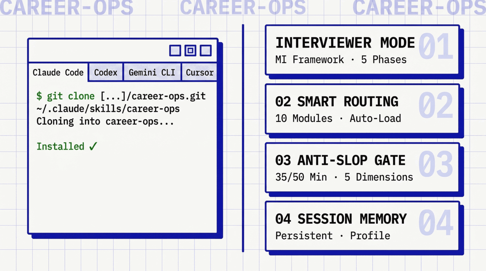
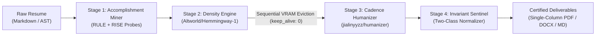

<div align="center">


# CAREER-OPS
### The First Open-Weight AI Resume Operations Engine

**No Slop. No Hallucinations. 100% Deterministic Fact Preservation.**

A production-grade dual-engine resume compiler and candidate intelligence CLI. Mines authentic achievements via Motivational Interviewing, drives hyper-dense bullet restructuring via **`Altworld/Hemmingway-1`**, naturalizes rhythm via **`jialinyyzz/humanizer`**, locks facts with an invariant AST gate, and exports certified single-column ATS deliverables.

[Quickstart](#-quickstart-in-10-seconds) · [Interactive Studio](#-three-act-interactive-web-studio) · [Architecture](#-four-stage-dual-engine-pipeline) · [Hardware Envelope](#-hardware-envelope--model-execution) · [ATS Science](#-ats-mechanics--recruiter-cognitive-science) · [CLI Reference](#-cli-command-center-reference)

---

</div>



---

## ⚡ Quickstart in 10 Seconds

Experience the full transformation pipeline with zero model downloads, zero API keys, and zero configuration:

```bash
# Run the instant viral demo on the bundled Morgan Vance candidate fixture
npx career-ops optimize --demo --diff
```

You'll get an immediate terminal report with colored transformation diffs, dimension scores, and invariant lock confirmations:

```text
════════════════════════════════════════════════════════════════
  CAREER-OPS // DUAL-ENGINE RESUME OPTIMIZER
  Deterministic ATS Invariant Gate & Human Cadence Engine
════════════════════════════════════════════════════════════════

 DEMO MODE: Executing on canonical Morgan Vance candidate fixture 

AUDIT SCORECARD & THREE-BAND QUALITY GATE
────────────────────────────────────────────────────────────
COMPOSITE SCORE: 46 / 50   CERTIFIED ATS READY 
────────────────────────────────────────────────────────────
DIMENSION BREAKDOWN:
  • 1. Directness (Passive/Hedging)        : 10.0 / 10
  • 2. Rhythm (Cadence & Variance)         :  9.0 / 10
  • 3. Trust (Factual Verifiability)       :  9.0 / 10
  • 4. Authenticity (Anti-Buzzword)        :  9.0 / 10
  • 5. Density (Action/Scope/Metric)       :  9.0 / 10
────────────────────────────────────────────────────────────
ATS Single-Column Compliance: PASS: Single-column canonical layout
────────────────────────────────────────────────────────────
Fact Preservation Gate: 100% INVARIANTS PRESERVED 🔒
────────────────────────────────────────────────────────────

TRANSFORMATION DIFF (ORIGINAL vs VERIFIED CANDIDATE):
────────────────────────────────────────────────────────────
### Staff Distributed Systems Engineer | ChronoScale Systems
- Spearheaded re-architecture of core event streaming pipeline to Apache Kafka and Go, boosting throughput to 250k events/sec.
+ Rebuilt our core event streaming pipeline around Apache Kafka and Go. Throughput reached 250k events/sec under peak load.
  🔒 [FACTS LOCKED: Go, Kafka]
```

---

## 🖥️ Three-Act Interactive Web Studio

Launch the local web studio with a side-by-side canvas, live Anti-Slop scorecard, and single-column ATS layout preview:

```bash
npx career-ops studio
```

Open **`http://localhost:3000`** in your browser.

* **Act 01: Intake, Mining & Invariant Lock** — Interactive interview assistant solves candidate articulation gaps before optimization.
* **Act 02: Dual-Engine Optimization Studio** — Hemingway density transformation, human cadence naturalizer, and inline diff highlight pills.
* **Act 03: Audit & Certified Export** — Single-column ATS layout verification, 5-dimension diagnostic scorecard, and one-click export to PDF, DOCX, and Markdown.

---

## 🧠 Four-Stage Dual-Engine Pipeline



### Stage 1: Accomplishment Miner & Motivational Interviewer
Solves the **Articulation Gap** — the reality that 80% of candidates undersell technical depth because their resume reflects what they remembered on a Sunday night, not what they engineered. Guided by the **RULE framework** and **RISE probes** (Role $\rightarrow$ Impact $\rightarrow$ Scope $\rightarrow$ Evidence) to surface unstated metrics before rewriting begins.

### Stage 2: Hemingway Density Engine (`Altworld/Hemmingway-1:Q4_K_M`)
Transforms verbose, passive job descriptions into dense, high-impact technical statements. Rotates weak verbs (*"Assisted with"*, *"Responsible for"*) into high-signal architectural actions (*"Architected"*, *"Scaled"*, *"Orchestrated"*).

### Stage 3: Humanizer Cadence Engine (`jialinyyzz/humanizer:Q4_K_M`)
Eliminates robotic AI fingerprints and machine monotonicity by naturalizing sentence length variance ($\sigma \ge 4.5$). Operates under a strict raw invariant contract: metrics, technologies, and verified facts are locked and immutable.

### Stage 4: Deterministic Invariant Sentinel & Quality Gate
Guarantees **100% Metric & Fact Preservation**. Employs a Two-Class Normalizer:
* **Verbatim Invariants (Tools & Systems)**: Kubernetes, Go, PostgreSQL, AWS, Kafka — exact normalized string retention.
* **Semantic Invariants (Metrics & Quantities)**: Currency ($45K $\leftrightarrow$ 45,000 USD), numbers (14 $\leftrightarrow$ fourteen), timeframes (sub-10ms $\leftrightarrow$ under 10 milliseconds).
* **Deterministic Fallback**: If an invariant is altered during naturalization, the engine attempts programmatic re-injection $\rightarrow$ Stage 2 dense draft fallback $\rightarrow$ reversion to original bullet.

---

## 💻 Hardware Envelope & Model Execution

`career-ops` uses open-weight local inference with zero cloud vendor lock-in. Because running a dense 27B model and a 12B model concurrently exceeds consumer GPU memory, `career-ops` enforces **sequential model swapping**:

| Setup | Hardware Floor | Configuration | Swapping Mechanism |
|---|---|---|---|
| **Local Full Pipeline** | 24GB VRAM GPU / 32GB Apple Silicon Mac | `Ollama` / `llama.cpp` local | Automatic `keep_alive: 0` eviction between stages. Never runs Stage 2 & 3 concurrently. |
| **Remote / Cloud GPU** | 16GB Laptops (M1/M2/M3 Air, PC) | `--remote https://your-ollama-host:11434` | Offloads heavy inference to your workstation, home server, or cloud VM. |
| **Zero-GPU / CI / Offline** | Any machine (1GB RAM) | `--mock` or `--demo` | Instant heuristic engine for automated testing and CI pull request gates. |

---

## 🎯 ATS Mechanics & Recruiter Cognitive Science

`career-ops` is built on empirical hiring research, debunking common resume folklore:

### 1. The "6-Second Scan" Myth vs Empirical Reality
* **The Myth**: Recruiters spend only 6 seconds scanning a resume.
* **The Reality**: The 6-second claim stems from an informal 2012 eye-tracking sample of 30 recruiters. Primary research shows:
  * **11.2 seconds**: Empirical average initial recruiter review time across 312 recruiters (InterviewPal 2025 telemetry study).
  * **7.4 seconds**: Formal Ladders eye-tracking study (2018).
  * *Design Implication*: Resumes must pass the 7.4s–11.2s cognitive scan by placing hard architectural scope and metrics on the left half of the top 3 bullet lines.

### 2. The AI Detector Myth (The No-Detector Law)
* **The Myth**: Modern ATS platforms (Workday, Greenhouse, Ashby, Lever) auto-reject resumes using AI detectors like GPTZero or CopyLeaks.
* **The Reality**: No major ATS vendor runs third-party AI detectors due to documented 15–30% false-positive rates and legal compliance risks under EEOC guidelines. ATS platforms use:
  * **Workday**: Semantic candidate-to-job matching via HiredScore (acquired 2024).
  * **Lever**: Opt-in, off-by-default LLM "Talent Fit" parsing.
  * **Ashby & Greenhouse**: Structured field extraction (patented parsing) and keyword indexing.
  * *System Law*: `career-ops` never features fake "AI Detector Evasion" gauges. Instead, it enforces authentic human cadence and factual density.

### 3. The Single-Column ATS Law
* Tables, multi-column sidebars, skills progress bars, and floating text boxes cause linear AST parser failures in standard PDF extractors, interleaving text across columns.
* `career-ops` guarantees **100% single-column layout compliance** in all generated PDF and DOCX deliverables.

---

## 📦 CLI Command Center Reference

| Command | Purpose | Example |
|---|---|---|
| `career-ops optimize` | Runs the full 4-stage optimization pipeline | `career-ops optimize resume.md --diff --output dist/` |
| `career-ops audit` | Evaluates 5-dimension rubric & ATS compliance | `career-ops audit resume.md --ci` |
| `career-ops export` | Exports single-column ATS PDF, DOCX, MD, JSON | `career-ops export resume.md --format pdf,docx` |
| `career-ops interview` | Mines achievements using RISE interactive probes | `career-ops interview resume.md` |
| `career-ops studio` | Launches the local interactive Three-Act Web Studio | `career-ops studio --port 3000` |
| `career-ops doctor` | Verifies runtime, Ollama connectivity & memory | `career-ops doctor` |
| `career-ops cover-letter` | Track A: Hook-Match-Close targeted cover letter | `career-ops cover-letter resume.md --jd job.md` |
| `career-ops linkedin` | Track B: 220-char Headline & 3-Act About narrative | `career-ops linkedin resume.md --role "Staff Engineer"` |

---

## 🏛️ Monorepo Architecture

`career-ops` is organized as a pnpm TypeScript monorepo:

```text
career-ops/
├── packages/
│   ├── knowledge/    # SQLite store, RSS connectors, empirical trust classification (T1–T4)
│   ├── audit/        # Anti-Slop rubric, 3-Band Decision Gate, Two-Class Invariant Sentinel
│   ├── core/         # Document AST parser, 4-Stage Pipeline, PDF/DOCX certified exporters
│   └── cli/          # Commander CLI, Web Studio server, terminal diff UI
├── docs/             # PRD, Architecture Specs, Clief operating records
└── references/       # Peer-reviewed research, ATS vendor mechanics, interview frameworks
```

### Development & Testing

```bash
# Clone the repository
git clone https://github.com/poferraz/career-ops.git
cd career-ops

# Install dependencies
pnpm install

# Build all workspace packages
pnpm build

# Run all 92 unit, integration, and E2E tests
pnpm test
```

---

## 📄 License

MIT © [Paulo Ferraz](https://github.com/poferraz)
