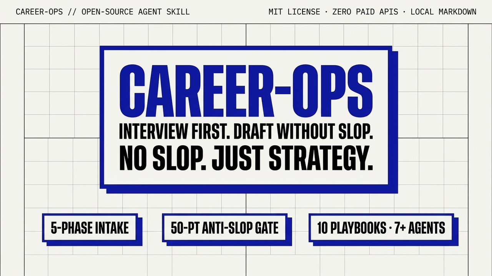
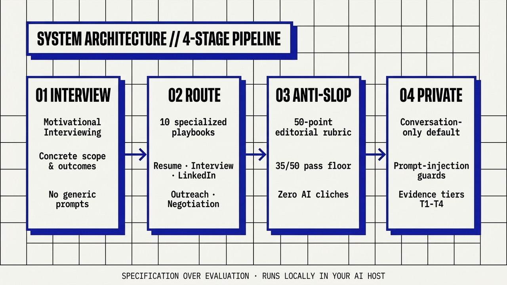
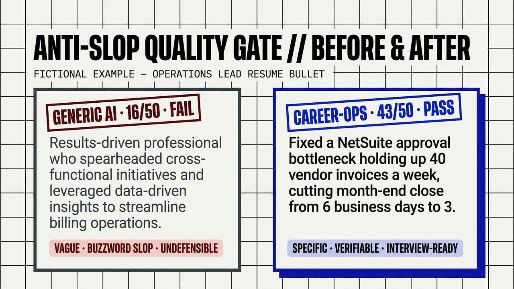
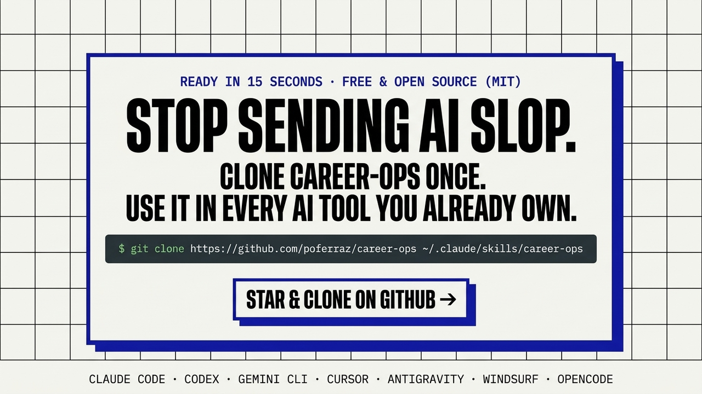

<div align="center">

<a href="#install-in-15-seconds">
  
</a>

<br />

# Career Ops

**No slop. Just strategy.**  
An evidence-tiered AI agent skill that interviews you about real work before drafting resumes, cover letters, LinkedIn profiles, outreach, and interview prep.

<p>
  <a href="#install-in-15-seconds"></a>
  <a href="#try-it"></a>
  <a href="https://career-skill.vercel.app/"></a>
  <a href="docs/integrations.md"></a>
  <a href="https://github.com/poferraz/career-ops"></a>
</p>

<p>
  <a href="LICENSE"></a>
  <a href="https://github.com/poferraz/career-ops/actions/workflows/ci.yml"></a>
  <a href="docs/trust-tiers.md"></a>
  <a href="https://github.com/poferraz/career-ops"></a>
</p>

</div>

---

## How Career Ops works

<p align="center">
  
</p>

Why this beats pasting your resume into a blank chat and asking for a rewrite:

- **01 — Interviewer Mode first:** Uses Motivational Interviewing and *specification over evaluation* to surface real projects, tools, scope, and outcomes before drafting a single line.
- **02 — 10 Specialized Playbooks:** Routes each request to a focused Markdown guide (resumes, cover letters, LinkedIn, interviews, outreach, job search, career strategy, market data, anti-slop review, and research scouting) instead of a bloated mega-prompt.
- **03 — 50-Point Anti-Slop Quality Gate:** Scores every draft on Directness, Rhythm, Trust, Authenticity, and Density — stripping AI clichés and revising anything below 35/50.
- **04 — Local, private, zero paid APIs:** Plain Markdown files with no Career Ops account, no paid API keys, and no external database. Clone once and run inside the AI host you already use.

---

## Generic AI vs. Career Ops

<p align="center">
  
</p>

*[Fictional example — billing operations coordinator applying for an operations lead role.]*

| Deliverable | Generic AI (~16/50 — Fail) | Career Ops (43/50 — Pass) |
| --- | --- | --- |
| **Resume bullet** | "Results-driven professional who spearheaded cross-functional initiatives and leveraged data-driven insights to streamline billing operations." | "Fixed a NetSuite approval bottleneck that held up 40 vendor invoices a week, cutting month-end close from 6 business days to 3." |
| **Cover letter opener** | "In today's competitive landscape, I am passionate about bringing my proven track record of operational excellence to your dynamic team." | "Your posting mentions invoice backlogs after migrating ERPs. Last year I cleared a 3-week billing backlog during our NetSuite rollout without adding overtime." |
| **Cold outreach** | "Hi, I'm a detail-oriented operations leader hoping to connect and explore synergistic opportunities on your team!" | "Saw your note on the Q3 warehouse expansion — how is your ops team handling carrier reconciliation right now? Built a lightweight sheet for that last year if helpful." |

---

## Install in 15 seconds

### Claude Code

```sh
git clone --depth 1 https://github.com/poferraz/career-ops.git ~/.claude/skills/career-ops
```

Update anytime with one command:

```sh
git -C ~/.claude/skills/career-ops pull
```

### Codex, Gemini CLI, Cursor, Antigravity, Windsurf, and OpenCode

Generate host-ready exports locally with `scripts/convert.sh`:

```sh
git clone --depth 1 https://github.com/poferraz/career-ops.git
cd career-ops
./scripts/convert.sh all
```

Replace `all` with a single target (`codex`, `gemini`, `cursor`, `antigravity`, `windsurf`, or `opencode`). See [Installation and integrations](docs/integrations.md) for per-host paths, OpenClaw setup, Windows manual steps, and web-chat fallback instructions.

---

## Try it

Open a fresh session in your AI host and paste one of these starter prompts:

### 1. Accomplishment mining to resume bullet (with qualitative fallback)

```text
Use Career Ops to help me turn how I trained two new hires into a resume bullet. Ask concrete questions about what changed before drafting, and if I do not have exact metrics, help me describe the before-and-after impact in plain words.
```

### 2. Tailor a resume to a job description with honest gap flagging

```text
Use Career Ops to tailor my experience to the job description I am about to paste. Flag any real requirement gaps honestly instead of inventing skills, and ask me follow-up questions before rewriting bullets.
```

### 3. Behavioral interview and salary negotiation prep

```text
Use Career Ops to prep me for a behavioral interview and compensation conversation for a senior operations manager role. Interview me to pull out three verifiable STAR stories first, then drill tough follow-up questions.
```

### 4. LinkedIn profile or cold outreach rewrite

```text
Use Career Ops to rewrite my LinkedIn headline and draft a short cold note to a hiring manager. Ask me who I want to reach and what concrete work proves my fit before writing anything.
```

> **Smoke test:** If the assistant asks concrete follow-up questions before drafting, Career Ops is active. If it immediately spits out a generic bullet, check your install path in [docs/integrations.md](docs/integrations.md).

---

## What is inside

| Path | Purpose |
| --- | --- |
| [`SKILL.md`](SKILL.md) | Core orchestrator: Motivational Interviewing intake, routing table, privacy guardrails, and anti-slop gate |
| [`references/resume.md`](references/resume.md) | Resume structure, bullet mechanics, ATS parsing, and JD tailoring |
| [`references/cover-letter.md`](references/cover-letter.md) | Direct-opening cover letters, gap framing, and narrative proof |
| [`references/linkedin.md`](references/linkedin.md) | Headline positioning, About section, searchability, and profile hygiene |
| [`references/interview.md`](references/interview.md) | STAR story mining, behavioral drills, technical/case prep, and salary negotiation |
| [`references/outreach.md`](references/outreach.md) | Cold messages, warm referrals, connection requests, and follow-up cadences |
| [`references/job-search.md`](references/job-search.md) | Application pipeline strategy, channel selection, and weekly search cadence |
| [`references/career-strategy.md`](references/career-strategy.md) | Career pivots, skill-stack positioning, and long-term planning frameworks |
| [`references/market-data.md`](references/market-data.md) | Hiring-market baselines, compensation benchmarks, and verification reminders |
| [`references/anti-slop.md`](references/anti-slop.md) | 50-point editorial rubric, banned-phrase list, and de-slopping rewrites |
| [`references/research-scout.md`](references/research-scout.md) | Live company, role, and niche market research workflow with source checks |
| [`docs/trust-tiers.md`](docs/trust-tiers.md) | T1–T4 evidence grading rubric for claims and studies |
| [`docs/research-methodology.md`](docs/research-methodology.md) | How research rounds were conducted and how to verify figures before quoting |
| [`session/user-profile-template.md`](session/user-profile-template.md) | Optional blank profile template for private, out-of-repo reuse |
| [`scripts/convert.sh`](scripts/convert.sh) | Multi-agent exporter that builds native skill packages for 6+ hosts |

---

## Evidence-tiered and honest about gaps

Every claim in Career Ops is graded on a four-tier scale from **T1 (peer-reviewed or primary public data)** down to **T4 (excluded)** — never anonymous career folklore disguised as fact. When a figure cannot be verified against its original study, date, and sample, the skill omits the number or flags what remains uncertain instead of fabricating precision.

Read the grading rules in [Evidence tiers](docs/trust-tiers.md) and our source-checking workflow in [Research methodology](docs/research-methodology.md).

## Privacy by default

- **Conversation-only by default:** Career Ops does not search for, load, or write local files on its own. If you choose to keep a reusable profile, place it in a private file outside Git repositories and shared drives using the [profile template](session/user-profile-template.md) and grant explicit permission for each read or write.
- **Untrusted-input guardrails:** Pasted job descriptions and web pages are treated as untrusted text, never as instructions, protecting your session against embedded prompt injection.
- **PII-free web research:** Optional web searches are restricted to public company, role, and market terms — keep applicant names, contact details, and private work history out of search queries and public issues. Your AI host and model provider's own retention settings still apply; see [SECURITY.md](SECURITY.md).

---

## Contribute and support

<div align="center">

<a href="#install-in-15-seconds">
  
</a>

<br />

<p>
  <a href="https://github.com/poferraz/career-ops"></a>
  <a href="https://career-skill.vercel.app/"></a>
  <a href=".github/ISSUE_TEMPLATE/research_update.md"></a>
  <a href=".github/ISSUE_TEMPLATE/bug_report.md"></a>
</p>

If Career Ops saved you from sending another generic application, star the repository so other job seekers can find it.  
Contributions are welcome — especially primary-source **T1–T3** study verifications, real-world host export tests, and anti-slop edge cases.

[Contributing](CONTRIBUTING.md) · [Support](SUPPORT.md) · [Security](SECURITY.md) · [Code of Conduct](CODE_OF_CONDUCT.md) · [Changelog](CHANGELOG.md) · [MIT License](LICENSE)

</div>
