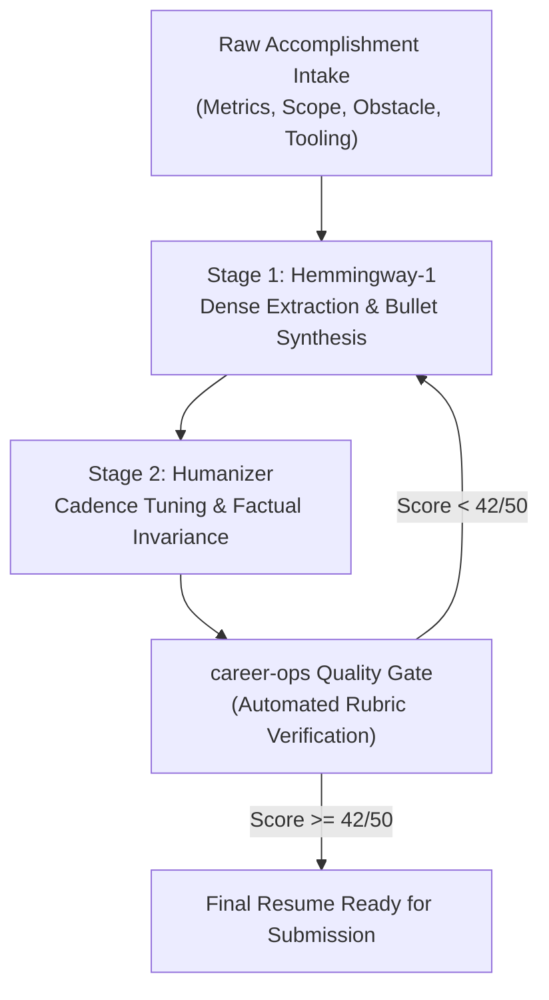

# Product Plan: Dual-Engine Resume Optimizer & Anti-AI Detector

**Repository:** `poferraz/career-ops`  
**Branch:** `feat/dual-engine-resume-product`  
**Date:** 2026-10-10  
**Status:** In Brainstorming / Planning  

---

## 1. Vision & Core Mission

Transform `career-ops` from a markdown-based prompt skill into a complete **end-to-end resume operations engine** that:
1. Mines authentic, verifiable career accomplishments using structured Motivational Interviewing (Phase 1–5 intake).
2. Generates hyper-dense, high-impact resume bullets and executive summaries using **`Altworld/Hemmingway-1`**.
3. Naturalizes the cadence and eliminates robotic AI fingerprints using **`jialinyyzz/humanizer`**, strictly preserving all metrics and facts.
4. Enforces the **career-ops Anti-Slop Rubric** (minimum score 42/50 across Directness, Rhythm, Trust, Authenticity, and Density) to satisfy both ATS semantic extraction (Workday, Ashby, Greenhouse) and recruiter cognitive scan heuristics (11.2s/7.4s scanning behavior).

---

## 2. In-Depth Model Comparison

| Dimension | `Altworld/Hemmingway-1` | `jialinyyzz/humanizer` |
| :--- | :--- | :--- |
| **Developer / Source** | Altworld (`Altworld/Hemmingway-1`) | `jialinyyzz/humanizer` |
| **Base Model** | Qwen3.8-27B fine-tune | Gemma 4 12B fine-tune |
| **Target Function** | Extreme density, active voice, zero conversational filler | AI draft rewriting, human cadence injection, anti-detection |
| **Context Window** | 262,144 tokens | Standard context window (~8k–128k) |
| **Preservation Focus** | Context retention across massive transcripts & JDs | Strict invariant preservation of numbers, dates, tools, quotes |
| **Local Footprint** | ~59 GB (FP16) / ~15–18 GB (Q4_K GGUF) | ~26 GB (FP16) / ~6.5–8 GB (Q4_K GGUF) |
| **License** | CC BY-NC 4.0 (Commercial license via Altworld) | Open weights |
| **Role in Pipeline** | **The Condenser (Stage 1)** | **The Naturalizer & Guard (Stage 2)** |

---

## 3. The Two-Stage Architecture & Anti-Slop Mapping

### Rubric Dimension Alignment
* **Directness (9/10)**: Handled by `Hemmingway-1`. Removes conversational hedging, passive constructions, and corporate filler phrases.
* **Density (8/10)**: Handled by `Hemmingway-1`. Enforces the `[Action Verb] + [Specific Problem/Context] + [Metric]` structure.
* **Rhythm (8/10)**: Handled by `humanizer`. Introduces sentence length variance (burstiness) and organic punctuation to break mechanical robot cadence.
* **Authenticity (8/10)**: Handled by `humanizer`. Replaces predictable high-probability token transitions with human writing patterns.
* **Trust (9/10)**: Handled by `humanizer`'s strict factual invariant constraint. Guarantees that zero numbers, metrics, dates, or tool names are altered or hallucinated.

---

## 4. Product Opportunities & Potential Form Factors

1. **Local CLI & Agent Extension (`career-ops cli`)**:
   - A CLI tool that can run locally via Ollama / llama.cpp / vLLM.
   - Takes a `user-profile.md` + target `job-description.txt` and outputs optimized, scored resumes in Markdown, JSON Resume, and clean PDF.

2. **Web / Desktop App (The Candidate Studio)**:
   - Modern brutalist / blueprint UI (matching `career-ops` design tokens).
   - Side-by-side comparison: *Before vs. Hemmingway vs. Humanizer vs. Final*.
   - ATS Single-Column Layout & Semantic Match Gate.
   - ATS Keyword Density heat-map.

3. **CI / Pre-Submission Validation Service**:
   - Automated git hook or CLI validator (`career-ops check resume.md --jd jd.txt`) that outputs a detailed diagnostic report before sending a resume out.

---

## 5. Next Steps
* Complete user product discovery and brainstorm requirements.
* Determine the preferred delivery interface (CLI tool, Python library, full-stack app, or enhanced agent skill).
* Design modular components and implementation plan.
