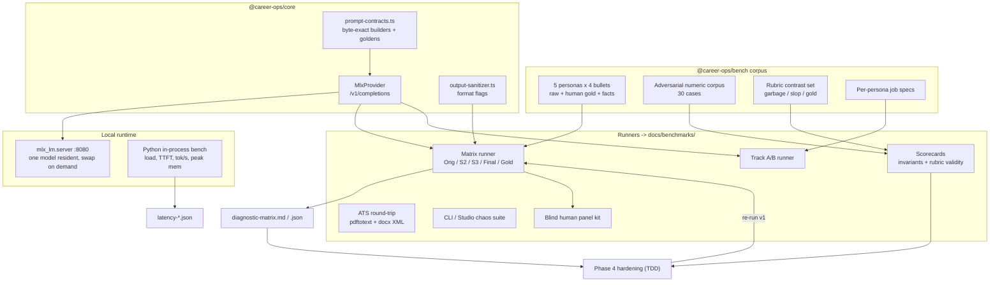

# Benchmark, Empirical Testing & Hardening Loop — Implementation Plan

> **For agentic workers:** REQUIRED SUB-SKILL: Use superpowers:subagent-driven-development (recommended) or superpowers:executing-plans to implement this plan task-by-task. Steps use checkbox (`- [ ]`) syntax for tracking.

**Goal:** Measure, with reproducible evidence, where the career-ops pipeline (Resume Stages 1–4, Track A cover letter, Track B LinkedIn) succeeds and fails on local MLX models, then harden it until output is fact-exact, human-sounding, and ATS-clean.

**Architecture:** A new private `@career-ops/bench` package holds the persona corpus, deterministic quality metrics, and runners. Live-model runs talk to one `mlx_lm.server` through a new `MlxProvider` that sends **byte-exact, pre-rendered prompts** to `/v1/completions`. Python scripts handle what only Python can do: rendering reference chat templates and measuring in-process latency and memory. Every hardening change is TDD'd against a scorecard that was frozen *before* the change (v0 baseline → v1 comparison).

**Tech Stack:** TypeScript 5.5, Vitest 2.1, pnpm workspaces, Node ≥ 20, Python 3.14 + `mlx==0.32.x` + `mlx-lm==0.32.0` (in a dedicated venv), `pdftotext` (poppler), `unzip`.

## Global Constraints

- Hardware target: Apple M4, 32 GB unified memory, Metal recommended working set **26.8 GB** (measured). Memory bandwidth on base M4 is about 120 GB/s.
- **Never** keep Hemmingway-1 (≈19 GB) and Humanizer (≈12.7 GB) resident at the same time: 31.7 GB > 26.8 GB.
- Context budget: prompt tokens + `max_tokens` ≤ **8192** for every call (Humanizer runner rejects > 8192).
- Humanizer is **raw completion only**: `instr + "\n\n" + draft.trim() + sep`, SHA-256 prefix of `build("X")` must equal `cc51d66b4c593fbe`. No chat template.
- Hemmingway-1 and Qwen3-8B are **thinking models**. Every prompt must disable thinking (`<think>\n\n</think>\n\n` assistant prefix), and output must be stripped of any `<think>` residue.
- No-Detector Law: never add an "AI risk" score, detector-evasion claim, or detector API.
- Attention lineage: 11.2 s median initial review, 7.4 s skim. The "6-second" figure must never appear.
- 60/30/10 and the Removal Test: every LLM call has a deterministic fallback, and fallbacks must be **flagged**, not silent.
- Live-model tests run only when `CAREER_OPS_LIVE=1`. Default `pnpm test` must stay green and offline.
- No `console.log` in `packages/*/src`. Bench reporters write files and use `process.stdout.write`.
- Benchmark artifacts go to `docs/benchmarks/` (JSON = source of truth, Markdown = rendered view).
- Status updates go to `docs/clief/STATUS.md` (One Fact, One Location).

---

## Pre-Flight Evidence Ledger (captured 2026-10-11, before any change)

These findings came from live probes run while writing this plan. They are the null hypothesis every task below must confirm or refute.

### Runtime & connectivity

| # | Probe | Result | Severity |
|---|---|---|---|
| R1 | HF cache for all 3 models | `refs/main` only. **No `snapshots/` and no `blobs/`. 4 KB on disk.** The models are not downloaded. | 🔴 Blocker |
| R2 | Download size needed | Hemmingway 18.99 GB + Humanizer 12.68 GB + Qwen3-8B 4.62 GB = **36.3 GB**. 199 GB free. | OK |
| R3 | Inference servers | Ollama :11434 up, but only `:cloud` models. LM Studio :1234 down. `mlx_lm.server` :8080 down. | 🔴 Blocker |
| R4 | Local `mlx_lm` | 0.31.3. `gemma4_unified` (Humanizer arch) **missing**. Humanizer card pins `mlx-lm==0.32.0`. | 🔴 Blocker |
| R5 | Hemmingway MLX arch | `qwen3_5_text` (Qwen3.5-27B hybrid linear/full attention), 64 layers, thinking-enabled chat template, MTP head in `optiq/`. | 🟠 |
| R6 | Provider abstraction | Only `OllamaProvider` + `MockProvider`. **No MLX provider.** CLI and Studio hard-wire `new OllamaProvider`. | 🔴 |
| R7 | Stage 1 model routing | `MotivationalInterviewer` passes no model, so it defaults to `richardyoung/hemmingway-1:Q4_K_M`. **Qwen3-8B is never used.** | 🟠 |

### Prompt-contract violations (static, verified against model cards)

| # | Finding | Evidence |
|---|---|---|
| P1 | **Stage 3 breaks the Humanizer fine-tune contract.** It sends a custom "You are Humanizer…" instruction at temp 0.3. The model was trained on one exact instruction (fingerprint `cc51d66b4c593fbe`, verified) at temp 1.0 / top_p 0.95 / top_k 0. | `stage3-humanizer.ts:30-45` vs `prompt_format.json` |
| P2 | **Stage 2 hand-rolls ChatML with no thinking-disable prefix**, and also stops on `"\n\n"`. Hypothesis: a Qwen3.5 thinking model emits `<think>\n…\n\n`, so the stop cuts output to a think fragment. | `stage2-density.ts:49-55`, Hemmingway `chat_template.jinja:46,165` |
| P3 | **Ollama double-templating.** Stage 2 sends a pre-rendered ChatML string to `/api/generate` without `raw: true`, so Ollama wraps it in the model template a second time. | `ollama-provider.ts:38-42` |
| P4 | Stage 2 system prompt seeds slop verbs ("Architected, Engineered, Slashed, Scaled, Streamlined"). Stage 2 has no seniority calibration and no rule to preserve ownership level. | `stage2-density.ts:37` |
| P5 | 60 s provider timeout. At an estimated 4–6 tok/s for a 27B model on a base M4, a 400-token cover letter takes about 80 s, so it **silently falls back to the hardcoded template**. | `ollama-provider.ts:19`, `cover-letter.ts:44-52` |

### Invariant sentinel probe (live run, `packages/audit`)

| Input → Candidate | Expected | Actual |
|---|---|---|
| `Migrated billing service to Kubernetes` → `…, cutting costs 40% and saving $2M` | **reject (hallucinated facts)** | ✅ accepted as `verbatim_match` 🔴 |
| `Reduced churn 15-20%` → `Reduced churn 20%` | reject | accepted 🔴 |
| `Cut latency from 1.2s to 340ms` → `Cut latency to 340ms` | reject | accepted (`1.2s` never extracted) 🔴 |
| `Grew ARR from €450K` | currency `€450K` | number `450K` (currency symbol lost) 🟠 |
| `Saved £2.3m` | currency `£2.3m` | number `2.3m` 🟠 |
| `shipped 3 products in 2023`, `2.4 TB`, `1,200 req/s`, `18 months` | extracted | not extracted 🔴 |
| Re-injection | grammatical | `…over a million a year with Terraform ($1.2M)`: redundant and awkward 🟠 |

### Anti-slop rubric construct validity probe (live run)

| Set | Total | Gate |
|---|---|---|
| **Content-free garbage** ("Built things. Made stuff happen for the team…") | **48/50** | **certified** 🔴 |
| Human gold ("Cut p99 checkout latency from 1.2s to 340ms by moving session state from Postgres to Redis.") | 44/50 | certified |
| Classic LLM slop ("Orchestrated a robust, scalable microservices ecosystem, fostering seamless…") | 36/50 | warning (passes) 🔴 |

Root causes, from reading the code:
- `density.ts` metric regex `[\d.]+\s*(?:…|m|k|b|x)` matches **any period followed by a word starting with m/k/b/x** ("things. Made").
- `trust.ts` evidence regex `[\d.]+|…|go|…` matches any period and any word containing "go" ("good", "ago").
- The authenticity lexicon misses the most common LLM tells (robust, seamless, foster, pivotal, harness, transformative, empower, navigate, unlock, delve, showcase, underscore).
- The directness hedging penalty ("helped to", "contributed to") **pushes the pipeline toward ownership inflation**. That is exactly what recruiters flag as BS.

### Track A / Track B static findings

- `linkedin.ts` About section is **100% hardcoded distributed-systems prose**, whatever the persona. A PM gets "I architect distributed infrastructure…".
- The About output contains literal `## Act 1:` markdown headings. LinkedIn renders plain text.
- `signatureMetric` loop: `break` exits only the inner loop, so the **last** role's metric wins (usually the oldest job).
- Headline truncation appends `...` mid-token.
- The cover-letter deterministic fallback opens with "I am writing to express my strong interest". That is the #1 recruiter-flagged AI/template opener. Its distributed-systems paragraph is also hardcoded.
- Demo fixture `DEMO_CANDIDATE_RESUME` itself uses the banned word "Spearheaded".

---

## Benchmark Suite Architecture



### Metric catalogue (all deterministic, so they cannot be gamed by the model under test)

| Metric | Definition | Pass threshold |
|---|---|---|
| `factRecall` | Share of fixture `facts[]` (hand-declared, independent of the normalizer under test) present in output after canonicalization | **1.00** |
| `hallucinatedNumbers` | Numeric tokens in output that are absent from the source bullet (broad `\d` tokenizer, independent of the normalizer) | **0** |
| `ownershipInflation` | Source has a contribution hedge (helped, assisted, contributed, worked on, participated, supported) **and** output opens with a sole-ownership verb (led, spearheaded, architected, drove, owned, headed, directed, championed, pioneered) | **0** |
| `frontLoadIndex` | 1-based word index of the first fact token. Approximates the 7.4–11.2 s F-pattern gaze. | ≤ 8 |
| `slopHits` | Hits from the extended LLM-tell lexicon (see Task 5) | 0 per bullet |
| `caricatureRate` | Share of bullets that open with a military/hype verb (Slashed, Spearheaded, Architected, Orchestrated, Revolutionized, Supercharged, Turbocharged, Skyrocketed) | ≤ 0.15 |
| `verbDiversity` | Unique opening verbs ÷ bullets, per role | ≥ 0.75 |
| `lengthRatio` | Output words ÷ gold words | 0.8–1.3 |
| `goldTokenF1` | Token F1 against human gold (a weak signal; the human panel is authoritative) | reported only |
| `formatFlags` | thinkLeak, preamble, markdown, quoted, multiLine, truncated, empty | all false |
| `resolutionStage` | Sentinel outcome distribution | `revert_original` ≤ 10% |
| `latency` | cold load s, TTFT s, gen tok/s, peak GB | see Task 8 predictions |

---

## File Structure

```
packages/core/src/inference/
  prompt-contracts.ts        (new) byte-exact prompt builders + sampling presets
  output-sanitizer.ts        (new) strip think/preamble/markdown, classify format flags
  mlx-provider.ts            (new) OpenAI-compatible /v1/completions client
  types.ts                   (modify) add topP/topK/minP/raw, finishReason/promptTokens
  ollama-provider.ts         (modify) honor options.raw
packages/core/tests/
  prompt-contracts.test.ts   (new)
  output-sanitizer.test.ts   (new)
  mlx-provider.test.ts       (new)
  fixtures/prompt-goldens.json (generated by scripts/bench/render_goldens.py)
packages/bench/                (new private package @career-ops/bench)
  package.json, tsconfig.json
  src/corpus/personas.ts     persona resumes, gold rewrites, facts, job specs
  src/corpus/adversarial-invariants.ts
  src/corpus/rubric-contrast.ts
  src/metrics.ts             deterministic quality metrics
  src/recording-provider.ts  wraps a provider, captures raw responses + timings
  src/scorecards.ts          invariant + rubric-validity scorecards
  src/run-matrix.ts          live pipeline matrix -> docs/benchmarks
  src/run-tracks.ts          live Track A/B -> docs/benchmarks
  src/run-ats.ts             PDF/DOCX round-trip fidelity
  src/panel-kit.ts           blind human panel sheet generator
  src/report.ts              markdown renderers
  tests/metrics.test.ts, tests/scorecards.test.ts, tests/report.test.ts,
  tests/ats-roundtrip.test.ts, tests/cli-chaos.test.ts
scripts/bench/
  mlx-bootstrap.sh           venv + downloads + smoke + license check
  render_goldens.py          renders reference chat templates via real tokenizers
  mlx_latency.py             in-process latency/memory benchmark
docs/benchmarks/             generated artifacts (JSON + MD)
```

---

## Phase 0 — Runtime Unblock (needs explicit user approval: 36 GB download + new venv)

### Task 0.1: MLX runtime bootstrap, download, smoke, and license verification

**Files:**
- Create: `scripts/bench/mlx-bootstrap.sh`
- Modify: `.gitignore` (add `docs/benchmarks/raw/`)

**Interfaces:**
- Produces: venv at `~/.venvs/career-ops-mlx`; `mlx_lm.server` runnable via `~/.venvs/career-ops-mlx/bin/mlx_lm.server`; `docs/benchmarks/runtime-smoke.json`.

- [ ] **Step 1: Write the bootstrap script**

```bash
#!/usr/bin/env bash
# scripts/bench/mlx-bootstrap.sh — idempotent MLX runtime setup for career-ops benchmarks.
set -euo pipefail
VENV="${CAREER_OPS_MLX_VENV:-$HOME/.venvs/career-ops-mlx}"
MODELS=(
  "mlx-community/Qwen3-8B-4bit"
  "cowWhySo/humanizer-12b-mlx-8bit"
  "mlx-community/Hemmingway-1-OptiQ-4bit"
)
OUT="docs/benchmarks/runtime-smoke.json"
mkdir -p docs/benchmarks

if [ ! -x "$VENV/bin/python" ]; then
  python3 -m venv "$VENV"
fi
"$VENV/bin/pip" install --quiet --upgrade pip
"$VENV/bin/pip" install --quiet "mlx>=0.32.3,<0.33" "mlx-lm==0.32.0" "huggingface_hub>=1.0"

for m in "${MODELS[@]}"; do
  echo ">> downloading $m"
  "$VENV/bin/hf" download "$m"
done

"$VENV/bin/python" - "$OUT" <<'PY'
import json, sys, time, hashlib, importlib
import mlx.core as mx
from mlx_lm import load, generate
from mlx_lm.sample_utils import make_sampler
from huggingface_hub import hf_hub_download, model_info

out = {"mlx": mx.__version__, "mlx_lm": importlib.import_module("mlx_lm").__version__,
       "recommended_working_set_gb": mx.device_info()["max_recommended_working_set_size"] / 1e9,
       "models": {}}
for repo in ["mlx-community/Qwen3-8B-4bit", "cowWhySo/humanizer-12b-mlx-8bit", "mlx-community/Hemmingway-1-OptiQ-4bit"]:
    rec = {}
    try:
        mx.reset_peak_memory()
        t = time.perf_counter(); model, tok = load(repo); rec["load_s"] = round(time.perf_counter() - t, 2)
        if "humanizer" in repo:
            pf = json.load(open(hf_hub_download(repo, "prompt_format.json")))
            build = lambda d: pf["instr"] + "\n\n" + d.strip() + pf["sep"]
            rec["fingerprint_ok"] = hashlib.sha256(build("X").encode()).hexdigest()[:16] == "cc51d66b4c593fbe"
            prompt = build("We leverage cutting-edge synergies to deliver robust solutions.")
            sampler = make_sampler(temp=1.0, top_p=0.95, top_k=0, min_p=0.0)
        else:
            prompt = tok.apply_chat_template([{"role": "user", "content": "Reply with exactly: OK"}],
                                             add_generation_prompt=True, tokenize=False, enable_thinking=False)
            sampler = make_sampler(temp=0.0)
        rec["sample"] = generate(model, tok, prompt=prompt, max_tokens=48, sampler=sampler, verbose=False)
        rec["peak_gb"] = round(mx.get_peak_memory() / 1e9, 2)
        rec["ok"] = True
    except Exception as e:  # record, never hide
        rec["ok"] = False; rec["error"] = f"{type(e).__name__}: {e}"
    try:
        info = model_info(repo); base = (info.card_data or {}).get("base_model")
        rec["license"] = (info.card_data or {}).get("license")
        if base:
            b = model_info(base if isinstance(base, str) else base[0])
            rec["base_model"] = b.id; rec["base_license"] = (b.card_data or {}).get("license")
    except Exception as e:
        rec["license_error"] = str(e)
    out["models"][repo] = rec
    del_vars = [v for v in ("model", "tok") if v in dir()]
    for v in del_vars: exec(f"del {v}")
    mx.clear_cache()
json.dump(out, open(sys.argv[1], "w"), indent=2)
print(json.dumps(out, indent=2))
PY
```

- [ ] **Step 2: Run it**

Run: `bash scripts/bench/mlx-bootstrap.sh`
Expected: `docs/benchmarks/runtime-smoke.json` shows `ok: true` for all 3 models, `fingerprint_ok: true`, and a license record. If Hemmingway fails with `qwen3_5_text` unsupported, record it and retry with `pip install mlx-optiq && optiq serve --model mlx-community/Hemmingway-1-OptiQ-4bit` (OptiQ also enables the MTP head for speculative decoding).

- [ ] **Step 3: Reconcile the license claim**

`tasks/lessons.md` states Hemmingway-1 is CC BY-NC 4.0. The MLX card says apache-2.0. Read `base_license` from the smoke JSON and correct whichever document is wrong. **If the base is NC, commercial use of the product is blocked. Flag this to the user.**

- [ ] **Step 4: Commit**

```bash
git add scripts/bench/mlx-bootstrap.sh docs/benchmarks/runtime-smoke.json .gitignore tasks/lessons.md
git commit -m "chore(bench): add MLX runtime bootstrap and record runtime smoke results"
```

### Task 0.2: Render reference prompt goldens from the real tokenizers

**Files:**
- Create: `scripts/bench/render_goldens.py`
- Create (generated): `packages/core/tests/fixtures/prompt-goldens.json`

**Interfaces:**
- Produces: JSON `{ hemmingway: {system,user,rendered}, qwen3: {system,user,rendered}, humanizer: {draft,rendered,fingerprint} }` consumed by Task 1 tests.

- [ ] **Step 1: Write the renderer**

```python
#!/usr/bin/env python3
"""Render byte-exact reference prompts using each model's own tokenizer/chat template."""
import json, hashlib, sys
from transformers import AutoTokenizer
from huggingface_hub import hf_hub_download

SYSTEM = "You rewrite resume bullets."
USER = "Original bullet: Built a dashboard used by 300 agents."
out = {}
for key, repo in [("hemmingway", "mlx-community/Hemmingway-1-OptiQ-4bit"), ("qwen3", "mlx-community/Qwen3-8B-4bit")]:
    tok = AutoTokenizer.from_pretrained(repo)
    rendered = tok.apply_chat_template(
        [{"role": "system", "content": SYSTEM}, {"role": "user", "content": USER}],
        add_generation_prompt=True, tokenize=False, enable_thinking=False)
    out[key] = {"system": SYSTEM, "user": USER, "rendered": rendered}
pf = json.load(open(hf_hub_download("cowWhySo/humanizer-12b-mlx-8bit", "prompt_format.json")))
draft = "Built a dashboard used by 300 agents."
rendered = pf["instr"] + "\n\n" + draft.strip() + pf["sep"]
out["humanizer"] = {"draft": draft, "rendered": rendered,
                    "fingerprint": hashlib.sha256((pf["instr"] + "\n\nX" + pf["sep"]).encode()).hexdigest()[:16]}
json.dump(out, open(sys.argv[1], "w"), indent=2, ensure_ascii=False)
```

- [ ] **Step 2: Run it**

Run: `~/.venvs/career-ops-mlx/bin/pip install --quiet transformers jinja2 && ~/.venvs/career-ops-mlx/bin/python scripts/bench/render_goldens.py packages/core/tests/fixtures/prompt-goldens.json`
Expected: the file exists and `humanizer.fingerprint == "cc51d66b4c593fbe"`. Inspect `hemmingway.rendered` by eye: note whether the template injects reasoning instructions into the system block even when thinking is disabled. Task 1's builder must match whatever the file says, byte for byte.

- [ ] **Step 3: Commit**

```bash
git add scripts/bench/render_goldens.py packages/core/tests/fixtures/prompt-goldens.json
git commit -m "test(core): add tokenizer-rendered prompt goldens for MLX models"
```

---

## Phase 1 — Inference Plumbing

### Task 1: Byte-exact prompt contracts

**Files:**
- Create: `packages/core/src/inference/prompt-contracts.ts`
- Modify: `packages/core/src/index.ts` (export it)
- Test: `packages/core/tests/prompt-contracts.test.ts`

**Interfaces:**
- Produces:
  - `HUMANIZER_PROMPT_FORMAT: { instr: string; sep: string; fingerprint: 'cc51d66b4c593fbe' }`
  - `buildHumanizerPrompt(draft: string): string`
  - `humanizerFingerprint(): string`
  - `type ChatTurn = { role: 'system' | 'user'; content: string }`
  - `buildQwenNoThinkPrompt(turns: ChatTurn[]): string`
  - `SAMPLING: Record<'hemmingway' | 'humanizer' | 'qwen3', { temperature: number; topP: number; topK: number; minP?: number }>`
  - `MLX_MODELS: { stage1: string; stage2: string; stage3: string }`

- [ ] **Step 1: Write the failing test**

```ts
import { describe, it, expect } from 'vitest';
import { readFileSync } from 'node:fs';
import {
  buildHumanizerPrompt, humanizerFingerprint, buildQwenNoThinkPrompt, HUMANIZER_PROMPT_FORMAT
} from '../src/inference/prompt-contracts.js';

const goldens = JSON.parse(readFileSync(new URL('./fixtures/prompt-goldens.json', import.meta.url), 'utf8'));

describe('prompt contracts', () => {
  it('humanizer fingerprint matches the fine-tune contract', () => {
    expect(humanizerFingerprint()).toBe(HUMANIZER_PROMPT_FORMAT.fingerprint);
    expect(humanizerFingerprint()).toBe('cc51d66b4c593fbe');
  });
  it('humanizer prompt is byte-identical to the reference renderer', () => {
    expect(buildHumanizerPrompt(goldens.humanizer.draft)).toBe(goldens.humanizer.rendered);
  });
  it('humanizer prompt trims the draft and never adds chat tokens', () => {
    const p = buildHumanizerPrompt('  draft  \n');
    expect(p).not.toMatch(/<\|im_start\|>|<start_of_turn>/);
    expect(p.endsWith('draft\n\n### Rewritten:\n\n')).toBe(true);
  });
  for (const key of ['hemmingway', 'qwen3'] as const) {
    it(`${key} no-think prompt is byte-identical to apply_chat_template(enable_thinking=False)`, () => {
      const g = goldens[key];
      expect(buildQwenNoThinkPrompt([{ role: 'system', content: g.system }, { role: 'user', content: g.user }]))
        .toBe(g.rendered);
    });
  }
});
```

- [ ] **Step 2: Run test to verify it fails**

Run: `npx vitest run packages/core/tests/prompt-contracts.test.ts`
Expected: FAIL, "Cannot find module '../src/inference/prompt-contracts.js'".

- [ ] **Step 3: Write minimal implementation**

```ts
import { createHash } from 'node:crypto';

/** Copied byte-for-byte from cowWhySo/humanizer-12b-mlx-8bit/prompt_format.json. Do not edit. */
export const HUMANIZER_PROMPT_FORMAT = {
  instr:
    'Rewrite the text below so it reads like a person wrote it, not a language model.\n\n' +
    'Reorganize it as you see fit. Vary sentence length on purpose. Cut hedging,\n' +
    'throat-clearing, and any sentence that only announces what comes next.\n' +
    'Prefer the concrete word over the abstract one. It is fine to sound uneven.\n\n' +
    'Every fact, number, unit, date, name and quotation must survive unchanged.',
  sep: '\n\n### Rewritten:\n\n',
  fingerprint: 'cc51d66b4c593fbe'
} as const;

export function buildHumanizerPrompt(draft: string): string {
  return `${HUMANIZER_PROMPT_FORMAT.instr}\n\n${draft.trim()}${HUMANIZER_PROMPT_FORMAT.sep}`;
}

export function humanizerFingerprint(): string {
  return createHash('sha256').update(buildHumanizerPrompt('X'), 'utf8').digest('hex').slice(0, 16);
}

export type ChatTurn = { role: 'system' | 'user'; content: string };

/**
 * Qwen3 / Qwen3.5 ChatML with thinking disabled. Must equal
 * tokenizer.apply_chat_template(..., add_generation_prompt=True, enable_thinking=False).
 * If the Hemmingway golden shows template-injected system text, add it here, not in callers.
 */
export function buildQwenNoThinkPrompt(turns: ChatTurn[]): string {
  const body = turns.map(t => `<|im_start|>${t.role}\n${t.content}<|im_end|>\n`).join('');
  return `${body}<|im_start|>assistant\n<think>\n\n</think>\n\n`;
}

export const SAMPLING = {
  hemmingway: { temperature: 0.7, topP: 0.95, topK: 20 },
  humanizer: { temperature: 1.0, topP: 0.95, topK: 0, minP: 0 },
  qwen3: { temperature: 0.7, topP: 0.8, topK: 20 }
} as const;

export const MLX_MODELS = {
  stage1: 'mlx-community/Qwen3-8B-4bit',
  stage2: 'mlx-community/Hemmingway-1-OptiQ-4bit',
  stage3: 'cowWhySo/humanizer-12b-mlx-8bit'
} as const;
```

- [ ] **Step 4: Run test to verify it passes**

Run: `npx vitest run packages/core/tests/prompt-contracts.test.ts`
Expected: PASS (5 tests). If a Qwen golden fails, diff the strings and fix `buildQwenNoThinkPrompt`. **Never edit the golden.**

- [ ] **Step 5: Commit**

```bash
git add packages/core/src/inference/prompt-contracts.ts packages/core/src/index.ts packages/core/tests/prompt-contracts.test.ts
git commit -m "feat(core): add byte-exact prompt contracts for Qwen no-think and Humanizer raw"
```

### Task 2: Output sanitizer and format-adherence classifier

**Files:**
- Create: `packages/core/src/inference/output-sanitizer.ts`
- Test: `packages/core/tests/output-sanitizer.test.ts`

**Interfaces:**
- Produces:
  - `interface FormatFlags { thinkLeak: boolean; preamble: boolean; markdown: boolean; quoted: boolean; multiLine: boolean; truncated: boolean; empty: boolean }`
  - `sanitizeOutput(raw: string, opts?: { finishReason?: string }): { text: string; flags: FormatFlags }`

- [ ] **Step 1: Write the failing test**

```ts
import { describe, it, expect } from 'vitest';
import { sanitizeOutput } from '../src/inference/output-sanitizer.js';

describe('sanitizeOutput', () => {
  it('strips closed think blocks and flags the leak', () => {
    const r = sanitizeOutput('<think>\nplan\n</think>\n\nCut p99 latency to 180ms.');
    expect(r.text).toBe('Cut p99 latency to 180ms.');
    expect(r.flags.thinkLeak).toBe(true);
  });
  it('returns empty for an unclosed think block (forces fallback)', () => {
    const r = sanitizeOutput('<think>\nOkay, the user wants');
    expect(r.text).toBe('');
    expect(r.flags.empty).toBe(true);
  });
  it('removes conversational preambles', () => {
    for (const p of ['Here is your revised bullet: ', 'Sure! ', 'Rewritten: ', "Here's the rewrite:\n"]) {
      const r = sanitizeOutput(`${p}Built the admin dashboard.`);
      expect(r.text).toBe('Built the admin dashboard.');
      expect(r.flags.preamble).toBe(true);
    }
  });
  it('removes markdown, bullet markers and wrapping quotes', () => {
    const r = sanitizeOutput('- "**Built** the admin dashboard."');
    expect(r.text).toBe('Built the admin dashboard.');
    expect(r.flags.markdown).toBe(true);
    expect(r.flags.quoted).toBe(true);
  });
  it('keeps the first line of multi-line output and flags it', () => {
    const r = sanitizeOutput('Built the dashboard.\n\nAlternatively: Shipped the dashboard.');
    expect(r.text).toBe('Built the dashboard.');
    expect(r.flags.multiLine).toBe(true);
  });
  it('flags truncation on length finish or dangling connector', () => {
    expect(sanitizeOutput('Cut costs by $1.2M using', {}).flags.truncated).toBe(true);
    expect(sanitizeOutput('Cut costs by $1.2M', { finishReason: 'length' }).flags.truncated).toBe(true);
    expect(sanitizeOutput('Cut costs by $1.2M', { finishReason: 'stop' }).flags.truncated).toBe(false);
  });
});
```

- [ ] **Step 2: Run test to verify it fails**

Run: `npx vitest run packages/core/tests/output-sanitizer.test.ts`
Expected: FAIL, module not found.

- [ ] **Step 3: Write minimal implementation**

```ts
export interface FormatFlags {
  thinkLeak: boolean; preamble: boolean; markdown: boolean; quoted: boolean;
  multiLine: boolean; truncated: boolean; empty: boolean;
}

const PREAMBLE =
  /^(?:(?:sure|certainly|of course|absolutely|okay)[,!.]?\s+|here(?:'s| is| are)\b[^:\n]{0,60}:\s*|(?:rewritten|revised|improved|humanized|final|output)(?:\s+bullet)?\s*:\s*)/i;
const DANGLING = /\b(?:and|or|to|with|by|from|of|for|in|on|using|via|the|a|an)$|[,;:–-]$/i;

export function sanitizeOutput(raw: string, opts: { finishReason?: string } = {}): { text: string; flags: FormatFlags } {
  const flags: FormatFlags = {
    thinkLeak: false, preamble: false, markdown: false, quoted: false,
    multiLine: false, truncated: false, empty: false
  };
  let t = raw ?? '';

  if (/<think>/i.test(t)) {
    flags.thinkLeak = true;
    t = /<\/think>/i.test(t) ? t.replace(/<think>[\s\S]*?<\/think>/gi, '') : '';
  }
  t = t.trim();

  let prev: string;
  do {
    prev = t;
    if (PREAMBLE.test(t)) { flags.preamble = true; t = t.replace(PREAMBLE, '').trim(); }
  } while (t !== prev);

  const lines = t.split(/\n+/).map(l => l.trim()).filter(Boolean);
  if (lines.length > 1) flags.multiLine = true;
  t = lines[0] ?? '';

  if (/^(?:[-*•]|\d+[.)])\s+/.test(t)) { flags.markdown = true; t = t.replace(/^(?:[-*•]|\d+[.)])\s+/, ''); }
  if (/\*\*|__|`/.test(t)) { flags.markdown = true; t = t.replace(/\*\*|__|`/g, ''); }
  if (/^["'“‘].*["'”’]$/.test(t)) { flags.quoted = true; t = t.slice(1, -1).trim(); }

  t = t.replace(/\s+/g, ' ').trim();
  flags.empty = t.length === 0;
  flags.truncated = !flags.empty && (opts.finishReason === 'length' || DANGLING.test(t));
  return { text: t, flags };
}
```

- [ ] **Step 4: Run test to verify it passes**

Run: `npx vitest run packages/core/tests/output-sanitizer.test.ts`
Expected: PASS (6 tests).

- [ ] **Step 5: Commit**

```bash
git add packages/core/src/inference/output-sanitizer.ts packages/core/tests/output-sanitizer.test.ts
git commit -m "feat(core): add output sanitizer with think-leak, preamble and truncation flags"
```

### Task 3: `MlxProvider`, extended inference options, and the Ollama `raw` fix

**Files:**
- Create: `packages/core/src/inference/mlx-provider.ts`
- Modify: `packages/core/src/inference/types.ts`
- Modify: `packages/core/src/inference/ollama-provider.ts:38-63`
- Modify: `packages/core/src/index.ts`
- Test: `packages/core/tests/mlx-provider.test.ts`

**Interfaces:**
- Consumes: `InferenceProvider` (existing).
- Produces:
  - `InferenceOptions` gains `topP?: number; topK?: number; minP?: number; raw?: boolean`
  - `InferenceResponse` gains `finishReason?: string; promptTokens?: number`
  - `class MlxProvider implements InferenceProvider` with `constructor(opts?: { baseUrl?: string; timeoutMs?: number; fetchFn?: typeof fetch; maxContext?: number })`
  - `class ContextBudgetError extends Error`

- [ ] **Step 1: Write the failing test**

```ts
import { describe, it, expect, vi } from 'vitest';
import { MlxProvider, ContextBudgetError } from '../src/inference/mlx-provider.js';
import { OllamaProvider } from '../src/inference/ollama-provider.js';

const okResponse = (body: unknown) =>
  Promise.resolve(new Response(JSON.stringify(body), { status: 200, headers: { 'Content-Type': 'application/json' } }));

describe('MlxProvider', () => {
  it('posts raw prompt to /v1/completions with sampling params', async () => {
    const fetchFn = vi.fn(() => okResponse({
      model: 'm', choices: [{ text: ' Built it.', finish_reason: 'stop' }],
      usage: { prompt_tokens: 12, completion_tokens: 4 }
    }));
    const p = new MlxProvider({ baseUrl: 'http://x:8080/', fetchFn: fetchFn as unknown as typeof fetch });
    const r = await p.generate('PROMPT', { model: 'm', temperature: 1, topP: 0.95, topK: 0, minP: 0, maxTokens: 64, stop: ['\n'] });
    const [url, init] = fetchFn.mock.calls[0] as unknown as [string, RequestInit];
    expect(url).toBe('http://x:8080/v1/completions');
    expect(JSON.parse(init.body as string)).toMatchObject({
      model: 'm', prompt: 'PROMPT', temperature: 1, top_p: 0.95, top_k: 0, min_p: 0, max_tokens: 64, stop: ['\n'], stream: false
    });
    expect(r).toMatchObject({ text: ' Built it.', finishReason: 'stop', promptTokens: 12, totalTokens: 4 });
  });
  it('refuses prompts that exceed the 8192-token budget before calling the server', async () => {
    const fetchFn = vi.fn();
    const p = new MlxProvider({ fetchFn: fetchFn as unknown as typeof fetch });
    await expect(p.generate('x'.repeat(30000), { maxTokens: 512 })).rejects.toBeInstanceOf(ContextBudgetError);
    expect(fetchFn).not.toHaveBeenCalled();
  });
  it('reports availability via /v1/models', async () => {
    const fetchFn = vi.fn(() => okResponse({ data: [] }));
    expect(await new MlxProvider({ fetchFn: fetchFn as unknown as typeof fetch }).isAvailable()).toBe(true);
  });
});

describe('OllamaProvider raw mode', () => {
  it('sends raw: true when requested so pre-templated prompts are not double-wrapped', async () => {
    const spy = vi.spyOn(globalThis, 'fetch').mockImplementation(() => okResponse({ response: 'ok', model: 'm' }));
    await new OllamaProvider().generate('<|im_start|>user\nhi<|im_end|>', { raw: true });
    expect(JSON.parse((spy.mock.calls[0]![1] as RequestInit).body as string).raw).toBe(true);
    spy.mockRestore();
  });
});
```

- [ ] **Step 2: Run test to verify it fails**

Run: `npx vitest run packages/core/tests/mlx-provider.test.ts`
Expected: FAIL, module not found.

- [ ] **Step 3: Write minimal implementation**

`types.ts`, add the fields:

```ts
export interface InferenceOptions {
  model?: string;
  temperature?: number;
  topP?: number;
  topK?: number;
  minP?: number;
  maxTokens?: number;
  stop?: string[];
  systemPrompt?: string;
  keepAlive?: number | string;
  format?: 'json' | string;
  numCtx?: number;
  /** Prompt is already fully templated; providers must not apply a chat template. */
  raw?: boolean;
}

export interface InferenceResponse {
  text: string;
  model: string;
  totalTokens?: number;
  promptTokens?: number;
  finishReason?: string;
  durationMs?: number;
}
```

`ollama-provider.ts`, directly after `if (options.format) {...}`:

```ts
    if (options.raw) {
      payload.raw = true;
    }
```

and inside `runtimeOptions`:

```ts
    if (options.topP !== undefined) runtimeOptions.top_p = options.topP;
    if (options.topK !== undefined) runtimeOptions.top_k = options.topK;
    if (options.minP !== undefined) runtimeOptions.min_p = options.minP;
```

`mlx-provider.ts`:

```ts
import type { InferenceProvider, InferenceOptions, InferenceResponse } from './types.js';

export class ContextBudgetError extends Error {}

export interface MlxProviderOptions {
  baseUrl?: string;
  timeoutMs?: number;
  fetchFn?: typeof fetch;
  maxContext?: number;
}

/** Conservative token estimate (≈3 chars/token) so the budget check errs on refusal. */
const estimateTokens = (s: string): number => Math.ceil(s.length / 3);

export class MlxProvider implements InferenceProvider {
  public readonly name = 'mlx';
  private readonly baseUrl: string;
  private readonly timeoutMs: number;
  private readonly fetchFn: typeof fetch;
  private readonly maxContext: number;

  constructor(opts: MlxProviderOptions = {}) {
    this.baseUrl = (opts.baseUrl ?? process.env.CAREER_OPS_MLX_URL ?? 'http://127.0.0.1:8080').replace(/\/+$/, '');
    this.timeoutMs = opts.timeoutMs ?? 300_000;
    this.fetchFn = opts.fetchFn ?? fetch;
    this.maxContext = opts.maxContext ?? 8192;
  }

  public async generate(prompt: string, options: InferenceOptions = {}): Promise<InferenceResponse> {
    const maxTokens = options.maxTokens ?? 256;
    if (estimateTokens(prompt) + maxTokens > this.maxContext) {
      throw new ContextBudgetError(`Prompt (~${estimateTokens(prompt)} tok) + max_tokens ${maxTokens} exceeds ${this.maxContext}`);
    }
    const body: Record<string, unknown> = { model: options.model, prompt, max_tokens: maxTokens, stream: false };
    if (options.temperature !== undefined) body.temperature = options.temperature;
    if (options.topP !== undefined) body.top_p = options.topP;
    if (options.topK !== undefined) body.top_k = options.topK;
    if (options.minP !== undefined) body.min_p = options.minP;
    if (options.stop !== undefined) body.stop = options.stop;

    const started = Date.now();
    const res = await this.fetchFn(`${this.baseUrl}/v1/completions`, {
      method: 'POST',
      headers: { 'Content-Type': 'application/json' },
      body: JSON.stringify(body),
      signal: AbortSignal.timeout(this.timeoutMs)
    });
    if (!res.ok) {
      throw new Error(`MLX request failed with HTTP ${res.status}: ${await res.text().catch(() => '')}`);
    }
    const data = (await res.json()) as {
      model?: string;
      choices?: Array<{ text?: string; finish_reason?: string }>;
      usage?: { prompt_tokens?: number; completion_tokens?: number };
    };
    const choice = data.choices?.[0] ?? {};
    return {
      text: choice.text ?? '',
      model: data.model ?? options.model ?? 'unknown',
      finishReason: choice.finish_reason,
      promptTokens: data.usage?.prompt_tokens,
      totalTokens: data.usage?.completion_tokens,
      durationMs: Date.now() - started
    };
  }

  public async isAvailable(): Promise<boolean> {
    try {
      const res = await this.fetchFn(`${this.baseUrl}/v1/models`, { signal: AbortSignal.timeout(2000) });
      return res.ok;
    } catch {
      return false;
    }
  }

  /** mlx_lm.server holds one model and swaps on the next request's `model`; nothing to evict. */
  public async evictModel(): Promise<void> {}
}
```

- [ ] **Step 4: Run tests**

Run: `npx vitest run packages/core/tests/mlx-provider.test.ts && pnpm test`
Expected: new tests PASS. The full suite stays green.

- [ ] **Step 5: Live verification (requires Task 0.1)**

Run in a second terminal: `~/.venvs/career-ops-mlx/bin/mlx_lm.server --model mlx-community/Qwen3-8B-4bit --port 8080`
Then: `curl -s localhost:8080/v1/completions -H 'Content-Type: application/json' -d '{"model":"cowWhySo/humanizer-12b-mlx-8bit","prompt":"hi","max_tokens":4,"top_k":0,"min_p":0}'`
Expected: a completion from the Humanizer, which proves on-demand model swap and that `top_k`/`min_p` are accepted. **If the server rejects `top_k`/`min_p`, record it in `docs/benchmarks/runtime-smoke.json` and drop them from the body when undefined server support is detected.**

- [ ] **Step 6: Commit**

```bash
git add packages/core/src/inference packages/core/src/index.ts packages/core/tests/mlx-provider.test.ts
git commit -m "feat(core): add MlxProvider with context budget guard; honor raw mode in OllamaProvider"
```

---

## Phase 2 — Corpus, Metrics, Scorecards (`@career-ops/bench`)

### Task 4: Bench package scaffold and persona corpus

**Files:**
- Create: `packages/bench/package.json`, `packages/bench/tsconfig.json`
- Create: `packages/bench/src/corpus/personas.ts`
- Test: `packages/bench/tests/corpus.test.ts`

**Interfaces:**
- Produces:
  - `type Level = 'mid' | 'senior' | 'staff' | 'switcher'`
  - `interface BenchBullet { id: string; raw: string; gold: string; facts: string[]; trap?: 'no-metric' | 'hedged-ownership' | 'approximation' | 'range' | 'bare-numbers' }`
  - `interface Persona { id: string; name: string; level: Level; title: string; company: string; dates: string; bullets: BenchBullet[]; skills: string[]; jobSpec: string; domainTerms: string[] }`
  - `PERSONAS: Persona[]`
  - `personaToMarkdown(p: Persona): string` (format accepted by `parseResumeMarkdown`)

- [ ] **Step 1: Scaffold package**

`packages/bench/package.json`:

```json
{
  "name": "@career-ops/bench",
  "version": "0.0.0",
  "private": true,
  "type": "module",
  "scripts": {
    "matrix": "tsx src/run-matrix.ts",
    "tracks": "tsx src/run-tracks.ts",
    "ats": "tsx src/run-ats.ts",
    "panel": "tsx src/panel-kit.ts"
  },
  "dependencies": {
    "@career-ops/audit": "workspace:*",
    "@career-ops/core": "workspace:*"
  },
  "devDependencies": { "tsx": "^4.19.0" }
}
```

`packages/bench/tsconfig.json`:

```json
{ "extends": "../../tsconfig.base.json", "compilerOptions": { "outDir": "dist", "rootDir": "src", "noEmit": true }, "include": ["src"] }
```

Run: `pnpm install`

- [ ] **Step 2: Write the failing test**

```ts
import { describe, it, expect } from 'vitest';
import { PERSONAS, personaToMarkdown } from '../src/corpus/personas.js';
import { parseResumeMarkdown } from '@career-ops/core';

describe('persona corpus', () => {
  it('has 5 personas x 4 bullets with unique ids', () => {
    expect(PERSONAS).toHaveLength(5);
    const ids = PERSONAS.flatMap(p => p.bullets.map(b => b.id));
    expect(ids).toHaveLength(20);
    expect(new Set(ids).size).toBe(20);
  });
  it('every declared fact appears verbatim in both raw and gold (gold is fact-equal)', () => {
    for (const b of PERSONAS.flatMap(p => p.bullets)) {
      for (const f of b.facts) {
        expect(b.raw, `${b.id} raw missing ${f}`).toContain(f);
        expect(b.gold, `${b.id} gold missing ${f}`).toContain(f);
      }
    }
  });
  it('round-trips through the production parser', () => {
    for (const p of PERSONAS) {
      const ast = parseResumeMarkdown(personaToMarkdown(p));
      expect(ast.experience[0]!.bullets.map(b => b.originalText)).toEqual(p.bullets.map(b => b.raw));
    }
  });
});
```

- [ ] **Step 3: Run test to verify it fails**

Run: `npx vitest run packages/bench/tests/corpus.test.ts`
Expected: FAIL, module not found.

- [ ] **Step 4: Write the corpus**

Gold rewrites are **panel-authored**. They are fact-equal to the raw bullet: they add no number, tool, or scope. The user must review them (Task 13) before they count as ground truth.

```ts
export type Level = 'mid' | 'senior' | 'staff' | 'switcher';
export interface BenchBullet {
  id: string; raw: string; gold: string; facts: string[];
  trap?: 'no-metric' | 'hedged-ownership' | 'approximation' | 'range' | 'bare-numbers';
}
export interface Persona {
  id: string; name: string; level: Level; title: string; company: string; dates: string;
  bullets: BenchBullet[]; skills: string[]; jobSpec: string; domainTerms: string[];
}

export const PERSONAS: Persona[] = [
  {
    id: 'p1-staff-dist', name: 'Avery Kim', level: 'staff', title: 'Staff Software Engineer', company: 'Ledgerline',
    dates: 'Jan 2021 - Present', skills: ['Go', 'Kafka', 'CockroachDB', 'AWS', 'Kubernetes'],
    domainTerms: ['distributed', 'Kafka', 'failover', 'latency'],
    jobSpec: '# Staff Engineer, Payments Infrastructure\n\n**Company:** Northwind Pay\n\nOwn the reliability and scale of our ledger and event pipeline.',
    bullets: [
      { id: 'p1b1', raw: 'Was responsible for the migration of our event pipeline from RabbitMQ to Kafka, which helped improve throughput to 250k events/sec and reduced p99 latency from 1.2s to 180ms.',
        gold: 'Moved the event pipeline from RabbitMQ to Kafka; throughput rose to 250k events/sec and p99 latency fell from 1.2s to 180ms.',
        facts: ['RabbitMQ', 'Kafka', '250k events/sec', '1.2s', '180ms'] },
      { id: 'p1b2', raw: 'Helped to design a multi-region failover strategy for the payments ledger using CockroachDB across 3 regions, achieving 99.995% availability over 18 months.',
        gold: 'Co-designed multi-region failover for the payments ledger on CockroachDB across 3 regions: 99.995% availability over 18 months.',
        facts: ['CockroachDB', '3 regions', '99.995%', '18 months'], trap: 'hedged-ownership' },
      { id: 'p1b3', raw: 'Mentored 6 engineers on distributed systems topics and ran weekly design reviews.',
        gold: 'Ran weekly design reviews and mentored 6 engineers on distributed systems.',
        facts: ['6 engineers'], trap: 'no-metric' },
      { id: 'p1b4', raw: 'Worked on reducing our AWS bill, we cut costs by about $1.2M annually by rightsizing EC2 fleets and moving batch jobs to Spot instances.',
        gold: 'Cut AWS spend by about $1.2M a year by rightsizing EC2 fleets and moving batch jobs to Spot instances.',
        facts: ['about $1.2M', 'EC2', 'Spot'], trap: 'approximation' }
    ]
  },
  {
    id: 'p2-senior-pm', name: 'Jordan Reyes', level: 'senior', title: 'Senior Product Manager', company: 'Brightloop',
    dates: 'Mar 2020 - Present', skills: ['Experimentation', 'SQL', 'Amplitude', 'Roadmapping', 'User Research'],
    domainTerms: ['activation', 'conversion', 'churn', 'roadmap'],
    jobSpec: '# Group Product Manager, Growth\n\n**Company:** Fieldnote\n\nLead activation and monetization for a self-serve B2B product.',
    bullets: [
      { id: 'p2b1', raw: 'Led the cross-functional team responsible for redesigning onboarding flow which resulted in activation going up from 31% to 44% in Q2 2024.',
        gold: 'Led the onboarding redesign with design and engineering; activation rose from 31% to 44% in Q2 2024.',
        facts: ['31%', '44%', 'Q2 2024'] },
      { id: 'p2b2', raw: 'Responsible for the pricing page experiment program, ran 14 A/B tests that lifted paid conversion by 12.5 percentage points.',
        gold: 'Ran 14 A/B tests on the pricing page that lifted paid conversion by 12.5 percentage points.',
        facts: ['14 A/B tests', '12.5 percentage points'] },
      { id: 'p2b3', raw: 'Worked closely with stakeholders to define the product roadmap for the enterprise tier.',
        gold: 'Worked with stakeholders across the company to define the enterprise-tier roadmap.',
        facts: ['enterprise'], trap: 'no-metric' },
      { id: 'p2b4', raw: 'Interviewed 60+ customers to identify churn drivers, which informed a retention initiative that reduced logo churn 15-20% over two quarters.',
        gold: 'Interviewed 60+ customers about why they left. The retention work that followed cut logo churn 15-20% over two quarters.',
        facts: ['60+', '15-20%', 'two quarters'], trap: 'range' }
    ]
  },
  {
    id: 'p3-fullstack-lead', name: 'Sam Okafor', level: 'senior', title: 'Full-Stack Tech Lead', company: 'Parcelwise',
    dates: 'Jun 2019 - Present', skills: ['React', 'TypeScript', 'Node.js', 'GraphQL', 'Next.js'],
    domainTerms: ['React', 'Next.js', 'GraphQL', 'deploy'],
    jobSpec: '# Engineering Lead, Customer Platform\n\n**Company:** Harborline\n\nLead a full-stack team shipping customer-facing and internal tools.',
    bullets: [
      { id: 'p3b1', raw: 'Built a new internal admin dashboard in React and TypeScript with a Node.js/GraphQL backend used by 300 support agents daily.',
        gold: 'Built the internal admin dashboard (React, TypeScript, Node.js, GraphQL) that 300 support agents use daily.',
        facts: ['React', 'TypeScript', 'Node.js', 'GraphQL', '300 support agents'] },
      { id: 'p3b2', raw: 'Improved page load times by 3.5x by implementing server-side rendering with Next.js and image CDN caching.',
        gold: 'Made pages load 3.5x faster with Next.js server-side rendering and CDN image caching.',
        facts: ['3.5x', 'Next.js', 'CDN'] },
      { id: 'p3b3', raw: 'Leading a team of 5 engineers, responsible for sprint planning, code reviews and hiring.',
        gold: 'Lead a team of 5 engineers: sprint planning, code review, and hiring.',
        facts: ['5 engineers'], trap: 'no-metric' },
      { id: 'p3b4', raw: 'Set up CI/CD pipelines using GitHub Actions that reduced deploy time from 45 minutes to 8 minutes.',
        gold: 'Cut deploy time from 45 minutes to 8 minutes with new GitHub Actions CI/CD pipelines.',
        facts: ['GitHub Actions', '45 minutes', '8 minutes'] }
    ]
  },
  {
    id: 'p4-switcher', name: 'Riley Chen', level: 'switcher', title: 'Mathematics Teacher', company: 'Lincoln High School',
    dates: 'Aug 2016 - Jun 2024', skills: ['SQL', 'Python', 'Tableau', 'Google Sheets', 'Statistics'],
    domainTerms: ['students', 'teachers', 'pass rates', 'data'],
    jobSpec: '# Data Analyst\n\n**Company:** Civic Metrics\n\nTurn messy public-sector data into decisions. SQL, Python, Tableau.',
    bullets: [
      { id: 'p4b1', raw: 'Taught algebra and statistics to 150 students per year across 5 sections.',
        gold: 'Taught algebra and statistics to 150 students a year across 5 sections.',
        facts: ['150 students', '5 sections'] },
      { id: 'p4b2', raw: 'Created a Google Sheets and Python grade tracker that the whole math department (12 teachers) adopted, saving roughly 3 hours per teacher per week.',
        gold: 'Wrote a grade tracker in Python and Google Sheets that all 12 math teachers adopted; it saved each of them roughly 3 hours per week.',
        facts: ['Google Sheets', 'Python', '12 teachers', 'roughly 3 hours'], trap: 'approximation' },
      { id: 'p4b3', raw: 'Analyzed state test score data to find gaps, and our intervention plan raised pass rates from 62% to 78%.',
        gold: 'Analyzed state test data to find skill gaps; the intervention plan our team built on it raised pass rates from 62% to 78%.',
        facts: ['62%', '78%'], trap: 'hedged-ownership' },
      { id: 'p4b4', raw: 'Completed Google Data Analytics Certificate and built 3 portfolio projects in SQL and Tableau.',
        gold: 'Completed the Google Data Analytics Certificate; built 3 portfolio projects in SQL and Tableau.',
        facts: ['Google Data Analytics Certificate', '3 portfolio projects', 'SQL', 'Tableau'] }
    ]
  },
  {
    id: 'p5-mid-frontend', name: 'Casey Novak', level: 'mid', title: 'Frontend Engineer', company: 'Tiller',
    dates: 'Feb 2022 - Present', skills: ['React', 'Tailwind CSS', 'Jest', 'Playwright', 'Accessibility'],
    domainTerms: ['components', 'accessibility', 'tests', 'Tailwind'],
    jobSpec: '# Frontend Engineer II\n\n**Company:** Oakbridge\n\nBuild accessible, well-tested product UI in React.',
    bullets: [
      { id: 'p5b1', raw: 'Helped migrate the design system components from Styled Components to Tailwind CSS.',
        gold: 'Helped migrate the design-system components from Styled Components to Tailwind CSS.',
        facts: ['Styled Components', 'Tailwind CSS'], trap: 'hedged-ownership' },
      { id: 'p5b2', raw: 'Fixed accessibility issues across the checkout flow, bringing Lighthouse accessibility score from 72 to 96.',
        gold: 'Fixed accessibility issues across checkout; the Lighthouse accessibility score went from 72 to 96.',
        facts: ['Lighthouse', '72', '96'], trap: 'bare-numbers' },
      { id: 'p5b3', raw: 'Wrote unit and integration tests with Jest and Playwright, increasing coverage to 85%.',
        gold: 'Wrote Jest unit tests and Playwright integration tests, raising coverage to 85%.',
        facts: ['Jest', 'Playwright', '85%'] },
      { id: 'p5b4', raw: 'Built reusable form components used in 20+ pages.',
        gold: 'Built reusable form components now used on 20+ pages.',
        facts: ['20+'] }
    ]
  }
];

export function personaToMarkdown(p: Persona): string {
  return [
    `# ${p.name}`,
    `${p.id}@example.com | Remote`,
    '',
    '## Experience',
    '',
    `### ${p.title} | ${p.company}`,
    `${p.dates} | Remote`,
    ...p.bullets.map(b => `- ${b.raw}`),
    '',
    '## Skills',
    '',
    '### Core',
    p.skills.join(', '),
    ''
  ].join('\n');
}
```

- [ ] **Step 5: Run test to verify it passes**

Run: `npx vitest run packages/bench/tests/corpus.test.ts`
Expected: PASS. If round-trip fails, the parser is mangling realistic bullets. **Record that as a finding** (do not change the corpus to suit the parser).

- [ ] **Step 6: Commit**

```bash
git add packages/bench pnpm-lock.yaml
git commit -m "feat(bench): scaffold bench package with 5-persona fact-locked corpus"
```

### Task 5: Deterministic quality metrics

**Files:**
- Create: `packages/bench/src/metrics.ts`
- Test: `packages/bench/tests/metrics.test.ts`

**Interfaces:**
- Produces:
  - `SLOP_LEXICON: string[]`, `CARICATURE_VERBS: string[]`, `OWNERSHIP_VERBS: string[]`, `HEDGE_PATTERNS: RegExp`
  - `factRecall(output: string, facts: string[]): number`
  - `hallucinatedNumbers(source: string, output: string): string[]`
  - `ownershipInflation(source: string, output: string): boolean`
  - `frontLoadIndex(output: string, facts: string[]): number | null`
  - `slopHits(output: string): string[]`
  - `isCaricature(output: string): boolean`
  - `verbDiversity(bullets: string[]): number`
  - `goldTokenF1(output: string, gold: string): number`
  - `interface BulletMetrics { factRecall: number; hallucinated: string[]; ownershipInflation: boolean; frontLoadIndex: number | null; slop: string[]; caricature: boolean; lengthRatio: number; goldF1: number }`
  - `scoreBullet(source: string, output: string, gold: string, facts: string[]): BulletMetrics`

- [ ] **Step 1: Write the failing test**

```ts
import { describe, it, expect } from 'vitest';
import {
  factRecall, hallucinatedNumbers, ownershipInflation, frontLoadIndex, slopHits, isCaricature, verbDiversity, goldTokenF1
} from '../src/metrics.js';

describe('metrics', () => {
  it('factRecall is case-insensitive and whitespace tolerant', () => {
    expect(factRecall('Cut p99 from 1.2s to 180ms on kafka', ['Kafka', '1.2s', '180ms'])).toBe(1);
    expect(factRecall('Cut p99 to 180ms', ['1.2s', '180ms'])).toBe(0.5);
  });
  it('hallucinatedNumbers flags numbers absent from source', () => {
    expect(hallucinatedNumbers('Migrated billing to Kubernetes', 'Migrated billing to Kubernetes, cutting costs 40% and saving $2M'))
      .toEqual(['40', '2']);
    expect(hallucinatedNumbers('cut $1,200,000', 'cut $1,200,000')).toEqual([]);
  });
  it('ownershipInflation catches hedged -> sole-owner rewrites', () => {
    expect(ownershipInflation('Helped migrate components to Tailwind', 'Led migration of components to Tailwind')).toBe(true);
    expect(ownershipInflation('Helped migrate components to Tailwind', 'Helped migrate components to Tailwind')).toBe(false);
    expect(ownershipInflation('Led the redesign', 'Led the redesign')).toBe(false);
  });
  it('frontLoadIndex returns 1-based word index of first fact', () => {
    expect(frontLoadIndex('Cut deploy time from 45 minutes to 8 minutes', ['45 minutes', '8 minutes'])).toBe(5);
    expect(frontLoadIndex('Ran weekly design reviews', [])).toBeNull();
  });
  it('slopHits finds LLM tells with word boundaries', () => {
    expect(slopHits('Fostered a robust, seamless culture')).toEqual(expect.arrayContaining(['fostered', 'robust', 'seamless']));
    expect(slopHits('Cut latency on the robustness suite')).toEqual([]);
  });
  it('caricature and verb diversity', () => {
    expect(isCaricature('Slashed costs by 38%')).toBe(true);
    expect(isCaricature('Cut costs by 38%')).toBe(false);
    expect(verbDiversity(['Built a', 'Built b', 'Cut c', 'Ran d'])).toBe(0.75);
  });
  it('goldTokenF1 is 1 for identical text', () => {
    expect(goldTokenF1('Built the dashboard', 'built the dashboard')).toBe(1);
  });
});
```

- [ ] **Step 2: Run test to verify it fails**

Run: `npx vitest run packages/bench/tests/metrics.test.ts`
Expected: FAIL, module not found.

- [ ] **Step 3: Write minimal implementation**

```ts
export const SLOP_LEXICON = [
  'robust', 'seamless', 'seamlessly', 'leverage', 'leveraged', 'leveraging', 'utilize', 'utilized', 'utilizing',
  'spearhead', 'spearheaded', 'foster', 'fostered', 'fostering', 'pivotal', 'synergy', 'synergies', 'cutting-edge',
  'transformative', 'holistic', 'empower', 'empowered', 'empowering', 'harness', 'harnessed', 'harnessing',
  'unlock', 'unlocked', 'unlocking', 'navigate', 'navigated', 'navigating', 'landscape', 'tapestry', 'testament',
  'showcase', 'showcased', 'showcasing', 'underscore', 'underscored', 'delve', 'delved', 'innovative',
  'dynamic', 'impactful', 'world-class', 'best-in-class', 'game-changing', 'paradigm', 'ecosystem',
  'meticulous', 'meticulously', 'passionate', 'results-driven', 'proven track record', 'drive impact', 'driving impact'
];
export const CARICATURE_VERBS = [
  'slashed', 'spearheaded', 'architected', 'orchestrated', 'revolutionized', 'supercharged',
  'turbocharged', 'skyrocketed', 'catapulted', 'masterminded', 'pioneered', 'championed'
];
export const OWNERSHIP_VERBS = [
  'led', 'lead', 'spearheaded', 'architected', 'drove', 'owned', 'headed', 'directed', 'championed', 'pioneered', 'orchestrated'
];
export const HEDGE_PATTERNS = /\b(?:helped|help(?:ed)? to|assisted|contributed|worked on|participated|supported|co-?\w+)\b/i;

const norm = (s: string) => s.toLowerCase().replace(/\s+/g, ' ').trim();
const words = (s: string) => s.trim().split(/\s+/).filter(Boolean);
const firstWord = (s: string) => (words(s)[0] ?? '').toLowerCase().replace(/[^a-z-]/g, '');

export function factRecall(output: string, facts: string[]): number {
  if (facts.length === 0) return 1;
  const o = norm(output);
  return facts.filter(f => o.includes(norm(f))).length / facts.length;
}

const numberTokens = (s: string): string[] =>
  (s.match(/\d[\d,]*(?:\.\d+)?/g) ?? []).map(n => n.replace(/,/g, ''));

export function hallucinatedNumbers(source: string, output: string): string[] {
  const src = new Set(numberTokens(source));
  return numberTokens(output).filter(n => !src.has(n));
}

export function ownershipInflation(source: string, output: string): boolean {
  return HEDGE_PATTERNS.test(source) && !HEDGE_PATTERNS.test(output) && OWNERSHIP_VERBS.includes(firstWord(output));
}

export function frontLoadIndex(output: string, facts: string[]): number | null {
  const lower = output.toLowerCase();
  let best: number | null = null;
  for (const f of facts) {
    const at = lower.indexOf(f.toLowerCase());
    if (at < 0) continue;
    const idx = words(output.slice(0, at)).length + 1;
    best = best === null ? idx : Math.min(best, idx);
  }
  return best;
}

export function slopHits(output: string): string[] {
  const lower = output.toLowerCase();
  return SLOP_LEXICON.filter(term => new RegExp(`(?<![\\w-])${term.replace(/[-]/g, '\\-')}(?![\\w-])`, 'i').test(lower));
}

export function isCaricature(output: string): boolean {
  return CARICATURE_VERBS.includes(firstWord(output));
}

export function verbDiversity(bullets: string[]): number {
  if (bullets.length === 0) return 1;
  return new Set(bullets.map(firstWord)).size / bullets.length;
}

export function goldTokenF1(output: string, gold: string): number {
  const tok = (s: string) => norm(s).replace(/[^\w%$.\s-]/g, '').split(' ').filter(Boolean);
  const a = tok(output), b = tok(gold);
  const counts = new Map<string, number>();
  b.forEach(t => counts.set(t, (counts.get(t) ?? 0) + 1));
  let overlap = 0;
  for (const t of a) {
    const c = counts.get(t) ?? 0;
    if (c > 0) { overlap++; counts.set(t, c - 1); }
  }
  if (overlap === 0) return 0;
  const p = overlap / a.length, r = overlap / b.length;
  return (2 * p * r) / (p + r);
}

export interface BulletMetrics {
  factRecall: number; hallucinated: string[]; ownershipInflation: boolean; frontLoadIndex: number | null;
  slop: string[]; caricature: boolean; lengthRatio: number; goldF1: number;
}

export function scoreBullet(source: string, output: string, gold: string, facts: string[]): BulletMetrics {
  return {
    factRecall: factRecall(output, facts),
    hallucinated: hallucinatedNumbers(source, output),
    ownershipInflation: ownershipInflation(source, output),
    frontLoadIndex: frontLoadIndex(output, facts),
    slop: slopHits(output),
    caricature: isCaricature(output),
    lengthRatio: words(output).length / Math.max(1, words(gold).length),
    goldF1: goldTokenF1(output, gold)
  };
}
```

- [ ] **Step 4: Run test to verify it passes**

Run: `npx vitest run packages/bench/tests/metrics.test.ts`
Expected: PASS (7 tests).

- [ ] **Step 5: Commit**

```bash
git add packages/bench/src/metrics.ts packages/bench/tests/metrics.test.ts
git commit -m "feat(bench): add deterministic fact, hallucination, ownership and slop metrics"
```

### Task 6: Invariant and rubric-validity scorecards (frozen v0 baseline)

**Files:**
- Create: `packages/bench/src/corpus/adversarial-invariants.ts`
- Create: `packages/bench/src/corpus/rubric-contrast.ts`
- Create: `packages/bench/src/scorecards.ts`
- Test: `packages/bench/tests/scorecards.test.ts`
- Output: `docs/benchmarks/2026-10-11-scorecard-v0.json`

**Interfaces:**
- Consumes: `extractInvariants`, `checkInvariantPreservation`, `reconcileBullet`, `AntiSlopScorer` from `@career-ops/audit`.
- Produces:
  - `interface InvariantCase { id: string; original: string; candidate: string; shouldPreserve: boolean; note: string }`
  - `INVARIANT_CASES: InvariantCase[]`
  - `interface ContrastItem { id: string; label: 'gold' | 'slop' | 'garbage' | 'attack'; bullets: string[] }`
  - `CONTRAST_SET: ContrastItem[]`
  - `runInvariantScorecard(): { total: number; correct: number; failures: Array<{ id: string; note: string; expected: boolean; actual: boolean }> }`
  - `runRubricScorecard(): { pairwiseAccuracy: number; scores: Record<string, number>; inversions: string[] }`

The scorecard **reports** pass rates and does not assert them. Phase 4 converts each failure into a real failing unit test in `packages/audit/tests/`.

- [ ] **Step 1: Write corpora**

`adversarial-invariants.ts`:

```ts
export interface InvariantCase { id: string; original: string; candidate: string; shouldPreserve: boolean; note: string }

export const INVARIANT_CASES: InvariantCase[] = [
  { id: 'i01', original: 'Reduced churn 15-20% in Q3 2024', candidate: 'Cut churn 15–20% in Q3 2024', shouldPreserve: true, note: 'en-dash range equivalence' },
  { id: 'i02', original: 'Reduced churn 15-20% in Q3 2024', candidate: 'Reduced churn 20% in Q3 2024', shouldPreserve: false, note: 'range lower bound dropped' },
  { id: 'i03', original: 'Cut latency from 1.2s to 340ms', candidate: 'Cut latency to 340ms', shouldPreserve: false, note: 'seconds unit not extracted' },
  { id: 'i04', original: 'Cut latency from 1.2s to 340ms', candidate: 'Cut latency from 1.2 seconds to 340 ms', shouldPreserve: true, note: 'unit spelling equivalence' },
  { id: 'i05', original: 'Grew ARR from €450K to $1.2M', candidate: 'Grew ARR from $450K to $1.2M', shouldPreserve: false, note: 'currency symbol swap €->$' },
  { id: 'i06', original: 'Saved £2.3m annually', candidate: 'Saved £2.3 million annually', shouldPreserve: true, note: 'GBP magnitude equivalence' },
  { id: 'i07', original: 'Saved £2.3m annually', candidate: 'Saved $2.3M annually', shouldPreserve: false, note: 'GBP->USD swap' },
  { id: 'i08', original: 'Achieved sub-millisecond (0.4ms) lookups', candidate: 'Achieved 0.4ms lookups', shouldPreserve: true, note: 'sub-ms equivalent' },
  { id: 'i09', original: 'Served 2.4 TB of data', candidate: 'Served 24 TB of data', shouldPreserve: false, note: 'data size magnitude' },
  { id: 'i10', original: 'Scaled to 1,200 req/s', candidate: 'Scaled to 12,000 req/s', shouldPreserve: false, note: 'throughput magnitude' },
  { id: 'i11', original: 'Scaled to 1,200 req/s', candidate: 'Scaled to 1.2k requests per second', shouldPreserve: true, note: 'k-suffix + unit spelling' },
  { id: 'i12', original: 'Shipped 3 products in 2023', candidate: 'Shipped 4 products in 2023', shouldPreserve: false, note: 'bare count' },
  { id: 'i13', original: 'Shipped 3 products in 2023', candidate: 'Shipped 3 products in 2022', shouldPreserve: false, note: 'bare year' },
  { id: 'i14', original: 'Lighthouse score from 72 to 96', candidate: 'Lighthouse score from 72 to 98', shouldPreserve: false, note: 'bare score' },
  { id: 'i15', original: 'Over 18 months', candidate: 'Over 1.5 years', shouldPreserve: true, note: 'duration equivalence' },
  { id: 'i16', original: 'Over 18 months', candidate: 'Over 8 months', shouldPreserve: false, note: 'duration changed' },
  { id: 'i17', original: 'Cut costs by about $1.2M', candidate: 'Cut costs by $1.2M', shouldPreserve: false, note: 'approximation qualifier dropped (overclaim)' },
  { id: 'i18', original: 'Interviewed 60+ customers', candidate: 'Interviewed 60 customers', shouldPreserve: false, note: 'plus qualifier dropped' },
  { id: 'i19', original: 'Migrated billing to Kubernetes', candidate: 'Migrated billing to Kubernetes, saving $2M', shouldPreserve: false, note: 'HALLUCINATED currency added' },
  { id: 'i20', original: 'Migrated billing to Kubernetes', candidate: 'Migrated billing to Kubernetes and cut costs 40%', shouldPreserve: false, note: 'HALLUCINATED percent added' },
  { id: 'i21', original: 'Uptime 99.99%', candidate: 'Uptime 99.9%', shouldPreserve: false, note: 'nines precision' },
  { id: 'i22', original: 'Improved throughput 3.5x', candidate: 'Improved throughput 350%', shouldPreserve: false, note: '3.5x is +250%, not 350%' },
  { id: 'i23', original: 'Improved throughput 3.5x', candidate: 'Made throughput 3.5 times higher', shouldPreserve: true, note: 'multiplier spelling' },
  { id: 'i24', original: 'Led 8 engineers', candidate: 'Led eight engineers', shouldPreserve: true, note: 'number word equivalence' },
  { id: 'i25', original: 'Used by 40k+ users', candidate: 'Used by 40,000+ users', shouldPreserve: true, note: 'k expansion with plus' },
  { id: 'i26', original: 'Cut p99 latency by 38%', candidate: 'Cut p95 latency by 38%', shouldPreserve: false, note: 'percentile identifier changed' },
  { id: 'i27', original: 'Built on PostgreSQL and Redis', candidate: 'Built on Postgres and Redis', shouldPreserve: true, note: 'tool alias' },
  { id: 'i28', original: 'Built on PostgreSQL and Redis', candidate: 'Built on PostgreSQL', shouldPreserve: false, note: 'tool dropped' },
  { id: 'i29', original: 'Reconciled $42M daily', candidate: 'Reconciled $42M monthly', shouldPreserve: false, note: 'rate period changed' },
  { id: 'i30', original: 'Q2 2024', candidate: 'second quarter of 2024', shouldPreserve: true, note: 'quarter spelling' }
];
```

`rubric-contrast.ts`:

```ts
export interface ContrastItem { id: string; label: 'gold' | 'slop' | 'garbage' | 'attack'; bullets: string[] }

export const CONTRAST_SET: ContrastItem[] = [
  { id: 'gold-a', label: 'gold', bullets: [
    'Cut p99 checkout latency from 1.2s to 340ms by moving session state from Postgres to Redis.',
    'Rewrote the Kafka consumer after a 6-hour outage. No repeat in 14 months.',
    'Hired and onboarded 5 engineers; two now lead their own teams.' ] },
  { id: 'gold-b', label: 'gold', bullets: [
    'Ran 14 A/B tests on the pricing page that lifted paid conversion by 12.5 percentage points.',
    'Interviewed 60+ customers about why they left.',
    'Activation rose from 31% to 44% after the onboarding redesign.' ] },
  { id: 'slop-a', label: 'slop', bullets: [
    'Orchestrated a robust, scalable microservices ecosystem, fostering seamless cross-functional collaboration.',
    'Pioneered innovative data-driven strategies, harnessing cutting-edge technologies to unlock efficiencies.',
    'Championed a culture of excellence, empowering stakeholders to navigate complex challenges.' ] },
  { id: 'slop-b', label: 'slop', bullets: [
    'Spearheaded transformative initiatives that drove impactful outcomes across the organization.',
    'Leveraged deep expertise to deliver world-class solutions in a fast-paced environment.',
    'Meticulously showcased a proven track record of delivering results.' ] },
  { id: 'garbage-a', label: 'garbage', bullets: [
    'Built things. Made stuff happen for the team and many many people everywhere.',
    'Led initiatives. Moved metrics a lot across numerous varied important areas of business.',
    'Delivered value. Kicked off great work that went super well for everybody involved here.' ] },
  { id: 'attack-verb-stuff', label: 'attack', bullets: [
    'Built 10x 10x 10x improvements improvements improvements across across across everything.',
    'Reduced 99% 99% 99% of of of all all all problems problems forever.',
    'Improved 5x stuff stuff stuff stuff stuff stuff stuff stuff.' ] },
  { id: 'attack-period-m', label: 'attack', bullets: [
    'Designed it. Many people liked the general idea of the whole thing a lot.',
    'Optimized it. Most folks agreed it was nicer than before in many ways overall.',
    'Automated it. Mostly fine. Basically better than the old thing for many users.' ] }
];
```

- [ ] **Step 2: Write the failing test**

```ts
import { describe, it, expect } from 'vitest';
import { runInvariantScorecard, runRubricScorecard } from '../src/scorecards.js';

describe('scorecards', () => {
  it('invariant scorecard reports every case', () => {
    const r = runInvariantScorecard();
    expect(r.total).toBe(30);
    expect(r.correct + r.failures.length).toBe(30);
  });
  it('rubric scorecard computes pairwise accuracy in [0,1]', () => {
    const r = runRubricScorecard();
    expect(r.pairwiseAccuracy).toBeGreaterThanOrEqual(0);
    expect(r.pairwiseAccuracy).toBeLessThanOrEqual(1);
    expect(Object.keys(r.scores)).toHaveLength(7);
  });
});
```

- [ ] **Step 3: Run test to verify it fails**

Run: `npx vitest run packages/bench/tests/scorecards.test.ts`
Expected: FAIL, module not found.

- [ ] **Step 4: Implement scorecards**

```ts
import { checkInvariantPreservation, reconcileBullet, AntiSlopScorer } from '@career-ops/audit';
import { INVARIANT_CASES } from './corpus/adversarial-invariants.js';
import { CONTRAST_SET } from './corpus/rubric-contrast.js';

export function runInvariantScorecard() {
  const failures: Array<{ id: string; note: string; expected: boolean; actual: boolean }> = [];
  for (const c of INVARIANT_CASES) {
    // A candidate is "accepted" only if the full sentinel would keep it as-is.
    const preserved = checkInvariantPreservation(c.original, c.candidate).preserved;
    const sentinel = reconcileBullet(c.original, c.original, c.candidate);
    const accepted = preserved && sentinel.resolutionStage === 'verbatim_match' && sentinel.finalBullet === c.candidate;
    if (accepted !== c.shouldPreserve) failures.push({ id: c.id, note: c.note, expected: c.shouldPreserve, actual: accepted });
  }
  return { total: INVARIANT_CASES.length, correct: INVARIANT_CASES.length - failures.length, failures };
}

export function runRubricScorecard() {
  const scores: Record<string, number> = {};
  for (const item of CONTRAST_SET) {
    const sentences = item.bullets.flatMap(b => b.split(/(?<=[.!?])\s+/));
    scores[item.id] = AntiSlopScorer.evaluate({ bullets: item.bullets, sentences }).totalScore;
  }
  const golds = CONTRAST_SET.filter(i => i.label === 'gold');
  const others = CONTRAST_SET.filter(i => i.label !== 'gold');
  const inversions: string[] = [];
  let correct = 0, total = 0;
  for (const g of golds) for (const o of others) {
    total++;
    if (scores[g.id]! > scores[o.id]!) correct++;
    else inversions.push(`${o.id} (${scores[o.id]}) >= ${g.id} (${scores[g.id]})`);
  }
  return { pairwiseAccuracy: correct / total, scores, inversions };
}
```

Add a small writer at the bottom of `scorecards.ts` that runs when invoked by `tsx`:

```ts
import { writeFileSync, mkdirSync } from 'node:fs';
if (import.meta.url === `file://${process.argv[1]}`) {
  mkdirSync('docs/benchmarks', { recursive: true });
  const out = { at: new Date().toISOString(), invariants: runInvariantScorecard(), rubric: runRubricScorecard() };
  writeFileSync(process.argv[2] ?? 'docs/benchmarks/scorecard.json', JSON.stringify(out, null, 2));
  process.stdout.write(`invariants ${out.invariants.correct}/${out.invariants.total}, rubric pairwise ${out.rubric.pairwiseAccuracy.toFixed(2)}\n`);
}
```

- [ ] **Step 5: Run tests, then freeze the v0 baseline**

Run: `npx vitest run packages/bench/tests/scorecards.test.ts`
Expected: PASS.
Run: `pnpm --filter @career-ops/bench exec tsx src/scorecards.ts ../../docs/benchmarks/2026-10-11-scorecard-v0.json`
Expected (prediction from pre-flight): invariants **≤ 18/30**, rubric pairwise accuracy **≤ 0.50**.

- [ ] **Step 6: Commit**

```bash
git add packages/bench/src packages/bench/tests docs/benchmarks/2026-10-11-scorecard-v0.json
git commit -m "feat(bench): add invariant and rubric construct-validity scorecards; freeze v0 baseline"
```

---

## Phase 3 — Empirical Runs (require Phase 0 + `mlx_lm.server`)

### Task 7: In-process latency and memory benchmark

**Files:**
- Create: `scripts/bench/mlx_latency.py`
- Output: `docs/benchmarks/2026-10-11-latency.json`

**Interfaces:**
- Produces JSON: `{ machine, models: { [repo]: { load_s, runs: [{ ttft_s, gen_tps, prompt_tps, gen_tokens, peak_gb }] } }, swap: { hemmingway_to_humanizer_s, humanizer_to_hemmingway_s } }`

Predictions to falsify (base M4, ~120 GB/s, decode is memory-bound):

| Model | Weights | Predicted decode ceiling | Predicted 20-bullet stage time |
|---|---|---|---|
| Hemmingway-1 OptiQ-4bit | 18.99 GB | ≤ 6.3 tok/s | ≈ 3–4 min |
| Humanizer 12B 8-bit | 12.68 GB | ≤ 9.5 tok/s | ≈ 1.5–2 min |
| Qwen3-8B 4-bit | 4.62 GB | ≤ 26 tok/s | ≈ 35 s |

- [ ] **Step 1: Write the script**

```python
#!/usr/bin/env python3
"""In-process MLX latency/memory benchmark. Usage: mlx_latency.py OUT.json [--runs 3]"""
import argparse, json, platform, subprocess, time, hashlib
import mlx.core as mx
from mlx_lm import load, stream_generate
from mlx_lm.sample_utils import make_sampler
from huggingface_hub import hf_hub_download

BULLET = "Was responsible for the migration of our event pipeline from RabbitMQ to Kafka, which helped improve throughput to 250k events/sec and reduced p99 latency from 1.2s to 180ms."
MODELS = ["mlx-community/Qwen3-8B-4bit", "mlx-community/Hemmingway-1-OptiQ-4bit", "cowWhySo/humanizer-12b-mlx-8bit"]

def build(repo, tok):
    if "humanizer" in repo:
        pf = json.load(open(hf_hub_download(repo, "prompt_format.json")))
        return pf["instr"] + "\n\n" + BULLET + pf["sep"], make_sampler(temp=1.0, top_p=0.95, top_k=0, min_p=0.0)
    msgs = [{"role": "system", "content": "Rewrite the resume bullet. Keep every fact. Output one line."},
            {"role": "user", "content": BULLET}]
    return tok.apply_chat_template(msgs, add_generation_prompt=True, tokenize=False, enable_thinking=False), make_sampler(temp=0.7, top_p=0.95, top_k=20)

def bench(repo, runs):
    mx.clear_cache(); mx.reset_peak_memory()
    t = time.perf_counter(); model, tok = load(repo); load_s = time.perf_counter() - t
    prompt, sampler = build(repo, tok)
    out = {"load_s": round(load_s, 2), "runs": []}
    for _ in range(runs):
        t = time.perf_counter(); ttft = None; last = None; text = ""
        for r in stream_generate(model, tok, prompt, max_tokens=96, sampler=sampler):
            if ttft is None: ttft = time.perf_counter() - t
            last = r; text += r.text
        out["runs"].append({"ttft_s": round(ttft, 3), "total_s": round(time.perf_counter() - t, 2),
                            "gen_tps": round(last.generation_tps, 2), "prompt_tps": round(last.prompt_tps, 1),
                            "gen_tokens": last.generation_tokens, "peak_gb": round(mx.get_peak_memory() / 1e9, 2),
                            "sample": text.strip()[:400]})
    del model, tok; mx.clear_cache()
    return out

if __name__ == "__main__":
    ap = argparse.ArgumentParser(); ap.add_argument("out"); ap.add_argument("--runs", type=int, default=3); a = ap.parse_args()
    res = {"machine": {"chip": subprocess.getoutput("sysctl -n machdep.cpu.brand_string"),
                       "mem_gb": int(subprocess.getoutput("sysctl -n hw.memsize")) / 1e9,
                       "working_set_gb": mx.device_info()["max_recommended_working_set_size"] / 1e9,
                       "mlx": mx.__version__, "os": platform.platform()}, "models": {}}
    for repo in MODELS:
        res["models"][repo] = bench(repo, a.runs)
    # swap cost: cold reload sequence Hemmingway -> Humanizer -> Hemmingway
    swap = {}
    for a_, b_ in [(MODELS[1], MODELS[2]), (MODELS[2], MODELS[1])]:
        load(a_); mx.clear_cache()
        t = time.perf_counter(); load(b_); swap[f"{a_.split('/')[1]}->{b_.split('/')[1]}_s"] = round(time.perf_counter() - t, 2)
        mx.clear_cache()
    res["swap"] = swap
    json.dump(res, open(a.out, "w"), indent=2)
    print(json.dumps(res, indent=2))
```

- [ ] **Step 2: Run with other GPU apps closed**

Run: `~/.venvs/career-ops-mlx/bin/python scripts/bench/mlx_latency.py docs/benchmarks/2026-10-11-latency.json --runs 3`
Expected: JSON written. Every `sample` must be one clean line with no `<think>`. **Any `peak_gb > 26.8` is a 🔴 finding** (swap thrash risk on 32 GB).

- [ ] **Step 3: Decide architecture from data**

Record in the JSON's sibling `.md` whether: (a) the Stage 2 per-bullet budget (≤ 8 s warm) holds; (b) per-role batching (one call returns N lines) is needed to amortize prefill; (c) Qwen3-8B should be benchmarked as a Stage 2 alternative in Task 8's variant sweep; (d) OptiQ MTP speculative decoding is worth enabling.

- [ ] **Step 4: Commit**

```bash
git add scripts/bench/mlx_latency.py docs/benchmarks/2026-10-11-latency.*
git commit -m "bench: record MLX cold/warm latency, throughput, peak memory and swap cost"
```

### Task 8: Empirical diagnostic matrix runner (Orig / S2 / S3 / Final / Gold)

**Files:**
- Create: `packages/bench/src/recording-provider.ts`
- Create: `packages/bench/src/report.ts`
- Create: `packages/bench/src/run-matrix.ts`
- Test: `packages/bench/tests/report.test.ts`
- Output: `docs/benchmarks/2026-10-11-matrix-v0.json`, `docs/benchmarks/2026-10-11-matrix-v0.md`

**Interfaces:**
- Consumes: `HemingwayDensityEngine`, `HumanizerCadenceEngine`, `parseResumeMarkdown`, `MlxProvider`, `MLX_MODELS`, `sanitizeOutput` (core); `reconcileBullet` (audit); `PERSONAS`, `personaToMarkdown`, `scoreBullet`, `verbDiversity`, `isCaricature` (bench).
- Produces:
  - `class RecordingProvider implements InferenceProvider` with `calls: Array<{ model: string; prompt: string; raw: string; finishReason?: string; ms: number }>`
  - `interface MatrixRow { personaId: string; bulletId: string; level: string; trap?: string; original: string; s2Raw: string; s2: string; s3Raw: string; s3: string; final: string; gold: string; resolution: string; s2Flags: FormatFlags; s3Flags: FormatFlags; metrics: { s2: BulletMetrics; s3: BulletMetrics; final: BulletMetrics; gold: BulletMetrics }; ms: { s2: number; s3: number } }`
  - `renderMatrixMarkdown(rows: MatrixRow[], meta: { variant: string; at: string }): string`

- [ ] **Step 1: Write the failing report test**

```ts
import { describe, it, expect } from 'vitest';
import { renderMatrixMarkdown, type MatrixRow } from '../src/report.js';
import { scoreBullet } from '../src/metrics.js';

const flags = { thinkLeak: false, preamble: false, markdown: false, quoted: false, multiLine: false, truncated: false, empty: false };
const m = scoreBullet('Helped migrate X', 'Led migration of X', 'Helped migrate X', ['X']);
const row: MatrixRow = {
  personaId: 'p5', bulletId: 'p5b1', level: 'mid', trap: 'hedged-ownership', original: 'Helped migrate X',
  s2Raw: 'Led migration of X', s2: 'Led migration of X', s3Raw: 'Led migration of X', s3: 'Led migration of X',
  final: 'Led migration of X', gold: 'Helped migrate X', resolution: 'verbatim_match',
  s2Flags: flags, s3Flags: { ...flags, thinkLeak: true }, metrics: { s2: m, s3: m, final: m, gold: m }, ms: { s2: 1000, s3: 500 }
};

describe('renderMatrixMarkdown', () => {
  it('renders summary table and per-bullet card with all five columns and red flags', () => {
    const md = renderMatrixMarkdown([row], { variant: 'v0', at: '2026-10-11' });
    expect(md).toContain('| Persona |');
    for (const h of ['Original', 'Stage 2', 'Stage 3', 'Final', 'Gold']) expect(md).toContain(`**${h}**`);
    expect(md).toContain('ownership inflation');
    expect(md).toContain('thinkLeak');
  });
});
```

- [ ] **Step 2: Run test to verify it fails**

Run: `npx vitest run packages/bench/tests/report.test.ts`
Expected: FAIL, module not found.

- [ ] **Step 3: Implement `recording-provider.ts`**

```ts
import type { InferenceProvider, InferenceOptions, InferenceResponse } from '@career-ops/core';

export class RecordingProvider implements InferenceProvider {
  public readonly name: string;
  public calls: Array<{ model: string; prompt: string; raw: string; finishReason?: string; ms: number }> = [];
  constructor(private inner: InferenceProvider, private transform: (prompt: string, o: InferenceOptions) => { prompt: string; options: InferenceOptions } = (p, o) => ({ prompt: p, options: o })) {
    this.name = `recording(${inner.name})`;
  }
  async generate(prompt: string, options: InferenceOptions = {}): Promise<InferenceResponse> {
    const t = this.transform(prompt, options);
    const started = Date.now();
    const res = await this.inner.generate(t.prompt, t.options);
    this.calls.push({ model: t.options.model ?? '', prompt: t.prompt, raw: res.text, finishReason: res.finishReason, ms: Date.now() - started });
    return res;
  }
  isAvailable() { return this.inner.isAvailable(); }
  last() { return this.calls[this.calls.length - 1]!; }
}
```

- [ ] **Step 4: Implement `report.ts`**

```ts
import type { FormatFlags } from '@career-ops/core';
import type { BulletMetrics } from './metrics.js';

export interface MatrixRow {
  personaId: string; bulletId: string; level: string; trap?: string;
  original: string; s2Raw: string; s2: string; s3Raw: string; s3: string; final: string; gold: string;
  resolution: string; s2Flags: FormatFlags; s3Flags: FormatFlags;
  metrics: { s2: BulletMetrics; s3: BulletMetrics; final: BulletMetrics; gold: BulletMetrics };
  ms: { s2: number; s3: number };
}

const flagList = (f: FormatFlags) => Object.entries(f).filter(([, v]) => v).map(([k]) => k);
const pct = (n: number) => `${Math.round(n * 100)}%`;
const median = (xs: number[]) => { const s = [...xs].sort((a, b) => a - b); return s.length ? s[Math.floor(s.length / 2)]! : 0; };
const esc = (s: string) => s.replace(/\|/g, '\\|');

function redFlags(r: MatrixRow): string[] {
  const out: string[] = [];
  const f = r.metrics.final;
  if (f.factRecall < 1) out.push(`fact recall ${pct(f.factRecall)}`);
  if (f.hallucinated.length) out.push(`hallucinated numbers: ${f.hallucinated.join(', ')}`);
  if (f.ownershipInflation) out.push('ownership inflation');
  if (f.caricature) out.push('caricature verb');
  if (f.slop.length) out.push(`slop: ${f.slop.join(', ')}`);
  if (f.frontLoadIndex !== null && f.frontLoadIndex > 8) out.push(`late fact (word ${f.frontLoadIndex})`);
  const s2f = flagList(r.s2Flags), s3f = flagList(r.s3Flags);
  if (s2f.length) out.push(`S2 format: ${s2f.join(', ')}`);
  if (s3f.length) out.push(`S3 format: ${s3f.join(', ')}`);
  return out;
}

export function renderMatrixMarkdown(rows: MatrixRow[], meta: { variant: string; at: string }): string {
  const lines: string[] = [`# Diagnostic Matrix — ${meta.variant}`, '', `Generated ${meta.at}. JSON sibling is the source of truth.`, ''];
  lines.push('| Persona | Fact recall | Halluc. | Own. infl. | Front-load ≤8 | Slop hits | Caricature | Fallbacks (S2/orig) | p50 S2 ms | p50 S3 ms |');
  lines.push('|---|---|---|---|---|---|---|---|---|---|');
  const byPersona = new Map<string, MatrixRow[]>();
  rows.forEach(r => byPersona.set(r.personaId, [...(byPersona.get(r.personaId) ?? []), r]));
  for (const [pid, rs] of byPersona) {
    const fin = rs.map(r => r.metrics.final);
    const fl = fin.filter(m => m.frontLoadIndex !== null);
    lines.push(`| ${pid} | ${pct(fin.reduce((a, m) => a + m.factRecall, 0) / fin.length)} | ${fin.reduce((a, m) => a + m.hallucinated.length, 0)} | ${fin.filter(m => m.ownershipInflation).length} | ${fl.length ? pct(fl.filter(m => m.frontLoadIndex! <= 8).length / fl.length) : 'n/a'} | ${fin.reduce((a, m) => a + m.slop.length, 0)} | ${fin.filter(m => m.caricature).length} | ${rs.filter(r => r.resolution === 'fallback_stage2').length}/${rs.filter(r => r.resolution === 'revert_original').length} | ${median(rs.map(r => r.ms.s2))} | ${median(rs.map(r => r.ms.s3))} |`);
  }
  lines.push('');
  for (const r of rows) {
    lines.push(`## ${r.bulletId} · ${r.level}${r.trap ? ` · trap: ${r.trap}` : ''} · resolved: \`${r.resolution}\``, '');
    lines.push(`- **Original**: ${esc(r.original)}`);
    lines.push(`- **Stage 2**: ${esc(r.s2)}`);
    lines.push(`- **Stage 3**: ${esc(r.s3)}`);
    lines.push(`- **Final**: ${esc(r.final)}`);
    lines.push(`- **Gold**: ${esc(r.gold)}`);
    const flags = redFlags(r);
    lines.push('', flags.length ? `> [!WARNING]\n> ${flags.join(' · ')}` : '> ✅ No deterministic red flags.', '');
  }
  return lines.join('\n');
}
```

- [ ] **Step 5: Run report test**

Run: `npx vitest run packages/bench/tests/report.test.ts`
Expected: PASS.

- [ ] **Step 6: Implement `run-matrix.ts`**

Variant `v0` runs the **current production engines unchanged** through MLX, so the matrix measures today's real behavior. Variant `v1` is added in Phase 4.

```ts
import { writeFileSync, mkdirSync } from 'node:fs';
import {
  parseResumeMarkdown, HemingwayDensityEngine, HumanizerCadenceEngine, MlxProvider, MLX_MODELS, sanitizeOutput
} from '@career-ops/core';
import { reconcileBullet } from '@career-ops/audit';
import { PERSONAS, personaToMarkdown } from './corpus/personas.js';
import { scoreBullet } from './metrics.js';
import { RecordingProvider } from './recording-provider.js';
import { renderMatrixMarkdown, type MatrixRow } from './report.js';

const variant = process.argv[2] ?? 'v0';
const outBase = process.argv[3] ?? `docs/benchmarks/${new Date().toISOString().slice(0, 10)}-matrix-${variant}`;

async function main() {
  const mlx = new MlxProvider();
  if (!(await mlx.isAvailable())) throw new Error('mlx_lm.server is not reachable at CAREER_OPS_MLX_URL / 127.0.0.1:8080');
  const s2p = new RecordingProvider(mlx);
  const s3p = new RecordingProvider(mlx);
  const s2 = new HemingwayDensityEngine(s2p, MLX_MODELS.stage2);
  const s3 = new HumanizerCadenceEngine(s3p, MLX_MODELS.stage3);

  // Stage 2 for all personas first (one model resident), then Stage 3 (one swap).
  const stage2: Map<string, { text: string; raw: string; finish?: string; ms: number }> = new Map();
  for (const p of PERSONAS) {
    const role = parseResumeMarkdown(personaToMarkdown(p)).experience[0]!;
    const outs = await s2.optimizeRoleBullets(role);
    role.bullets.forEach((b, i) => {
      const call = s2p.calls[s2p.calls.length - role.bullets.length + i]!;
      stage2.set(p.bullets[i]!.id, { text: outs[i] ?? b.originalText, raw: call.raw, finish: call.finishReason, ms: call.ms });
    });
  }
  const rows: MatrixRow[] = [];
  for (const p of PERSONAS) {
    const role = parseResumeMarkdown(personaToMarkdown(p)).experience[0]!;
    for (const [i, b] of role.bullets.entries()) {
      const fx = p.bullets[i]!;
      const d2 = stage2.get(fx.id)!;
      const s3Text = await s3.humanizeBullet(d2.text, { verbatimTools: b.invariants.verbatim, semanticMetrics: b.invariants.semantic });
      const c3 = s3p.last();
      const rec = reconcileBullet(fx.raw, d2.text, s3Text);
      rows.push({
        personaId: p.id, bulletId: fx.id, level: p.level, trap: fx.trap, original: fx.raw,
        s2Raw: d2.raw, s2: d2.text, s3Raw: c3.raw, s3: s3Text, final: rec.finalBullet, gold: fx.gold,
        resolution: rec.resolutionStage,
        s2Flags: sanitizeOutput(d2.raw, { finishReason: d2.finish }).flags,
        s3Flags: sanitizeOutput(c3.raw, { finishReason: c3.finishReason }).flags,
        metrics: {
          s2: scoreBullet(fx.raw, d2.text, fx.gold, fx.facts),
          s3: scoreBullet(fx.raw, s3Text, fx.gold, fx.facts),
          final: scoreBullet(fx.raw, rec.finalBullet, fx.gold, fx.facts),
          gold: scoreBullet(fx.raw, fx.gold, fx.gold, fx.facts)
        },
        ms: { s2: d2.ms, s3: c3.ms }
      });
    }
  }
  mkdirSync('docs/benchmarks', { recursive: true });
  const at = new Date().toISOString();
  writeFileSync(`${outBase}.json`, JSON.stringify({ variant, at, models: MLX_MODELS, rows, prompts: { s2: s2p.calls[0]?.prompt, s3: s3p.calls[0]?.prompt } }, null, 2));
  writeFileSync(`${outBase}.md`, renderMatrixMarkdown(rows, { variant, at }));
  process.stdout.write(`wrote ${outBase}.{json,md} (${rows.length} rows)\n`);
}
main().catch(e => { process.stderr.write(`${e instanceof Error ? e.stack : String(e)}\n`); process.exit(1); });
```

- [ ] **Step 7: Run v0 live (3 seeds for variance)**

Run (terminal A): `~/.venvs/career-ops-mlx/bin/mlx_lm.server --model mlx-community/Hemmingway-1-OptiQ-4bit --port 8080`
Run (terminal B): `for s in 1 2 3; do pnpm --filter @career-ops/bench matrix v0 ../../docs/benchmarks/2026-10-11-matrix-v0-s$s; done`
Expected: 3 × 20 rows. Predicted v0 failure signatures, from pre-flight:
- S2 `thinkLeak`/`truncated`/`empty` on most rows (P2), causing heavy `fallback_stage2` or `revert_original`.
- S3 output drifts from contract (P1): commentary, multi-line, or summary instead of rewrite.
- `ownershipInflation` on traps p1b2, p4b3, p5b1.
- `hallucinated` numbers on no-metric traps p1b3, p2b3, p3b3, **accepted** by the sentinel.

- [ ] **Step 8: Commit**

```bash
git add packages/bench/src packages/bench/tests docs/benchmarks/2026-10-11-matrix-v0*
git commit -m "bench: run v0 diagnostic matrix across 5 personas on local MLX models"
```

### Task 9: Track A (cover letter) and Track B (LinkedIn) evaluation

**Files:**
- Create: `packages/bench/src/track-metrics.ts`
- Create: `packages/bench/src/run-tracks.ts`
- Test: `packages/bench/tests/track-metrics.test.ts`
- Output: `docs/benchmarks/2026-10-11-tracks-v0.{json,md}`

**Interfaces:**
- Produces:
  - `TEMPLATE_FINGERPRINTS: string[]` (sentences copied from current deterministic fallbacks)
  - `COVER_CLICHES: string[]`
  - `evaluateCoverLetter(text: string, persona: Persona, resumeText: string): { usedTemplate: boolean; cliches: string[]; domainLeak: string[]; ungroundedNumbers: string[]; wordCount: number; paragraphs: number }`
  - `evaluateLinkedIn(profile: { headline: string; about: string }, persona: Persona, resumeText: string): { headlineChars: number; headlineEllipsis: boolean; markdownInAbout: boolean; usedTemplate: boolean; domainLeak: string[]; ungroundedNumbers: string[]; slop: string[] }`

- [ ] **Step 1: Write the failing test**

```ts
import { describe, it, expect } from 'vitest';
import { evaluateCoverLetter, evaluateLinkedIn } from '../src/track-metrics.js';
import { PERSONAS, personaToMarkdown } from '../src/corpus/personas.js';
import { CoverLetterArchitect, LinkedInStrategist, parseResumeMarkdown } from '@career-ops/core';

const pm = PERSONAS.find(p => p.id === 'p2-senior-pm')!;
const md = personaToMarkdown(pm);

describe('track metrics on current deterministic fallbacks (no provider)', () => {
  it('detects template use, cliches and domain leak in the PM cover letter', async () => {
    const letter = await CoverLetterArchitect.generateLetter(parseResumeMarkdown(md), pm.jobSpec);
    const r = evaluateCoverLetter(letter, pm, md);
    expect(r.usedTemplate).toBe(true);
    expect(r.cliches).toContain('i am writing to express');
    expect(r.domainLeak.length).toBeGreaterThan(0);
  });
  it('detects hardcoded About, markdown headings and domain leak in the PM LinkedIn profile', async () => {
    const prof = await LinkedInStrategist.generateProfile(parseResumeMarkdown(md));
    const r = evaluateLinkedIn(prof, pm, md);
    expect(r.usedTemplate).toBe(true);
    expect(r.markdownInAbout).toBe(true);
    expect(r.domainLeak).toEqual(expect.arrayContaining(['distributed']));
  });
});
```

- [ ] **Step 2: Run test to verify it fails**

Run: `npx vitest run packages/bench/tests/track-metrics.test.ts`
Expected: FAIL, module not found.

- [ ] **Step 3: Implement `track-metrics.ts`**

```ts
import type { Persona } from './corpus/personas.js';
import { slopHits, hallucinatedNumbers } from './metrics.js';

export const TEMPLATE_FINGERPRINTS = [
  'i am writing to express my strong interest',
  'i build systems with deterministic reliability',
  'i architect distributed infrastructure that balances relentless high throughput',
  'mentored engineering teams in distributed systems design'
];
export const COVER_CLICHES = [
  'i am writing to express', 'strong interest', 'i am excited to apply', 'energized by', 'passionate about',
  'i would welcome the opportunity', 'thank you for your time and consideration', 'perfect fit', 'unique blend',
  'dynamic team', 'make an immediate impact', 'hit the ground running', 'align perfectly', 'proven track record'
];
const INFRA_TERMS = ['distributed', 'multi-region', 'state synchronization', 'consensus', 'fault-tolerant', 'low-latency throughput', 'invariant'];

const hits = (text: string, list: string[]) => { const l = text.toLowerCase(); return list.filter(t => l.includes(t)); };
const domainLeak = (text: string, p: Persona) =>
  hits(text, INFRA_TERMS).filter(t => !p.domainTerms.some(d => d.toLowerCase().includes(t)) && !p.bullets.some(b => b.raw.toLowerCase().includes(t)));

export function evaluateCoverLetter(text: string, persona: Persona, resumeText: string) {
  return {
    usedTemplate: hits(text, TEMPLATE_FINGERPRINTS).length > 0,
    cliches: hits(text, COVER_CLICHES),
    domainLeak: domainLeak(text, persona),
    ungroundedNumbers: hallucinatedNumbers(resumeText + persona.jobSpec, text),
    wordCount: text.trim().split(/\s+/).length,
    paragraphs: text.split(/\n\s*\n/).filter(s => s.trim()).length
  };
}

export function evaluateLinkedIn(profile: { headline: string; about: string }, persona: Persona, resumeText: string) {
  const all = `${profile.headline}\n${profile.about}`;
  return {
    headlineChars: profile.headline.length,
    headlineEllipsis: /\.\.\.$|…$/.test(profile.headline),
    markdownInAbout: /^#{1,6}\s|\*\*/m.test(profile.about),
    usedTemplate: hits(all, TEMPLATE_FINGERPRINTS).length > 0,
    domainLeak: domainLeak(all, persona),
    ungroundedNumbers: hallucinatedNumbers(resumeText, all),
    slop: slopHits(all)
  };
}
```

- [ ] **Step 4: Run test to verify it passes**

Run: `npx vitest run packages/bench/tests/track-metrics.test.ts`
Expected: PASS. This test codifies the **current** broken behavior. In Phase 4 (H7) its expectations are inverted.

- [ ] **Step 5: Implement `run-tracks.ts` (live)**

```ts
import { writeFileSync, mkdirSync } from 'node:fs';
import { CoverLetterArchitect, LinkedInStrategist, parseResumeMarkdown, MlxProvider, MLX_MODELS } from '@career-ops/core';
import { PERSONAS, personaToMarkdown } from './corpus/personas.js';
import { evaluateCoverLetter, evaluateLinkedIn } from './track-metrics.js';
import { RecordingProvider } from './recording-provider.js';

const variant = process.argv[2] ?? 'v0';
const outBase = process.argv[3] ?? `docs/benchmarks/${new Date().toISOString().slice(0, 10)}-tracks-${variant}`;

async function main() {
  // v0: route provider default model to Hemmingway (what production would use) via transform.
  const rec = new RecordingProvider(new MlxProvider(), (p, o) => ({ prompt: p, options: { ...o, model: o.model ?? MLX_MODELS.stage2, maxTokens: o.maxTokens ?? 700 } }));
  const results = [];
  for (const p of PERSONAS) {
    const md = personaToMarkdown(p);
    const ast = parseResumeMarkdown(md);
    const t0 = Date.now();
    const letter = await CoverLetterArchitect.generateLetter(ast, p.jobSpec, { provider: rec });
    const letterMs = Date.now() - t0;
    const profile = await LinkedInStrategist.generateProfile(ast, { provider: rec });
    results.push({
      personaId: p.id, letter, letterMs, letterRaw: rec.calls.at(-1)?.raw, profile,
      coverEval: evaluateCoverLetter(letter, p, md), linkedinEval: evaluateLinkedIn(profile, p, md)
    });
  }
  mkdirSync('docs/benchmarks', { recursive: true });
  writeFileSync(`${outBase}.json`, JSON.stringify({ variant, at: new Date().toISOString(), results }, null, 2));
  const md = ['# Track A/B — ' + variant, '', '| Persona | CL template? | CL cliches | CL domain leak | CL ms | LI template? | LI markdown | LI headline chars | LI leak |', '|---|---|---|---|---|---|---|---|---|',
    ...results.map(r => `| ${r.personaId} | ${r.coverEval.usedTemplate} | ${r.coverEval.cliches.length} | ${r.coverEval.domainLeak.join(', ')} | ${r.letterMs} | ${r.linkedinEval.usedTemplate} | ${r.linkedinEval.markdownInAbout} | ${r.linkedinEval.headlineChars} | ${r.linkedinEval.domainLeak.join(', ')} |`),
    '', ...results.flatMap(r => [`## ${r.personaId}`, '', '### Cover letter', '', r.letter, '', '### LinkedIn headline', '', r.profile.headline, '', '### About', '', r.profile.about, ''])];
  writeFileSync(`${outBase}.md`, md.join('\n'));
}
main().catch(e => { process.stderr.write(`${e instanceof Error ? e.stack : String(e)}\n`); process.exit(1); });
```

- [ ] **Step 6: Run live and commit**

Run: `pnpm --filter @career-ops/bench tracks v0 ../../docs/benchmarks/2026-10-11-tracks-v0`
Expected (prediction): LinkedIn `usedTemplate: true` for all 5 personas (the generator never calls the provider). Cover letter either model-written in ≥ 60 s or silently template.

```bash
git add packages/bench docs/benchmarks/2026-10-11-tracks-v0*
git commit -m "bench: evaluate Track A/B for template leakage, cliches and grounding"
```

### Task 10: ATS round-trip fidelity (PDF + DOCX)

**Files:**
- Create: `packages/bench/src/ats-roundtrip.ts`
- Test: `packages/bench/tests/ats-roundtrip.test.ts`

**Interfaces:**
- Consumes: `generateAtsPdf(ast)`, `generateAtsDocx(ast)`, `parseResumeMarkdown`, `renderResumeMarkdown`.
- Produces:
  - `extractPdfText(buf: Buffer, mode: 'raw' | 'layout'): string` (shells out to `pdftotext`)
  - `extractDocxText(buf: Buffer): string` (unzips `word/document.xml`, joins `<w:t>` runs per `<w:p>`)
  - `sequenceFidelity(expected: string[], actual: string): { lcsRatio: number; missing: string[]; outOfOrder: number }`

Honest limitation: Workday, Greenhouse, Ashby, and Lever parsers are closed. `pdftotext -raw` (stream order) and `-layout` (visual order) bracket how they behave: interleaving appears as a divergence between the two orders. This task does **not** claim certification by any vendor.

- [ ] **Step 1: Write the failing test**

```ts
import { describe, it, expect } from 'vitest';
import { generateAtsPdf, generateAtsDocx, parseResumeMarkdown } from '@career-ops/core';
import { PERSONAS, personaToMarkdown } from '../src/corpus/personas.js';
import { extractPdfText, extractDocxText, sequenceFidelity } from '../src/ats-roundtrip.js';

const tokensOf = (p: (typeof PERSONAS)[number]) => [p.name, p.title, p.company, ...p.bullets.map(b => b.raw), ...p.skills];

describe.each(PERSONAS.map(p => [p.id, p] as const))('ATS round-trip %s', (_id, p) => {
  const ast = parseResumeMarkdown(personaToMarkdown(p));
  it('PDF raw stream order preserves every line in order', () => {
    const r = sequenceFidelity(tokensOf(p), extractPdfText(generateAtsPdf(ast), 'raw'));
    expect(r.missing).toEqual([]);
    expect(r.outOfOrder).toBe(0);
  });
  it('PDF layout order equals raw order (no interleaving)', () => {
    const r = sequenceFidelity(tokensOf(p), extractPdfText(generateAtsPdf(ast), 'layout'));
    expect(r.lcsRatio).toBe(1);
  });
  it('DOCX preserves every line in order', () => {
    const r = sequenceFidelity(tokensOf(p), extractDocxText(generateAtsDocx(ast)));
    expect(r.missing).toEqual([]);
    expect(r.outOfOrder).toBe(0);
  });
});
```

- [ ] **Step 2: Run test to verify it fails**

Run: `npx vitest run packages/bench/tests/ats-roundtrip.test.ts`
Expected: FAIL, module not found.

- [ ] **Step 3: Implement**

```ts
import { execFileSync } from 'node:child_process';
import { mkdtempSync, writeFileSync } from 'node:fs';
import { tmpdir } from 'node:os';
import { join } from 'node:path';

const normalize = (s: string) => s.normalize('NFKC').replace(/[‐-―]/g, '-').replace(/[“”]/g, '"').replace(/[‘’]/g, "'").replace(/\s+/g, ' ').trim().toLowerCase();

export function extractPdfText(buf: Buffer, mode: 'raw' | 'layout'): string {
  const dir = mkdtempSync(join(tmpdir(), 'ats-'));
  const f = join(dir, 'r.pdf');
  writeFileSync(f, buf);
  return execFileSync('pdftotext', [mode === 'raw' ? '-raw' : '-layout', '-enc', 'UTF-8', f, '-'], { encoding: 'utf8' });
}

export function extractDocxText(buf: Buffer): string {
  const dir = mkdtempSync(join(tmpdir(), 'ats-'));
  const f = join(dir, 'r.docx');
  writeFileSync(f, buf);
  const xml = execFileSync('unzip', ['-p', f, 'word/document.xml'], { encoding: 'utf8' });
  return xml.split(/<\/w:p>/).map(p => (p.match(/<w:t[^>]*>([^<]*)<\/w:t>/g) ?? []).map(t => t.replace(/<[^>]+>/g, '')).join('')).join('\n')
    .replace(/&amp;/g, '&').replace(/&lt;/g, '<').replace(/&gt;/g, '>').replace(/&quot;/g, '"').replace(/&apos;/g, "'");
}

export function sequenceFidelity(expected: string[], actual: string) {
  const hay = normalize(actual);
  const missing: string[] = [];
  const positions: number[] = [];
  for (const e of expected) {
    const at = hay.indexOf(normalize(e));
    if (at < 0) missing.push(e); else positions.push(at);
  }
  let outOfOrder = 0;
  for (let i = 1; i < positions.length; i++) if (positions[i]! < positions[i - 1]!) outOfOrder++;
  // LCS over found order vs expected order
  const n = positions.length;
  const lis: number[] = [];
  for (const p of positions) { let lo = 0, hi = lis.length; while (lo < hi) { const m = (lo + hi) >> 1; if (lis[m]! < p) lo = m + 1; else hi = m; } lis[lo] = p; }
  return { lcsRatio: expected.length ? lis.length / expected.length : 1, missing, outOfOrder: n ? outOfOrder : 0 };
}
```

- [ ] **Step 4: Run tests and record outcome**

Run: `npx vitest run packages/bench/tests/ats-roundtrip.test.ts`
Expected: Either PASS (record "ATS fidelity verified on 5 personas × 2 formats × 2 extraction orders"), or concrete failures. Likely failure modes for a hand-rolled PDF writer: missing `ToUnicode` CMap (glyph garbage), lines wrapped mid-bullet so the full bullet string is not found, ligatures, curly quotes. **Do not weaken the test. Each failure becomes a hardening item.** If the cause is only legitimate line-wrapping, change `sequenceFidelity` to compare on whitespace-collapsed text (already done via `normalize`) and document it.

- [ ] **Step 5: Commit**

```bash
git add packages/bench/src/ats-roundtrip.ts packages/bench/tests/ats-roundtrip.test.ts
git commit -m "test(bench): add PDF/DOCX ATS round-trip sequence fidelity across personas"
```

### Task 11: CLI and Studio resilience (chaos) suite

**Files:**
- Test: `packages/bench/tests/cli-chaos.test.ts`
- Read before writing: `packages/cli/src/commands/optimize.ts`, `packages/cli/src/server/studio-server.ts`, `packages/cli/tests/studio-command.test.ts` (copy its server start/stop helper exactly)

**Interfaces:**
- Consumes: CLI binary `node packages/cli/bin/career-ops.js` (built via `pnpm build`).

Scenarios (each is one `it`). Expected behavior is the **contract**. A failing test is a finding:

| # | Scenario | Contract |
|---|---|---|
| C1 | `doctor` with `OLLAMA_HOST=http://127.0.0.1:9` and no MLX server | exit 0, prints actionable "start server" guidance, no stack trace |
| C2 | `optimize` against an unreachable provider | completes via deterministic fallback, output says fallback was used (not silent), exit 0 |
| C3 | `optimize` with a provider stub that returns `<think>` + junk | final bullets equal originals or Stage 2; no `<think>` in output |
| C4 | `optimize` on an empty file / binary file / 2 MB markdown | non-zero exit with one-line error; no hang beyond 10 s |
| C5 | Studio: client aborts `POST /api/optimize` mid-request | server stays up; next request succeeds |
| C6 | Studio: malformed JSON body | HTTP 400 JSON error, not 500 |
| C7 | Studio: provider stub hangs 10 min | request returns timeout error within configured budget; server stays responsive |
| C8 | `export` to a read-only directory | non-zero exit, clear message |
| C9 | Narrow terminal (`COLUMNS=40`) for `audit` and `optimize` diff view | no line longer than 40 visible chars except unbreakable tokens; no ANSI garbage when `NO_COLOR=1` |

- [ ] **Step 1: Write the C1/C4/C6/C9 tests first** (they need no model stub), using `execFileSync` with `{ env: {...process.env, ...}, timeout: 10000 }` and asserting on `status`, `stdout`, `stderr`. Example for C1:

```ts
import { describe, it, expect } from 'vitest';
import { spawnSync } from 'node:child_process';

const CLI = ['packages/cli/bin/career-ops.js'];
const run = (args: string[], env: Record<string, string> = {}) =>
  spawnSync('node', [...CLI, ...args], { encoding: 'utf8', timeout: 10_000, env: { ...process.env, NO_COLOR: '1', ...env } });

describe('CLI chaos', () => {
  it('C1 doctor degrades gracefully with no servers', () => {
    const r = run(['doctor'], { OLLAMA_HOST: 'http://127.0.0.1:9', CAREER_OPS_MLX_URL: 'http://127.0.0.1:9' });
    expect(r.status).toBe(0);
    expect(r.stdout + r.stderr).not.toMatch(/at .+\.js:\d+:\d+/); // no stack trace
    expect((r.stdout + r.stderr).toLowerCase()).toMatch(/start|install|serve/);
  });
  it('C4 empty input fails fast with a one-line error', () => {
    const r = run(['optimize', '/dev/null']);
    expect(r.status).not.toBe(0);
    expect(r.stderr.trim().split('\n').length).toBeLessThanOrEqual(2);
  });
});
```

- [ ] **Step 2: Run, record failures, then add C2/C3/C5/C7/C8** with a tiny `http.createServer` stub on an ephemeral port that impersonates `/v1/completions` (returning think-junk, hanging, or closing the socket).

Run: `pnpm build && npx vitest run packages/bench/tests/cli-chaos.test.ts`
Expected: a pass/fail table. Copy it into `docs/benchmarks/2026-10-11-cli-chaos.md`.

- [ ] **Step 3: Commit**

```bash
git add packages/bench/tests/cli-chaos.test.ts docs/benchmarks/2026-10-11-cli-chaos.md
git commit -m "test(bench): add CLI and Studio chaos suite with recorded baseline"
```

### Task 12: Blind human panel kit (recruiter scan protocol)

**Files:**
- Create: `packages/bench/src/panel-kit.ts`
- Output: `docs/benchmarks/panel/2026-10-11-panel-sheet.md` and `…-panel-key.json` (key is gitignored until scoring is done)

**Interfaces:**
- Consumes: matrix JSON from Task 8.
- Produces: shuffled sheet where each bullet shows 4 anonymized variants (Original, Final-v0, Final-v1 when present, Gold) labelled A–D, with a seeded shuffle and a separate answer key.

Protocol (recorded in the sheet header):
1. Reviewer sets a **10-second timer per persona block**, reads, and marks the **one** variant they would stop on. This approximates the 7.4–11.2 s initial review.
2. Untimed: score each variant 1–5 on *Credible*, *Specific*, *Sounds like a person*, and *Level-appropriate*.
3. Flag any variant that triggers "I don't believe this" (BS detection).
4. Minimum panel: the user plus 2 people who hire for the persona's function. Report inter-rater agreement (Krippendorff's α, ordinal). If α < 0.4, the panel result is inconclusive.

- [ ] **Step 1: Implement a seeded shuffle (mulberry32) and the markdown renderer** with code like:

```ts
import { readFileSync, writeFileSync, mkdirSync } from 'node:fs';
import type { MatrixRow } from './report.js';

function mulberry32(seed: number) { return () => { seed |= 0; seed = (seed + 0x6d2b79f5) | 0; let t = Math.imul(seed ^ (seed >>> 15), 1 | seed); t = (t + Math.imul(t ^ (t >>> 7), 61 | t)) ^ t; return ((t ^ (t >>> 14)) >>> 0) / 4294967296; }; }

const [matrixPath, outDir = 'docs/benchmarks/panel', seedArg = '20261011'] = process.argv.slice(2);
const rows: MatrixRow[] = JSON.parse(readFileSync(matrixPath!, 'utf8')).rows;
const rand = mulberry32(Number(seedArg));
const key: Record<string, Record<string, string>> = {};
const lines = ['# Blind Panel Sheet', '', 'Timer: 10 s per persona block. Pick ONE variant you would stop on. Then score 1–5: Credible / Specific / Person / Level.', ''];
for (const r of rows) {
  const variants = [['original', r.original], ['final', r.final], ['gold', r.gold]] as Array<[string, string]>;
  for (let i = variants.length - 1; i > 0; i--) { const j = Math.floor(rand() * (i + 1)); [variants[i], variants[j]] = [variants[j]!, variants[i]!]; }
  key[r.bulletId] = {};
  lines.push(`## ${r.bulletId}`, '');
  variants.forEach(([label, text], i) => { const L = 'ABCD'[i]!; key[r.bulletId]![L] = label; lines.push(`- **${L}.** ${text}  — Credible _ Specific _ Person _ Level _ BS? _`); });
  lines.push('');
}
mkdirSync(outDir, { recursive: true });
writeFileSync(`${outDir}/panel-sheet.md`, lines.join('\n'));
writeFileSync(`${outDir}/panel-key.json`, JSON.stringify(key, null, 2));
```

- [ ] **Step 2: Add `docs/benchmarks/panel/*-key.json` to `.gitignore`, generate the sheet from `matrix-v0-s1.json`, and commit.**

```bash
git add packages/bench/src/panel-kit.ts docs/benchmarks/panel/panel-sheet.md .gitignore
git commit -m "feat(bench): add blind recruiter panel kit with seeded shuffle"
```

---

## Phase 4 — Hardening (TDD; each item starts from a v0 failure)

**Rule:** before you touch production code for an item, copy the relevant failing scorecard or matrix case into a real unit test in the owning package and watch it fail. After each item, re-run `pnpm test` and the scorecard. **Do not change the corpus or the gold.**

### H1: Stage 3 Humanizer contract compliance (fixes P1)

**Files:** Modify `packages/core/src/pipeline/stage3-humanizer.ts`; Test `packages/core/tests/stage3-humanizer.test.ts`

- [ ] **Step 1: Failing test.** Using `MockProvider` (or a `vi.fn` provider), assert that `humanizeBullet('Built X.')` calls `generate` with exactly `buildHumanizerPrompt('Built X.')`, `{ raw: true, temperature: 1.0, topP: 0.95, topK: 0, minP: 0, maxTokens: 160, model }`, and that the returned text is `sanitizeOutput(raw).text`.
- [ ] **Step 2: Implementation.**

```ts
import type { InferenceProvider } from '../inference/types.js';
import { buildHumanizerPrompt, SAMPLING, MLX_MODELS } from '../inference/prompt-contracts.js';
import { sanitizeOutput, type FormatFlags } from '../inference/output-sanitizer.js';

export interface HumanizeOptions { verbatimTools?: string[]; semanticMetrics?: string[] }

export class HumanizerCadenceEngine {
  public static readonly MODEL = MLX_MODELS.stage3;
  public lastFlags: FormatFlags | null = null;
  constructor(private provider: InferenceProvider, private model: string = HumanizerCadenceEngine.MODEL) {}

  /**
   * Raw-completion contract (fingerprint cc51d66b4c593fbe). Facts are NOT listed in the prompt:
   * the fine-tune's own instruction already demands fact survival, and Stage 4 enforces it.
   */
  public async humanizeBullet(denseBullet: string, _options: HumanizeOptions = {}): Promise<string> {
    const res = await this.provider.generate(buildHumanizerPrompt(denseBullet), {
      model: this.model, raw: true, maxTokens: 160,
      temperature: SAMPLING.humanizer.temperature, topP: SAMPLING.humanizer.topP,
      topK: SAMPLING.humanizer.topK, minP: SAMPLING.humanizer.minP
    });
    const { text, flags } = sanitizeOutput(res.text, { finishReason: res.finishReason });
    this.lastFlags = flags;
    return text;
  }
}
```

- [ ] **Step 3: Granularity experiment.** The Humanizer was trained on documents ("Reorganize it as you see fit"). Add `humanizeRole(bullets: string[]): Promise<string[]>`, which sends all bullets of a role as newline-separated lines and splits the output on newlines. Keep it **only if** the matrix shows per-role ≥ per-bullet on factRecall and panel preference, and the line count matches 100% of the time across 3 seeds. Otherwise delete it.
- [ ] **Step 4: Run tests, commit** `fix(core): restore Humanizer raw-completion fine-tune contract`.

### H2: Stage 2 Hemmingway prompt v1 (fixes P2, P4)

**Files:** Modify `packages/core/src/pipeline/stage2-density.ts`; Test `packages/core/tests/stage2-density.test.ts`

- [ ] **Step 1: Failing tests.** (a) The prompt sent equals `buildQwenNoThinkPrompt([...])` and the options include `raw: true` and no `'\n\n'` stop. (b) A provider returning `'<think>\nx\n</think>\n\nCut costs.'` yields `'Cut costs.'`. (c) The system prompt contains none of `CARICATURE_VERBS`. (d) For `level: 'mid'` the prompt contains the mid-level calibration line.
- [ ] **Step 2: Implementation.** Add a `level?: 'mid' | 'senior' | 'staff' | 'switcher'` field to `RoleContext`, then:

```ts
const LEVEL_VOICE: Record<string, string> = {
  mid: 'Voice: a capable mid-level engineer. Plain verbs. No claims of leading or owning beyond what the original says.',
  senior: 'Voice: a senior practitioner. Concrete scope and outcome. Calm, not salesy.',
  staff: 'Voice: a staff-level engineer writing for peers. Name the system and the constraint. Understate.',
  switcher: 'Voice: a career changer. Keep the original domain words (students, teachers, classrooms). Do not dress it up as engineering.'
};

const systemPrompt = [
  'Rewrite one resume bullet so a busy recruiter gets the point in the first eight words.',
  'Rules:',
  '1. Start with a plain past-tense verb that matches what the person actually did. If the original says "helped", "assisted", "contributed", or "worked with", keep that level of ownership.',
  '2. Put the strongest number or named system early.',
  '3. Keep every number, unit, qualifier ("about", "roughly", "+", ranges), tool, and name exactly. Add nothing that is not in the original.',
  '4. If the original has no number, do not invent one.',
  '5. One line, at most 28 words. No quotes, no bullet symbol, no preface.',
  'Avoid these words: spearheaded, leveraged, utilized, orchestrated, robust, seamless, cutting-edge, synergy, slashed.',
  LEVEL_VOICE[context.level ?? 'senior'],
  avoidVerbs
].filter(Boolean).join('\n');

const prompt = buildQwenNoThinkPrompt([{ role: 'system', content: systemPrompt }, { role: 'user', content: `Original: ${bullet.originalText}` }]);
const res = await this.provider.generate(prompt, {
  model: this.model, raw: true, maxTokens: 96, stop: ['<|im_end|>', '\n'],
  temperature: SAMPLING.hemmingway.temperature, topP: SAMPLING.hemmingway.topP, topK: SAMPLING.hemmingway.topK
});
return sanitizeOutput(res.text, { finishReason: res.finishReason }).text;
```

Thread `level` from the orchestrator (`PipelineOptions.level`) into `optimizeRoleBullets`.

- [ ] **Step 3: Temperature sweep.** Run the matrix as `v1-t02`, `v1-t07`, and `v1-t10` (temperature 0.2/0.7/1.0, 3 seeds each). Pick the lowest temperature whose `caricatureRate ≤ 0.15` and `verbDiversity ≥ 0.75`, with factRecall = 1.0 and 0 hallucinations. Write the chosen value into `SAMPLING.hemmingway`.
- [ ] **Step 4: Commit** `fix(core): Stage 2 no-think prompt v1 with ownership and level calibration`.

### H3: Sentinel becomes bidirectional (fixes hallucination acceptance)

**Files:** Modify `packages/audit/src/invariants/sentinel.ts`, `packages/audit/src/invariants/normalizer.ts`; Test `packages/audit/tests/sentinel.test.ts`

- [ ] **Step 1: Failing tests** from scorecard cases i19, i20 and the pre-flight probe:

```ts
it('rejects Stage 3 drafts that ADD numeric facts absent from the original', () => {
  const r = reconcileBullet('Migrated billing service to Kubernetes', 'Migrated billing service to Kubernetes',
    'Migrated billing service to Kubernetes, cutting costs 40% and saving $2M');
  expect(r.resolutionStage).toBe('fallback_stage2');
  expect(r.finalBullet).toBe('Migrated billing service to Kubernetes');
  expect(r.alerts.join(' ')).toMatch(/added/i);
});
```

- [ ] **Step 2: Implementation.** In `checkInvariantPreservation`, also extract invariants from the candidate and compute `added = candidateEntities.filter(c => !originalEntities.some(o => o.normalizedValue === c.normalizedValue))`. Return `{ preserved: missing.length === 0 && added.length === 0, missing, added }`. Add an independent guard that does not depend on extractor coverage: any digit-bearing token in the candidate whose numeric value is absent from the original's digit tokens counts as `added`. Use the same tokenizer as bench `hallucinatedNumbers`, and also accept number-word equivalents ("eight" ↔ 8).
- [ ] **Step 3: Run `pnpm test` and the scorecard. Commit** `fix(audit): reject hallucinated numeric additions in invariant sentinel`.

### H4: Normalizer coverage (ranges, currency symbols, durations, sizes, rates, bare numbers, qualifiers)

**Files:** Modify `packages/audit/src/invariants/normalizer.ts`; Test `packages/audit/tests/normalizer.test.ts`

- [ ] **Step 1: Failing tests:** one `it` per failing scorecard case among i01–i18 and i21–i30, asserting `checkInvariantPreservation(original, candidate).preserved === shouldPreserve`.
- [ ] **Step 2: Implementation**, in this order, re-running tests after each:
  1. **Range entity** `/\b(\d+(?:\.\d+)?)\s*[-–—]\s*(\d+(?:\.\d+)?)\s*(%|x|ms|s)?/`, normalized to `range:15-20:%`. It must run **before** the percent regex, and its span must be masked so `20%` is not double-extracted.
  2. **Currency symbols** `[$€£¥]`, carried into `normalizedValue` (`EUR:450000`, `GBP:2300000`).
  3. **Durations and latency** `(\d+(?:\.\d+)?)\s*(ms|s|sec|seconds?|minutes?|mins?|hours?|hrs?|days?|weeks?|months?|years?)`, normalized to milliseconds or days so that `18 months` ≡ `1.5 years`.
  4. **Data sizes** `(KB|MB|GB|TB|PB)` and **rates** `req/s|requests per second|rps|qps|tps|events/sec`.
  5. **Bare integers ≥ 2** and **4-digit years** become `number` entities. Exempt: section numbers in course codes such as `15-440`, and digits inside known tool names (`EC2`, `S3`, `p99`, `p95`). Identifiers like `p99` become `verbatim` entities so `p99 → p95` fails.
  6. **Qualifiers** (`about|roughly|approximately|~|over|under|up to|nearly|\+`) are attached to the following/preceding number's `normalizedValue` (`approx:1200000`, `gte:60`), so dropping them breaks preservation.
  7. **Number words** one–twenty map to digits for equivalence.
  8. **Multiplier vs percent:** never canonicalize `3.5x` into `350%`.
- [ ] **Step 3: Target:** invariant scorecard **30/30**. Commit `fix(audit): extend invariant normalizer for ranges, currencies, durations, sizes, rates, qualifiers`.

### H5: Re-injection that never produces awkward syntax

**Files:** Modify `packages/audit/src/invariants/sentinel.ts`; Test `packages/audit/tests/sentinel.test.ts`

- [ ] **Step 1: Failing test:**

```ts
it('does not append a parenthetical when the draft paraphrased the number; falls back to Stage 2', () => {
  const r = reconcileBullet('Cut AWS spend by $1.2M annually using Terraform', 'Cut AWS spend $1.2M annually via Terraform',
    'Cut AWS spend by over a million a year with Terraform');
  expect(r.finalBullet).toBe('Cut AWS spend $1.2M annually via Terraform');
  expect(r.resolutionStage).toBe('fallback_stage2');
});
```

- [ ] **Step 2: Implementation.** Re-inject only via **substitution**: if the Stage 3 draft contains a paraphrase span (number words, "a million", "over half", "roughly N"), replace that span with the canonical raw text. If no paraphrase span is found, skip re-injection and fall through to Stage 2. Delete the parenthetical-append path entirely.
- [ ] **Step 3: Commit** `fix(audit): replace parenthetical re-injection with span substitution or Stage 2 fallback`.

### H6: Anti-slop rubric v2 (construct validity)

**Files:** Modify `packages/audit/src/rubric/{density,trust,authenticity,directness,scorer}.ts`, `banned-phrases.ts`; Test `packages/audit/tests/scorer.test.ts` + new `packages/audit/tests/rubric-validity.test.ts`

- [ ] **Step 1: Failing validity test.** Copy `CONTRAST_SET` into `packages/audit/tests/fixtures/rubric-contrast.ts` (audit must not depend on bench), then:

```ts
it('every gold set outscores every slop, garbage and attack set by >= 5 points', () => {
  const s = (b: string[]) => AntiSlopScorer.evaluate({ bullets: b, sentences: b.flatMap(x => x.split(/(?<=[.!?])\s+/)) }).totalScore;
  const golds = CONTRAST_SET.filter(i => i.label === 'gold');
  for (const g of golds) for (const o of CONTRAST_SET.filter(i => i.label !== 'gold')) {
    expect(s(g.bullets) - s(o.bullets), `${g.id} vs ${o.id}`).toBeGreaterThanOrEqual(5);
  }
});
it('content-free garbage is rejected', () => {
  const g = CONTRAST_SET.find(i => i.id === 'garbage-a')!;
  expect(AntiSlopScorer.evaluate({ bullets: g.bullets }).gateStatus).toBe('rejected');
});
```

- [ ] **Step 2: Implementation**, one change at a time, re-running the validity test:
  1. **Density:** metric regex `(?<![\w.])\d[\d,]*(?:\.\d+)?\s*(?:%|x\b|[kKmMbB]\b|ms\b|s\b|…)` requires a digit. "Specific context" requires ≥ 1 named entity (tool, proper noun, or number), not ≥ 8 words. Penalize token repetition (unique-token ratio < 0.6 gives 0 points for that bullet).
  2. **Trust:** evidence requires a digit-bearing token or a whole-word tool from `COMMON_TECH_TOOLS` (`\bgo\b` only when preceded by "in"/"with" or listed with other languages). Add an "unsupported superlative" class (`best`, `top`, `#1`, `only`, `first-ever`) without a number.
  3. **Authenticity:** merge bench `SLOP_LEXICON` into `BANNED_CORPORATE_PHRASES`. Score per bullet (`10 - 3 × hits/bullet`, averaged) so long resumes are not penalized for length.
  4. **Directness:** drop the hedging penalty. Hedges are honest. Replace it with a penalty for ownership inflation, which needs the original text, so add `originals?: string[]` to `EvaluateInput` and skip that check when it is absent.
  5. **Gate:** keep 42/35. The validity test above is the gate's licence to exist.
- [ ] **Step 3: Target:** rubric pairwise accuracy **1.00** with margin ≥ 5. Commit `fix(audit): rubric v2 with construct-validity contrast tests`.

### H7: Track A / Track B de-templating

**Files:** Modify `packages/core/src/pipeline/cover-letter.ts`, `packages/core/src/pipeline/linkedin.ts`; Test `packages/core/tests/track-agents.test.ts` (new) and invert expectations in `packages/bench/tests/track-metrics.test.ts`

- [ ] **Step 1: Failing tests (PM persona):** `usedTemplate === false` for both deliverables, `domainLeak` empty, `markdownInAbout === false`, `headlineEllipsis === false`, `headline.length ≤ 220`, the signature metric comes from the **most recent** role, and generator results expose `generatedBy: 'model' | 'template'`.
- [ ] **Step 2: Implementation:**
  - Return type becomes `{ text: string; generatedBy: 'model' | 'template'; warnings: string[] }` for the letter and `LinkedInProfile & { generatedBy; warnings }` for LinkedIn. Update the CLI/Studio call sites to surface `generatedBy`.
  - The deterministic templates are rebuilt **only from resume data**: role title, company, top 2 fact-bearing bullets from the most recent role, skills. No domain prose. Opener pattern: `"{Company}'s {role title} role asks for {first JD requirement noun phrase}. At {current company}, I {top bullet lowercased-first-verb}."` Close: `"If that's useful for {Company}, I'd like to talk through how I'd approach {JD focus}."`
  - LinkedIn About: plain text, three short paragraphs, no headings. Headline: `${title} · ${top 2 skills} · ${signature metric phrase}`, truncated at a `·` boundary, never mid-word, never `...`.
  - Fix `signatureMetric`: use the first fact-bearing bullet of `experience[0]`.
  - The model path uses Qwen no-think + `raw: true` with a prompt that bans the `COVER_CLICHES`, and passes the persona level voice from H2. Output is validated: `evaluateCoverLetter` must report 0 template fingerprints, 0 ungrounded numbers, and ≤ 1 cliché, otherwise retry once at temperature +0.2 and then fall back to the template **with a warning**.
  - Timeout: Track A uses a `MlxProvider` with `timeoutMs: 300_000`. The CLI shows progress so the user knows it is working.
- [ ] **Step 3: Commit** `fix(core): de-template cover letter and LinkedIn; ground in persona data; expose generatedBy`.

### H8: Stage 1 routing to Qwen3-8B with validated structured output

**Files:** Modify `packages/core/src/pipeline/stage1-interviewer.ts`, `packages/core/src/pipeline/pipeline-orchestrator.ts`, `packages/cli/src/commands/optimize.ts`, `packages/cli/src/server/studio-server.ts`, `packages/cli/src/commands/doctor.ts`; Tests in the matching `tests/` files

- [ ] **Step 1: Failing tests:** `extractAccomplishment` calls the provider with `model: MLX_MODELS.stage1`, `raw: true`, and a Qwen no-think prompt. Invalid JSON triggers exactly one retry with the validation error appended, then a deterministic fallback. `extractAccomplishment` output may not contain numbers absent from `userResponse` + bullet (reuse the H3 guard).
- [ ] **Step 2: Implementation.** Validate with a zod schema `{ enrichedBullet: string; metrics: string[]; tools: string[] }`. Add provider selection to the CLI/Studio: `--provider mlx|ollama` (default `mlx` when `CAREER_OPS_MLX_URL` is reachable, else `ollama`). `doctor` probes both and prints the exact `mlx_lm.server` start command and the 26.8 GB working-set note.
- [ ] **Step 3: Commit** `feat(core,cli): route Stage 1 to Qwen3-8B with zod-validated output; add MLX provider selection`.

### H9: Re-run, compare, and record

- [ ] **Step 1:** Re-run Task 6 scorecard → `2026-10-11-scorecard-v1.json`; Task 8 matrix (3 seeds) → `matrix-v1-s{1,2,3}`; Task 9 → `tracks-v1`; Task 7 latency if H1/H2 changed token counts.
- [ ] **Step 2:** Write `docs/benchmarks/2026-10-11-v0-vs-v1.md` with this table filled from JSON (no hand-typed numbers):

| Metric | v0 | v1 | Target | Met? |
|---|---|---|---|---|
| Invariant scorecard | | | 30/30 | |
| Rubric pairwise accuracy | | | 1.00 | |
| Final factRecall (mean, 60 rows) | | | 1.00 | |
| Hallucinated numbers accepted | | | 0 | |
| Ownership inflation | | | 0 | |
| Front-load ≤ 8 words | | | ≥ 90% | |
| Slop hits | | | 0 | |
| Caricature rate | | | ≤ 15% | |
| `revert_original` rate | | | ≤ 10% | |
| Format flags (any) | | | 0 | |
| Track A template use | | | 0/5 | |
| Track B template use | | | 0/5 | |
| p50 Stage 2 ms / bullet | | | ≤ 8000 | |

- [ ] **Step 3:** Regenerate the panel sheet including Final-v1 and run the panel. **Success** means Final-v1 is chosen over Original in ≥ 70% of 10-second picks, and Gold is **not** chosen significantly more often than Final-v1 (two-sided binomial, p > 0.05). If Gold wins significantly, the pipeline is not yet human-grade. Record which personas fail.
- [ ] **Step 4:** Update `docs/clief/STATUS.md` and `tasks/lessons.md` (corrected license, the MLX runtime facts, rubric v2 rationale). Commit `docs(bench): record v0 vs v1 benchmark results and lessons`.

---

## Self-Review

- **Spec coverage:** MLX latency/memory/format (Tasks 0.1, 2, 3, 7); uncanny-valley quality for bullets (Task 8, H1, H2); Track A/B (Task 9, H7); voice calibration across 4+ personas incl. switcher and mid-level (Task 4, H2 `LEVEL_VOICE`); invariant edge cases incl. %, x, ranges, €/£, sub-ms (Task 6, H4); 4-step fallback awkwardness (H5); ATS PDF/DOCX fidelity (Task 10); gaze front-loading (metric `frontLoadIndex`, Task 8); rubric gaming (Task 6, H6); CLI/Studio chaos (Task 11); human panel (Task 12, H9); Stage 1 Qwen routing (H8). Deliverable 2 (empirical matrix) = Task 8 output. Deliverable 3 (hardening roadmap with code/prompt revisions) = Phase 4.
- **Placeholder scan:** Task 11 C2/C3/C5/C7/C8 specify the contract and stub approach, but their test bodies depend on the existing studio test harness, which the implementer is told to read and copy. This is the one deliberate exception.
- **Type consistency:** `FormatFlags`, `BulletMetrics`, `MatrixRow`, `MLX_MODELS`, `SAMPLING`, `buildQwenNoThinkPrompt`, `buildHumanizerPrompt`, `sanitizeOutput`, `RecordingProvider` are named identically across tasks.
