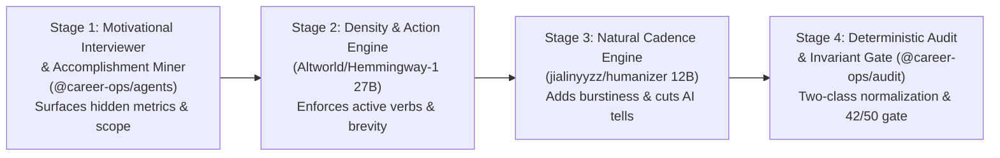
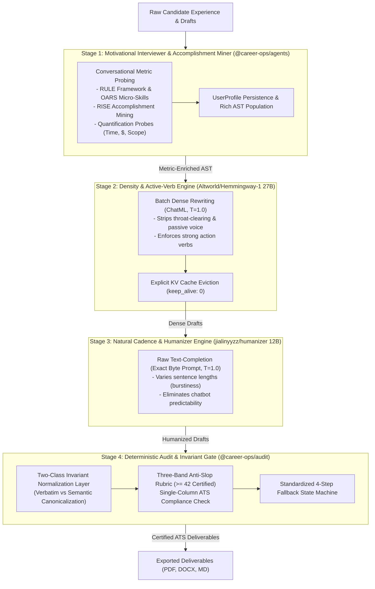
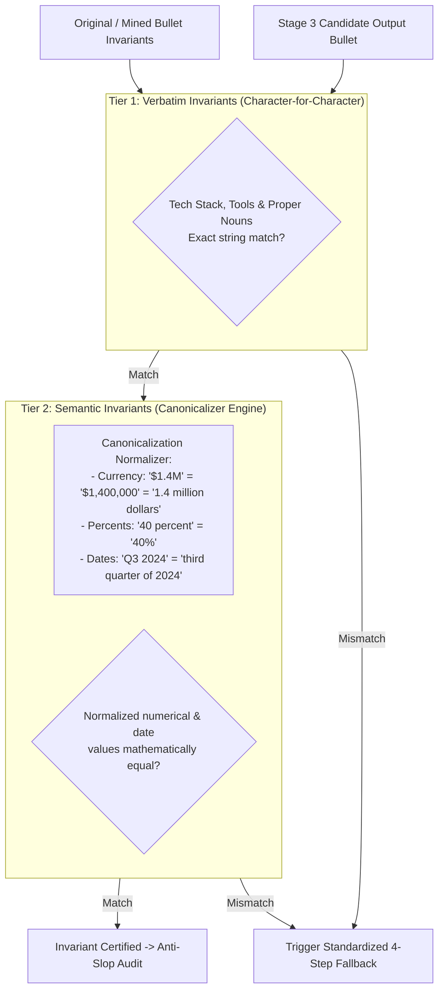
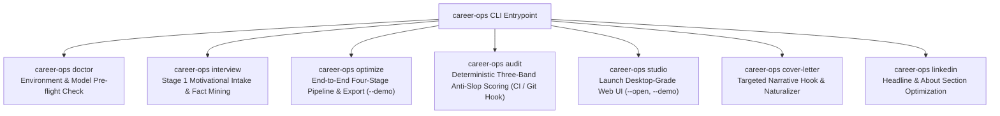
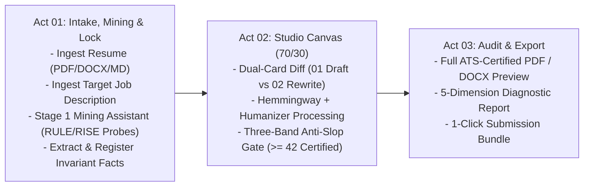
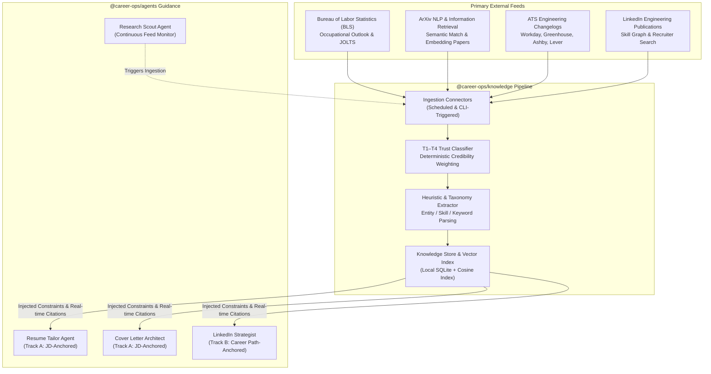
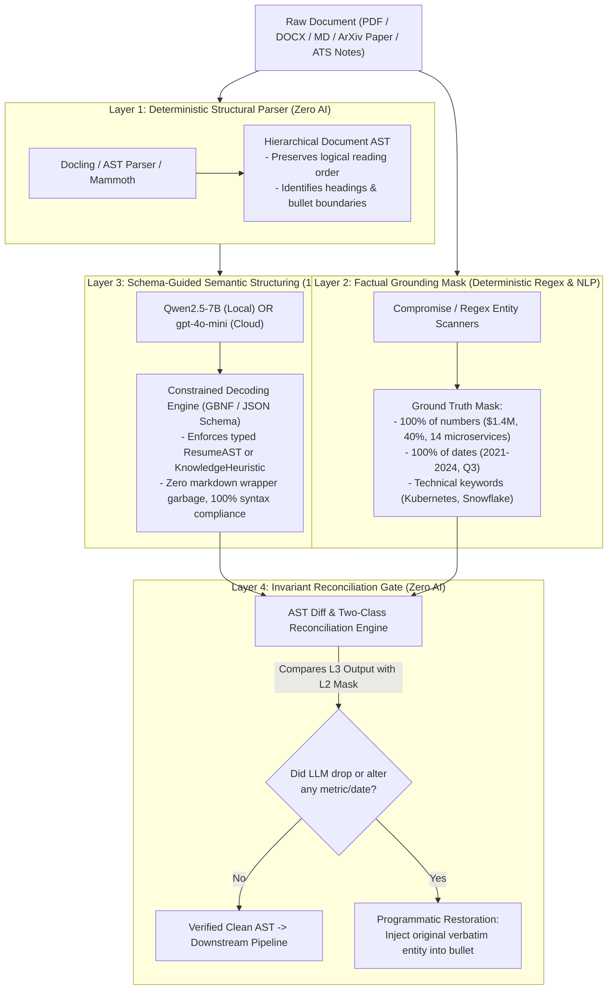
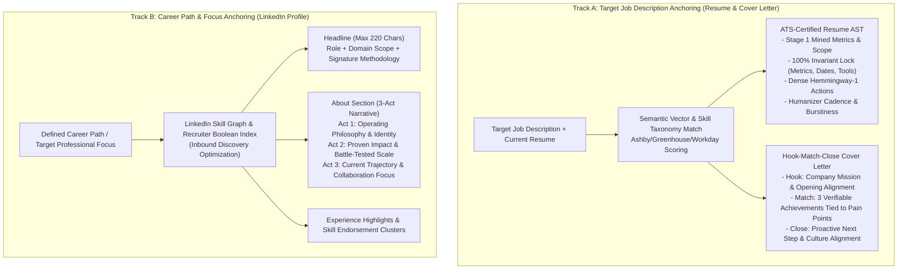
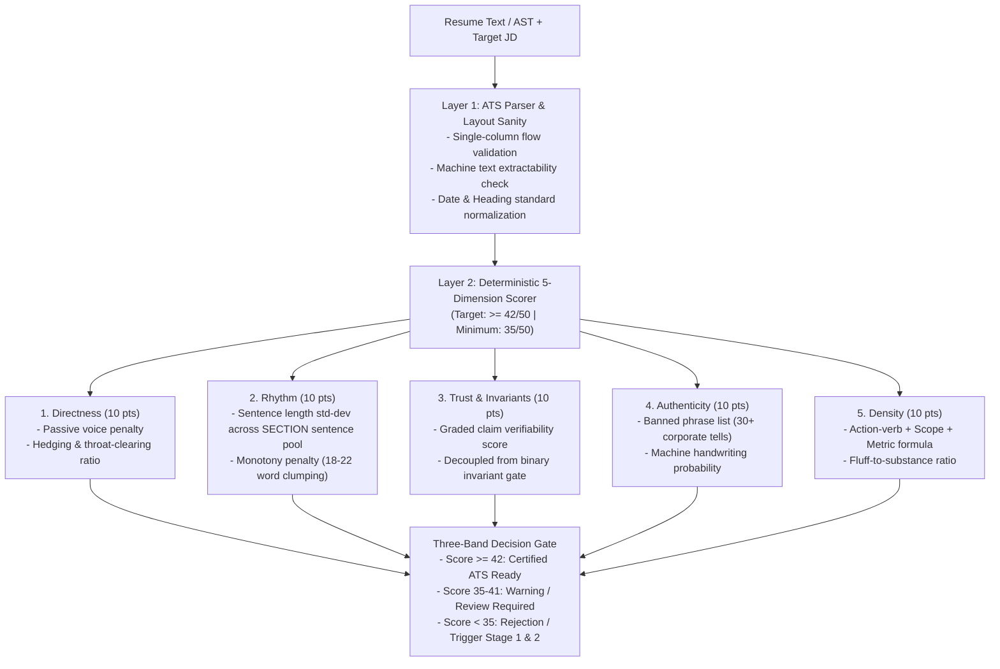

# System Design Specification: Dual-Engine Resume & Career Studio

**Repository:** `poferraz/career-ops`  
**Branch:** `feat/dual-engine-resume-product`  
**Date:** 2026-10-10  
**Status:** Approved in Stages (Section 1 Approved)  

---

## 1. Executive Summary & Vision

`career-ops` is evolving from a prompt-based agent skill into a full-fledged, multi-interface product and research-backed career operating system. Rather than discarding its origins, the platform evolves `career-ops`' original conversational intake, motivational interviewing, and deep research into an auditable **Four-Stage Core Engine**:



1. **`@career-ops/knowledge`**: A continuous research ingestion harness and T1–T4 trust classifier tracking verified hiring practices, ATS behaviors, LinkedIn algorithms, and market trends.
2. **`@career-ops/core`**: A shared TypeScript engine orchestrating document AST parsers, the Two-Class Invariant Normalization Layer (verbatim vs semantic), sequential VRAM swapper, and LLM runtime drivers.
3. **`@career-ops/agents`**: Specialized agent personas (Motivational Interviewer & Fact Miner, Resume Tailor, Cover Letter Architect, LinkedIn Strategist, Research Scout) operating under a Dual-Track optimization framework.
4. **`@career-ops/audit`**: A deterministic Three-Band Anti-Slop scoring rubric ($\ge 42/50$ Certified, 35–41 Warning, $<35$ Reject), fuzzy phrase scanner, and single-column ATS layout validator.
5. **`@career-ops/cli`**: A high-leverage terminal command center (`doctor`, `interview`, `ingest`, `optimize`, `audit`, `studio`) for headless optimization, `--demo` zero-input evaluation, and CI/CD verification.
6. **`@career-ops/web`**: A desktop-grade Web Application (Career Studio) featuring the Three-Act Pipeline (Act 01: Intake, Mining & Lock; Act 02: 70/30 Studio Canvas; Act 03: Audit & Export).

The system strictly follows the **Clief/ICM Operating Framework** (`docs/clief/`), applying a **60/30/10 architecture** (60% traditional code, 30% deterministic rules, 10% AI inference) and enforcing **100% factual invariance** over all candidate claims.

---

## 2. Hiring Landscape & AI Screening Realities (2026)

### 2.1 The ATS Hybrid Gate: Myth vs. Engineering Reality
* **The AI Detector Myth**: Applicant Tracking Systems (Workday, Greenhouse, Ashby, Lever, Taleo) do not run automated AI detectors (like GPTZero or Turnitin) to auto-reject resumes due to high false-positive rates and legal liabilities.
* **The "Pure Semantic" Myth**: Claiming that *"ATS is purely semantic, so keyword stuffing is wrong"* is equally false. Enterprise ATS platforms operate as **hybrid gates**:
  1. **Hard Boolean & Keyword Filters**: Greenhouse utilizes exact-keyword Preferred/Required searches; Workday indexes exact job title matches and recency; Lever employs structured skill fields. An Accenture/Harvard Business School study (2021) found that **88% of enterprise employers** agree qualified high-skills candidates are filtered out simply because their resumes miss exact criteria strings listed in the job post.
  2. **Semantic Vector Ranking**: Platforms (e.g., Greenhouse Talent Matching, Workday HiredScore) layer semantic vector models on top of keyword retrieval to score candidate fit.
* **The Rule of Dual-Objective Optimization**: Resumes must maximize semantic vector alignment *while* strictly guaranteeing the presence of extracted JD skill entities within verifiable operational context.

### 2.2 The Recruiter Initial Scan Gate & The Articulation Gap
* **Verified Recruiter Attention Lineage**:
  * **Initial Review**: Recruiters spend a median of **11.2 seconds** on initial review (InterviewPal 2025 platform telemetry, 312 recruiters across 4,289 reviews) and **7.4 seconds** skimming (Ladders 2018). Resumes that survive the initial pass receive a median deep verification read of **1 minute 34 seconds**.
  * **The AI Fatigue Reality**: 67% of HR leaders report that reviewing AI-generated job applications has slowed down their hiring process (Robert Half 2026), and 33.5% of hiring managers can spot generic AI text within 20 seconds, with 19.6% rejecting it outright (TopResume 2025).
* **Telltale Machine Indicators**:
  * **Machine Handwriting**: Monotonous sentence lengths (18–22 words per bullet), robotic rhythmic cadence, and overused AI buzzwords (*"spearheaded cross-functional initiatives," "proven track record," "leveraging data-driven insights"*).
  * **Generic Specificity**: Bullets that look grammatically sound but lack verifiable operational friction or organizational truth.
* **The Root Problem: The Articulation Gap**:
  * Candidates systematically undersell themselves, omitting quantifiable metrics, tooling, and team scope from their drafts.
  * **A rewriter cannot optimize what is missing.** `career-ops` solves this at intake through the **Motivational Interviewer (Stage 1)**, proactively mining accomplishments before document transformation.

---

## 3. Specialized Model Profiles & Runtime Realities

### 3.1 `Altworld/Hemmingway-1` (27B Parameter Model)
* **Base Architecture**: Qwen3.8-27B fine-tuned specifically for ultra-dense, direct professional communication.
* **Pinned Quantization**: `richardyoung/hemmingway-1:Q4_K_M` (Disk: 17.44 GB).
* **Operational Context Window**: Explicitly capped at `num_ctx: 8192` in `.career-opsrc.json` to prevent VRAM explosion during inference (the model's native 262k token window is restricted to prevent out-of-memory errors on 24GB GPUs).
* **Protocol & Format**: ChatML (`<|im_start|>system...<|im_end|>`).
* **Recommended Sampling**: `temperature: 1.0`, `top_p: 0.95`, `top_k: 20`, `presence_penalty: 0.0`.
* **Role in Pipeline**: **Stage 2: The Density & Active-Verb Engine**. Strips corporate throat-clearing, filler phrases, and passive voice; enforces active-verb impact and brevity.
* **Licensing Notice**: Released by Altworld under **CC BY-NC 4.0** (Non-Commercial). Personal and open-source non-commercial usage permitted; commercial deployment requires agreement with Altworld.

### 3.2 `jialinyyzz/humanizer` (12B Parameter Model)
* **Base Architecture**: Gemma-2-12B fine-tuned for text naturalization and AI-pattern eradication.
* **Pinned Quantization**: `jialinyyzz/humanizer:Q4_K_M` (Disk: 7.6 GB).
* **Protocol & Format**: **Text-Completion ONLY (NOT ChatML)**. Requires the exact byte-level prompt:
  ```text
  Rewrite the text below so it reads like a person wrote it, not a language model. Reorganize it as you see fit. Vary sentence length on purpose. Cut hedging, throat-clearing, and any sentence that only announces what comes next. Prefer the concrete word over the abstract one. It is fine to sound uneven. Every fact, number, unit, date, name and quotation must survive unchanged.

  <DRAFT_TEXT>

  ### Rewritten:
  ```
* **Recommended Sampling**: `temperature: 1.0`, `top_p: 0.95`, `top_k: 0`, `min_p: 0`, `repetition_penalty: 1.0`. No stop sequences except EOS.
* **Role in Pipeline**: **Stage 3: The Naturalizer & Cadence Engine**. Restores natural human sentence burstiness, varies cadence, purges machine predictability, and preserves locked factual entities.
* **Licensing Notice**: Apache-2.0 governed by Google Gemma Terms of Use.

### 3.3 Hardware Floors, VRAM Management & Execution Profiles
* **Profile A (Local Sovereign — Default)**:
  * **Hardware Floor**: 24GB dedicated VRAM GPU (NVIDIA RTX 3090, 4090) or 32GB Unified Memory Apple Silicon Mac (M1/M2/M3/M4 Pro/Max).
  * **Memory Management**: Sequential VRAM swapping state machine. Stage 2 (Hemmingway 17.44 GB) processes all section bullets, followed by explicit cache eviction (`keep_alive: 0`); Stage 3 (Humanizer 7.6 GB) then loads and processes the drafts.
  * **Ollama Apple Silicon Architecture Note**: The experimental MLX runner on Apple Silicon can silently ignore structured output (`format`). `career-ops doctor` checks runner compatibility and routes to the standard GGUF llama.cpp backend or activates client-side schema retries.
* **Profile B (Remote / Cloud Fallback)**:
  * **Target Machines**: 16GB MacBook Air/Pro, laptops without discrete 24GB GPUs.
  * **Routing**: The CLI and Web Studio automatically detect sub-24GB environments during `doctor` and guide the user to provide an OpenAI-compatible remote endpoint (`--remote <url>` or Ollama Cloud / vLLM / RunPod instance).

---

## 4. Section 1: Core Engine & Four-Stage Pipeline Architecture (`@career-ops/core`)

### 4.1 The Four-Stage Core Pipeline
`career-ops` integrates its original conversational intelligence directly into the automated pipeline, solving the fundamental **Articulation Gap**:



#### Detailed Breakdown of Stage 1: Motivational Interviewer & Accomplishment Miner
* **The Root Problem Solved**: Candidates systematically undersell themselves, omitting numbers, operational scale, and tools. A rewriting model (Stage 2 or Stage 3) cannot optimize metrics that do not exist on the page.
* **The Clinical Methodology**:
  * **RULE Framework**:
    * *Resist the righting reflex*: Never tell candidates what they should have done; draw out what they actually achieved.
    * *Understand motivation*: Probe the core business problem before asking for the technical solution.
    * *Listen with empathy*: Reflect back operational hurdles before offering structuring advice.
    * *Empower the candidate*: Ensure all accomplishments belong authentically to their lived experience.
  * **OARS Micro-Skills**: Open questions, Affirmations, Reflective listening, Summaries.
  * **5-Phase Intake & Mining**:
    1. *Emotional Map*: Identify loved, liked, and disliked projects.
    2. *Gap Identification*: Map current responsibilities to target role requirements.
    3. *Accomplishment Mining*:
       - *Decomposition*: Break down broad tasks into technical components.
       - *Social Proof*: Surface what teammates consistently relied on the candidate to solve.
       - *Quantification Probes*: "What happened to the metric after you deployed that? How many hours saved per week? What was the percentage change?"
       - *RISE Method*: Record wins, Include business impact, Capture tools used, Embrace authentic narrative.
    4. *Transferable Skill Extraction*: "If your team lost you tomorrow, what would break first?"
    5. *Target Calibration*: Define target salary minimums and day-to-day work preferences.
* **Persistence & Integration**: Ingested facts and mined accomplishments persist to `UserProfile` (`session/user-profile.md` or local SQLite) and populate the `ResumeAST` before Stage 2 execution.

---

### 4.2 Resume Abstract Syntax Tree (AST) & Two-Class Invariants
All documents are parsed into a typed AST that strictly differentiates verbatim entities from semantic entities:

```typescript
export interface ResumeAST {
  header: CandidateHeader;
  summary?: string;
  experience: ExperienceRole[];
  education: EducationItem[];
  skills: SkillCategory[];
  rawMarkdown: string;
}

export interface ExperienceRole {
  id: string;
  company: string;
  title: string;
  location?: string;
  dateRange: string;
  bullets: BulletNode[];
}

export interface BulletNode {
  id: string;
  originalText: string;
  minedMetrics?: string[];       // Surfaced via Stage 1 Motivational Interviewer
  hemingwayDraft?: string;       // Produced via Stage 2
  humanizedText?: string;        // Produced via Stage 3
  invariants: {
    // Verbatim Invariants: Must match character-for-character
    verbatim: {
      techStack: string[];       // ["Kubernetes", "Snowflake", "PostgreSQL"]
      properNouns: string[];     // ["Acme Corp", "Stripe API"]
      certifications: string[];  // ["AWS Solutions Architect", "PMP"]
    };
    // Semantic Invariants: Numbers, dates, currencies subject to canonicalization
    semantic: {
      metrics: string[];         // ["$1.4M", "40%", "14 microservices"]
      dates: string[];           // ["Q3 2024", "18 months", "2021-2024"]
    };
  };
  scores?: AntiSlopScore;
  status: 'pending' | 'mined' | 'processing' | 'verified' | 'fallback';
}
```

---

### 4.3 The Two-Class Invariant Normalization Layer (Fixing F1 False-Rejections)
A binary regex sentinel causes false-positive rejections when models legitimately restyle numbers or dates (e.g., rewriting `1.4 million dollars` as `$1.4M`, or `Q3 2024` as `third quarter of 2024`). The normalization layer solves this via two distinct verification tiers:



#### Standardized 4-Step Fallback Sequence
If an invariant mismatch occurs after Stage 3 humanization:
1. **Step 1 (Programmatic Re-Injection)**: Attempt to inject the exact missing invariant entity back into the humanized sentence AST node.
2. **Step 2 (Re-Verification)**: Re-run the Two-Class Invariant Normalizer on the adjusted bullet. If passing, retain humanized bullet.
3. **Step 3 (Stage 2 Dense Draft Fallback)**: If re-injection fails or harms sentence syntax, fall back to the Stage 2 Hemmingway draft (which maintains higher metric fidelity).
4. **Step 4 (Original Bullet Safe Fallback)**: If Stage 2 also altered an invariant, fall back to `originalText` and flag with a UI warning badge (`[Original Preserved — Invariant Lock]`).

---

### 4.4 Section 1 Gap Review
* **Gap 1.1 (Memory Swap Latency)**: Swapping models per-bullet causes severe reload latency.  
  * *Resolution*: Implemented **Stage-Batching** (run all Stage 2 passes, evict once with `keep_alive: 0`, load and run all Stage 3 passes).
* **Gap 1.2 (Action Verb Repetition)**: Bullets optimized in isolation may repeat identical action verbs across a single role.  
  * *Resolution*: Maintain a rolling context window of the last 2 verbs used within the same job role.
* **Gap 1.3 (Legitimate Numerical Restyling Rejection)**: Strict string matching fails when models convert `$1.4M` to `1.4 million dollars`.  
  * *Resolution*: The Two-Class Invariant Normalization Layer canonicalizes currencies, percentages, and dates prior to assertion.
* **Gap 1.4 (The Articulation Gap)**: Models cannot optimize missing data.  
  * *Resolution*: Stage 1 Motivational Interviewer proactively probes candidates for operational metrics and scope before passing AST to Stage 2.
* **Gap 1.5 (Ollama Apple Silicon Structured Output Glitch)**: MLX backend on Apple Silicon ignores JSON schema.  
  * *Resolution*: `career-ops doctor` asserts GGUF llama.cpp backend configuration and wraps calls with client-side JSON extraction and retry guards.

---

## 5. Section 2: CLI Architecture & Commands (`@career-ops/cli`)

### 5.1 Command Surface


#### 1. `career-ops doctor`
Probes local runtime health: verifies Ollama (`http://localhost:11434`), checks presence of `richardyoung/hemmingway-1:Q4_K_M` (17.44 GB) and `jialinyyzz/humanizer:Q4_K_M` (7.6 GB), profiles system memory/VRAM (asserting 24GB VRAM GPU or 32GB Mac floor), tests for Apple Silicon MLX structured output compatibility, and verifies fallback API keys. Flag `--fix` triggers automatic model pulls.

#### 2. `career-ops interview`
```bash
career-ops interview [--resume resume.pdf] [--interactive]
```
Executes Stage 1 Motivational Interviewer and Accomplishment Mining directly in the terminal. Proactively parses the candidate's draft, identifies bullets lacking metrics or operational scale, and uses RULE framework / RISE quantification probes to extract achievements, updating `UserProfile` and the underlying `ResumeAST`.

#### 3. `career-ops optimize`
```bash
career-ops optimize --resume resume.pdf --jd job-spec.txt --output ./dist/ --format pdf,docx,md
career-ops optimize --demo
```
* **Flags**: `--resume <path>`, `--jd <path>`, `--output <dir>`, `--format <pdf,docx,md,json>`, `--strategy <fast|balanced|deep>`, `--remote <url>`, `--demo`.
* **Zero-Input Evaluation (`--demo`)**: Automatically loads bundled test fixtures (Senior Distributed Systems Engineer resume + Staff SRE job post), runs the complete Four-Stage pipeline, and outputs terminal diffs and ATS scores. Guarantees immediate zero-friction evaluation for new users and viral repository evaluation.
* **UX**: Streams live section-by-section terminal diffs with colored additions/deletions, followed by an interactive summary table of the Three-Band Anti-Slop score and invariant verification status.

#### 4. `career-ops audit`
```bash
career-ops audit --resume resume.pdf [--jd jd.txt] [--threshold 42] [--json]
```
Non-destructive quality gate designed for pre-commit hooks and CI/CD pipelines. Returns exit code `0` on pass ($\ge 42$), `1` on fail. Outputs parser health, banned phrase occurrences, missing ATS keyword vectors, invariant status, and Three-Band rubric breakdown.

#### 5. `career-ops studio`
Starts local Vite server, binds to `localhost:3000`, and opens default browser into the Career Studio web application. Flag `--demo` pre-populates Act 01 with sample candidate data.

#### 6. `career-ops cover-letter` & `career-ops linkedin`
* `cover-letter`: Generates tailored Hook $\rightarrow$ Match $\rightarrow$ Close letters, filtered through Humanizer.
* `linkedin`: Optimizes Headline, About section, and Experience snippets for recruiter search algorithms.

### 5.2 Configuration Architecture (`.career-opsrc.json`)
```json
{
  "$schema": "https://career-ops.dev/schema.json",
  "runtime": {
    "defaultProvider": "ollama",
    "ollamaHost": "http://localhost:11434",
    "hemingwayModel": "richardyoung/hemmingway-1:Q4_K_M",
    "humanizerModel": "jialinyyzz/humanizer:Q4_K_M",
    "num_ctx": 8192,
    "remoteEndpoint": null,
    "vramSafetyMode": "sequential-swap"
  },
  "rubric": {
    "minPassingScore": 42,
    "threeBandGates": {
      "certified": 42,
      "warning": 35
    },
    "bannedPhraseEnforcement": "strict",
    "factualLock": true
  },
  "export": {
    "defaultFormats": ["pdf", "md"],
    "pdfTemplate": "single-column-ats",
    "outputDir": "./career-materials"
  }
}
```

### 5.3 Section 2 Gap Review
* **Gap 2.1 (Unix Pipeline & Stdio Support)**: Non-interactive scripts calling the CLI must not emit terminal escape sequences or spinners.  
  * *Resolution*: Automatic `process.stdout.isTTY` detection. Suppress all formatting and output pure JSON or raw text when piped.
* **Gap 2.2 (Scanned / Image PDFs)**: Scanned PDFs without OCR return empty text strings to standard extractors.  
  * *Resolution*: Density check on parsed character count. If near zero, emit clear diagnostic error warning the user of ATS parser failure.
* **Gap 2.3 (Secret Leakage in Config Files)**: Accidental commit of remote API keys in `.career-opsrc.json`.  
  * *Resolution*: Never serialize plaintext keys in project config. Read exclusively from environment variables (`CAREER_OPS_API_KEY`) or system keychain.
* **Gap 2.4 (Orphaned Inference on Cancellation)**: User cancels mid-run with `Ctrl+C`.  
  * *Resolution*: Trap `SIGINT`, cancel active HTTP request streams, clean up temporary files, and cleanly restore terminal cursor.

---

## 6. Section 3: Desktop-Grade Web Studio UI & UX (`@career-ops/web`)

Interactive Prototype: [`docs/assets/studio-prototype.html`](file:///Users/poferraz/Documents/Development/active/career-ops/docs/assets/studio-prototype.html)

### 6.1 The Three-Act Pipeline Model
Rather than presenting an unguided screen, the Career-Ops Studio guides the candidate through a purposeful **Three-Act Pipeline**:



1. **Act 01: Intake, Accomplishment Mining & Fact Lock**:
   * Drag-and-drop ingestion of resume files.
   * Target Job Description semantic parser (extracts high-priority keywords).
   * **Stage 1 Accomplishment Mining Assistant**: Interactive inspector highlighting weak bullets lacking metrics, providing guided quantification probes ("What happened to latency? How many users? What was the percentage gain?") to enrich the AST before rewriting.
   * Two-Class Invariant registration: Scans and locks verbatim tools and semantic metrics into the invariant capsule.
2. **Act 02: Studio Canvas (The Core Dual-Engine Diff Stage)**:
   * **Left Stage (70% Width)**: The Humanizer-inspired Dual-Card Diff container.
     * `01 Draft`: Shows raw uploaded text with red strikethroughs across corporate filler.
     * `02 Rewrite`: Shows humanized text with bright lime-green highlight pills (`#d9f99d`) on punchy action verbs and outcomes.
     * `✓ FACTS KEPT`: Capsule bar locking all invariant entities (`$1.4M 🔒`, `40% overtime 🔒`, `Kubernetes 🔒`).
   * **Right Panel (30% Width)**: The Architectural Anti-Slop Quality Gate.
     * Large bold cobalt `42/50` score badge (`CERTIFIED ATS READY`).
     * 5 Dimension breakdown (Directness, Rhythm, Trust, Authenticity, Density).
     * ATS Keyword Match Matrix.
     * Three-Band Gate Status Indicator ($\ge 42$ Certified, 35–41 Warning, $<35$ Reject).
     * *Strict No-Detector Law Compliance: No AI risk score or detector radar is displayed.*
3. **Act 03: Certified Audit & Export**:
   * Full single-column ATS PDF preview.
   * Native Word `.docx` download.
   * Diagnostic audit card for candidate records.

### 6.2 Design System Tokens & Impeccable Rules (`PRODUCT.md` & `DESIGN.md`)
* **Durable Design Authority**: Standardized in [`PRODUCT.md`](file:///Users/poferraz/Documents/Development/active/career-ops/PRODUCT.md) and [`DESIGN.md`](file:///Users/poferraz/Documents/Development/active/career-ops/DESIGN.md).
* **Canvas**: Warm light zinc-50 paper canvas (`#fafafa`) with a subtle 24px blueprint graph grid (`rgba(20, 20, 184, 0.04)`).
* **Architectural Borders & Shadows**: 3px solid cobalt blue borders (`border: 3px solid #1414b8`) with 6px hard geometric drop shadows (`box-shadow: 6px 6px 0px #1414b8`).
* **Typography**:
  * Headings: `Inter` (Black 900, uppercase, tracking-tight).
  * Body: `Inter` (Regular 400 / Medium 500, `text-[15px]`, `leading-7`).
  * Mono Data: `JetBrains Mono` (Bold 700 / Medium 500, `11px–12px`).
* **The Inline Highlight Rule**:
  * Diff text highlights use pure inline styling: `background-color: #d9f99d; color: #09090b; padding: 1px 3px; border-radius: 3px; box-decoration-break: clone; -webkit-box-decoration-break: clone; display: inline;`.
  * **Strict Prohibition**: Never use `display: inline-block` on inline text highlights, as it treats multi-word clauses as rigid atomic boxes, causing jagged line breaks, trailing gaps, and orphan punctuation.
* **The Left-Justified Rhythm Rule**:
  * Both Draft and Rewrite columns share identical left-alignment (`text-left`) and vertical rhythm (`leading-7`), with bullet markers (`•`) and attached punctuation to enable instant comparative eye-tracking.

### 6.3 The Three Workspace Modules
1. **Resume Optimizer**: Bullet-by-bullet AST transformation, keyword injection, single-column ATS verification.
2. **Cover Letter Studio**: Implements the Hook $\rightarrow$ Match $\rightarrow$ Close methodology with authentic human tone calibration.
3. **LinkedIn Forge**: Generates search-optimized Headlines (220 char limit), 3-act narrative About sections, and scannable experience summaries.

### 6.4 Section 3 Gap Review
* **Gap 3.1 (Browser CORS with Local Ollama)**: Browser security blocks direct `fetch('http://localhost:11434')`.  
  * *Resolution*: Vite dev server / Node local runner proxies `/api/*` requests directly to Ollama, eliminating all browser CORS issues.
* **Gap 3.2 (Virtualization on Long Diffs)**: Heavy diff calculations cause frame stutter on 3-page resumes.  
  * *Resolution*: Virtualized DOM list rendering (`@tanstack/react-virtual`) and offloading token diffing to a dedicated Web Worker (`diff.worker.ts`).
* **Gap 3.3 (Accidental Manual Edit Metric Corruption)**: User manually edits a bullet and deletes or mistypes a metric.  
  * *Resolution*: Inline Invariant Sentinel alerts the user immediately with a warning badge if any locked metric is missing.
* **Gap 3.4 (Window Cramping on Narrow Screens)**: 3-pane layout becomes crowded under 1280px width.  
  * *Resolution*: Responsive drawer design: Intelligence & Radar inspector collapses into a floating drawer on screens $<1280\text{px}$.


---

## 7. Section 4: Deep Research Ingestion Harness (`@career-ops/knowledge`) & Evidence-Based Agent Guidance (`@career-ops/agents`)

### 7.1 Continuous Research Ingestion Architecture
To prevent agents from relying on stale web-crawl assumptions or generic career advice, the platform incorporates a continuous, research-driven knowledge harness. This harness autonomously ingests, classifies, and indexes empirically verified labor market research, ATS vendor mechanics, and platform search algorithms.



#### 7.1.1 T1–T4 Trust Hierarchy & Credibility Scoring
Every ingested insight is classified into a four-tier trust hierarchy (`docs/trust-tiers.md`):
1. **Tier 1 (T1) — Empirical Science & Primary Government Data (Weight: 1.0)**:
   * Sources: U.S. Bureau of Labor Statistics (BLS), National Bureau of Economic Research (NBER), peer-reviewed labor economics, and IEEE/ACM algorithmic fairness studies.
   * Usage: Establishes macroeconomic baseline facts, occupational mobility data, and empirical compensation percentiles.
2. **Tier 2 (T2) — Authoritative Vendor Engineering & Official Specs (Weight: 0.85)**:
   * Sources: Engineering release notes and technical documentation from ATS vendors (Workday, Greenhouse, Ashby, Lever, Taleo) and LinkedIn Engineering.
   * Usage: Dictates strict parser layout rules, document format tokenization, and platform search indexing schemas.
3. **Tier 3 (T3) — Verified Talent Acquisition Studies & Empirical Surveys (Weight: 0.65)**:
   * Sources: Verified recruiter attention tracking studies (Ladders 2018 eye-tracking: 7.4s skim; InterviewPal 2025 platform telemetry: 11.2s median initial review across 312 recruiters; Robert Half 2026: 67% of HR leaders slowed by AI applications), large-scale corporate HR surveys, and published search playbooks.
   * Usage: Guides recruiter-scanning cognitive flow, action verb impact thresholds, and reading rhythm.
4. **Tier 4 (T4) — Unverified Social Media & Opinion (Weight: 0.0 — Excluded)**:
   * Sources: LinkedIn viral posts, TikTok career influencers, anonymous Reddit threads, and unverified coaching blogs.
   * Usage: **Strictly rejected or quarantined.** Internal agents are barred from utilizing T4 content for document guidance.

#### 7.1.2 Knowledge Schema & Query Engine
```typescript
export interface KnowledgeHeuristic {
  id: string;
  domain: 'ats-parsing' | 'resume-density' | 'cover-letter' | 'linkedin-seo' | 'market-skills';
  trustTier: 'T1' | 'T2' | 'T3';
  sourceTitle: string;
  sourceUrl: string;
  publishedAt: string;
  expiresAt: string;        // TTL enforcement to prevent stale guidance
  ruleKey: string;          // e.g., "WORKDAY_PARSER_MULTI_COLUMN_FAIL"
  content: string;          // The actionable heuristic
  metadata: {
    vendor?: 'workday' | 'greenhouse' | 'ashby' | 'lever' | 'linkedin' | 'generic';
    relevanceWeight: number; // 0.0 - 1.0
  };
}
```

#### 7.1.3 The 4-Layer Hybrid Ingestion Architecture
Recent 2025/2026 benchmarks (*ResumeBench*, *Djinni-CB*, and *LLMStructBench*) reveal that unconstrained, pure-LLM parsing drops to **75%–85% accuracy** on complex nested entities and fails on multi-column layouts. To guarantee 100% extraction precision with minimal local compute, ingestion is structured into 4 deterministic and constrained layers:



1. **Layer 1: Deterministic Structural Parser (60% Traditional Software)**:
   - Uses `Docling` / `pdf-parse` / `mammoth` to extract clean Markdown and logical AST nodes without AI. Guarantees zero token scrambles from multi-column PDFs.
2. **Layer 2: Factual Grounding Mask (30% Deterministic Rules)**:
   - Scans text for numerical values, currencies, percentages, dates, and technical tooling to establish an immutable ground truth mask.
3. **Layer 3: Schema-Guided Semantic Structuring (10% LLM Inference)**:
   - Uses **`Qwen2.5-7B-Instruct`** (or **`Qwen2.5-3B`** on low-memory machines) with **GBNF grammar-constrained decoding** to map unstructured text into strictly typed JSON. Runs ephemerally with `keep_alive: 0`, freeing VRAM before Stage 2 starts.
4. **Layer 4: Invariant Reconciliation Gate (Deterministic Sentinel)**:
   - Uses the Two-Class Invariant Normalizer to verify that 100% of Layer 2's ground truth entities survive into Layer 3's output. Any dropped metric or date is immediately re-injected.

#### 7.1.4 Pre-Baked Canonical Research Seed vs Dynamic Ingestion Engine
To prevent candidates from having to process dozens of academic papers locally on first run:
1. **Offline Canonical Distillation**: The core development team uses high-capacity frontier models (`Claude 3.5 Sonnet` / `Llama-3.3-70B`) offline to ingest and distill 50+ foundational papers, BLS tables, and ATS release notes into a pre-compiled SQLite database (`packages/knowledge/seed/career_knowledge.db`). This ships directly with the package.
2. **Runtime Dynamic Ingestion**: Candidates can ingest custom company culture memos, specific job descriptions, or new articles on-the-fly using the local ephemeral `Qwen2.5-7B` model (or an optional OpenAI-compatible remote endpoint with `--remote`).

---

### 7.2 The Dual-Track Optimization Framework
To reach human decision-makers, the system operates under a clear architectural duality based on the target audience and algorithmic discovery mechanism:



#### 7.2.1 Track A: Target Job Description Anchoring (Resume & Cover Letter)
* **Goal**: Overcome automated ATS hybrid filtering (exact Boolean requirements + semantic talent match) and pass the human recruiter's initial review (median 11.2s review / 7.4s skim).
* **Resume Strategy**:
  1. Parse candidate resume into `ResumeAST`.
  2. Run Stage 1 Motivational Interviewer & Accomplishment Miner to probe weak bullets and surface missing metrics/tools.
  3. Extract target JD's required skill taxonomy, technical tools, and problem spaces.
  4. Lock 100% of candidate achievements and metrics in the Two-Class Invariant Sentinel.
  5. Inject JD semantic keywords organically into existing experience bullets without keyword stuffing.
  6. Run Stage 2 Hemmingway density + Stage 3 Humanizer cadence passes.
* **Cover Letter Strategy**:
  1. Discard generic boilerplate templates.
  2. Implement the **Hook $\rightarrow$ Match $\rightarrow$ Close** structure:
     * **The Hook (Paragraph 1)**: Cites specific current company challenges, recent engineering blogs, or product initiatives; establishes authentic excitement.
     * **The Match (Paragraphs 2–3)**: Pulls 2–3 locked candidate achievements directly solving the job description's primary pain points.
     * **The Close (Paragraph 4)**: Confident, low-friction call to discussion; eliminates passive pleading.

#### 7.2.2 Track B: Career Path & Focus Anchoring (LinkedIn Profile)
* **Goal**: Maximize inbound discovery by recruiters conducting Boolean keyword queries on LinkedIn Recruiter, while positioning the candidate as a recognized authority in their target specialty.
* **Algorithmic Mechanics**: LinkedIn Recruiter ranks profiles based on exact-match job titles, skill density in the top 5 endorsements, and profile completeness.
* **Profile Deliverables**:
  1. **Headline (220 characters max)**:
     * Formula: `[Target Senior Role] | [Core Domain Specialization] | [Key Tech Stack or Signature Impact Metric]`
     * Example: *"Staff Distributed Systems Engineer | High-Throughput Streaming & Consensus | Go, Rust, Kafka | Scaling 2M+ QPS"*
  2. **About Section (The 3-Act Authority Narrative)**:
     * *Act 1: Operating Philosophy*: 2–3 sentences defining how the candidate approaches engineering challenges.
     * *Act 2: Battle-Tested Track Record*: Concrete, high-level impact themes (e.g., *"Scaled payments from \$100M to \$2B GMV"*).
     * *Act 3: Target Trajectory & Collaboration*: Explicitly states what problems they are seeking to solve next.
  3. **Experience & Skill Graph Optimization**:
     * Clusters skills to match LinkedIn's verified Skill Graph taxonomies.
     * Aligns past role titles with industry standard nomenclature without altering truth.

---

### 7.3 Specialized Internal Agents
Guided by `@career-ops/knowledge`, internal agents operate with strict prompt contracts and temperature bounds:

1. **Motivational Interviewer & Accomplishment Miner (Stage 1 Core)**:
   * Engine: Conversational reasoning with structured JSON extraction (`Qwen2.5-7B` local or remote endpoint).
   * Framework: RULE framework + OARS micro-skills + RISE method.
   * Role: Bridges the Articulation Gap by proactively questioning the user to surface hidden metrics, technical scope, and team impact before document rewriting.
   * Persistence: Writes to persistent `UserProfile` (`session/user-profile.md` / DB) and populates `ResumeAST`.
2. **Resume Tailor Agent (Track A)**:
   * Pipeline: `Altworld/Hemmingway-1` (ChatML) $\rightarrow$ `jialinyyzz/humanizer` (Raw).
   * Context: Resume AST with mined metrics, JD text, ATS parsing guidelines from knowledge store.
   * Invariant: Two-Class Invariant Sentinel assertions active.
3. **Cover Letter Architect (Track A)**:
   * Pipeline: Four-stage pipeline.
   * Context: Candidate achievements, JD text, company mission signals.
   * Output: 350-word Hook-Match-Close letter with zero corporate clichés.
4. **LinkedIn Strategist (Track B)**:
   * Pipeline: Four-stage pipeline.
   * Context: Full candidate AST, target career path, LinkedIn search indexing rules.
   * Output: Structured JSON containing Headline, About markdown, and Top 5 Skill suggestions.
5. **Research Scout Agent**:
   * Engine: Deterministic RSS/API parser + `Hemmingway-1` summarizer.
   * Context: External feeds (BLS, ArXiv, ATS engineering blogs).
   * Output: Verified `KnowledgeHeuristic` records tagged with T1–T3 trust tiers.

### 7.4 Section 4 Gap Review
* **Gap 4.1 (Guideline Staleness)**: ATS platforms update algorithms without notice.  
  * *Resolution*: Strict TTL expiration (180 days maximum) on all ingested heuristics; expired items require re-verification by Research Scout.
* **Gap 4.2 (Guideline Conflicts)**: Conflicting advice between recruitment blogs and vendor engineering notes.  
  * *Resolution*: Trust tier precedence: T1 overrides T2; T2 overrides T3. T4 is unconditionally discarded.
* **Gap 4.3 (Hallucination of Unstated JD Requirements)**: Agent assumes requirements not in the JD.  
  * *Resolution*: Deterministic extraction of JD entities prior to agent invocation; agent is strictly constrained to extracted list.

---

## 8. Section 5: Anti-Slop Scoring Engine & Verification Gate (`@career-ops/audit`)

### 8.1 Deterministic Rubric Metrics & Mathematical Formulations
To ensure objective, reproducible evaluations that eliminate recruiter AI flags, the audit engine computes deterministic scores across 5 dimensions:



#### 1. Directness (10 points)
Penalizes passive voice constructions (`was promoted to lead`, `was responsible for`) and hedging tokens (`helped to`, `participated in`, `assisted with`).
$$\text{Directness} = \max\left(0, \; 10 - 2 \times (\text{PassiveConstructions}) - 1.5 \times (\text{HedgingPhrases})\right)$$

#### 2. Rhythm (10 points — Construct-Valid Sentence Pool Calculation)
Measures sentence length variance (**burstiness**). Standard AI text clumps rigidly around $20 \pm 2$ words per sentence. Human writing has high standard deviation ($\sigma \ge 6.5$).
* **Construct Validity Rule**: Standard deviation ($\sigma$) must be computed across the **entire experience section sentence pool** (or candidate's multi-sentence bullet pool), NOT on isolated single-sentence bullets (which yields $\sigma = 0$ and an artificial failing score of 4/10).
$$\text{Rhythm} = \min\left(10, \; \max\left(0, \; \text{round}\left(4 + 0.8 \times \sigma_{\text{section\_sentence\_pool}}\right)\right)\right)$$

#### 3. Trust & Factual Verifiability (10 points — Graded Scoring)
Decoupled from the binary invariant sentinel (which gates pipeline execution). Measures the proportion of claims backed by verifiable operational metrics and un-hallucinated context:
$$\text{Trust} = \max\left(0, \; 10 - 2 \times (\text{UnverifiedClaims}) - 2 \times (\text{MissingMinedEntities})\right)$$

#### 4. Authenticity (10 points)
Scans for the 30+ banned phrases defined in `references/anti-slop.md` (*"spearheaded cross-functional initiatives"*, *"proven track record"*, *"leveraging insights"*, *"results-driven"*).
$$\text{Authenticity} = \max\left(0, \; 10 - 3 \times (\text{BannedPhrasesFound})\right)$$

#### 5. Density (10 points)
Verifies the presence of the three essential components in every experience bullet:
$$\text{Density} = \text{ActionVerbPresent (3 pts)} + \text{VerifiableContext (3 pts)} + \text{QuantifiedMetric (4 pts)}$$

### 8.2 Three-Band Quality Gate
* **Band 1: Score $\ge 42$ (Certified ATS Ready)**: Document meets senior engineering standards, exhibits natural human cadence, and passes all hybrid ATS gates.
* **Band 2: Score $35$ to $41$ (Warning / Review Required)**: Minor tone or density issues. Allowed to proceed with user notification or targeted re-humanization.
* **Band 3: Score $< 35$ (Reject / Intervention Required)**: Fails baseline standards. Automatically triggers Stage 1 Motivational Probing or Stage 2 rewriting.

### 8.3 ATS Parser Sanity Scanner
* **Single-Column Compliance**: Flags multi-column grids or sidebars that cause Taleo and Workday to interleave text horizontally.
* **Date Normalization**: Flags ambiguous dates (*"Spring 2023"*, *"recent"*) and enforces standard machine-readable formats (`MM/YYYY – MM/YYYY` or `YYYY – YYYY`).
* **Heading Standard**: Guarantees canonical section names (*Experience*, *Education*, *Skills*) so ATS taxonomy mappers correctly assign experience history.

### 8.4 Section 5 Gap Review
* **Gap 5.1 (False Positives on Protocol / Version Numbers)**: Technical terms like `OAuth 2.0` or `HTTP 404` misclassified as performance metrics.  
  * *Resolution*: Context-aware regex treats protocol versions and hardware names as **TechStack tokens**, excluding them from metrics calculations.
* **Gap 5.2 (Banned Phrase Evasion)**: Model rewords phrases slightly (e.g., *"demonstrated track record"* instead of *"proven track record"*).  
  * *Resolution*: Levenshtein fuzzy matching and synonym-stemming against the banned phrase dictionary.
* **Gap 5.3 (Non-Standard Action Verbs)**: Valid domain verbs (*"Orchestrated"*, *"Arbitrated"*) flagged by strict whitelists.  
  * *Resolution*: Comprehensive 250-word canonical action verb dictionary categorized by functional discipline.

---

## 9. Section 6: Monorepo Architecture, 60/30/10 Split & Phased Implementation

### 9.1 The 60/30/10 Architecture & The Removal Test
In accordance with the Clief/ICM operating principles, the platform is structured around strict technical ownership:

- **60% Traditional Software (Deterministic Foundation)**:
  - Document AST parsers (Markdown, DOCX, PDF) and reconstructors.
  - Token diffing algorithms and Web Worker offloading.
  - Vite + React Web Studio application with virtualized rendering.
  - Headless CLI with `commander`, stdio stream routing, `--demo` mode, and CI exit codes.
  - SQLite database for research storage and local vector indexing.
- **30% Deterministic Rules & Guardrails (The Quality Gate)**:
  - Two-Class Invariant Normalization Layer (verbatim vs semantic canonicalization).
  - T1–T4 trust classification engine and source weighting.
  - Three-Band Anti-Slop mathematical scoring algorithm ($\ge 42$ certified).
  - Banned corporate buzzword fuzzy matcher.
  - Single-column ATS layout rule validator.
  - Sequential VRAM swapper state machine (`keep_alive: 0` eviction).
- **10% Language Model Inference (The Semantic Operators)**:
  - Stage 1: Motivational Interviewer & Accomplishment Miner (conversational metric discovery).
  - Ingestion: Ephemeral `Qwen2.5-7B-Instruct` (or `Qwen2.5-3B` fallback) with GBNF grammar constraints.
  - Stage 2: `Altworld/Hemmingway-1` (ChatML, $T=1.0$) for active voice and maximum density.
  - Stage 3: `jialinyyzz/humanizer` (Raw Completion, exact template, $T=1.0$) for burstiness and natural cadence.
- **The Removal Test**:
  - If all LLMs are disabled or replaced with static rule templates, the document parser, Two-Class Invariant Sentinel, Anti-Slop rubric, ATS layout validator, and Three-Act web canvas continue functioning as an interactive manual career editor.

### 9.2 Clief/ICM Operating Framework Integration
All project memory and context routing resides canonically within `docs/clief/`:
- **Map**: `docs/clief/INDEX.md` (canonical routing table for all tasks).
- **Brief**: `docs/clief/BRIEF.md` (project goals, pain points, constraints, and non-goals).
- **PRD**: `docs/clief/PRD.md` (living requirements, 60/30/10 breakdown, and risk gates).
- **Status**: `docs/clief/STATUS.md` (session progress, blockers, and next steps).
- **Charter**: `docs/clief/AGENT-CHARTER.md` (boundaries for AI, code, and humans).
- **Rooms**: `docs/clief/workspaces/*/CONTEXT.md` (dedicated context per package).

### 9.3 Monorepo Layout
```text
career-ops/
├── CLIEF.md                                    # Root Clief routing adapter
├── PRODUCT.md                                  # Durable product authority (Impeccable)
├── DESIGN.md                                   # Durable design authority (Tokens & Rules)
├── .impeccable/
│   └── design.json                             # Impeccable component sidecar
├── docs/
│   ├── clief/                                  # Canonical ICM operating framework
│   │   ├── INDEX.md                            # Canonical map & routing table
│   │   ├── BRIEF.md                            # High-level project brief
│   │   ├── PRD.md                              # Living PRD (approved gate)
│   │   ├── STATUS.md                           # Progress and session tracking
│   │   ├── AGENT-CHARTER.md                    # Invariants & operating boundaries
│   │   └── workspaces/                         # Room context files
│   ├── assets/
│   │   └── studio-prototype.html               # Approved reference prototype
│   └── superpowers/specs/                      # Living system specifications
├── packages/
│   ├── knowledge/                              # Research ingestion & T1-T4 store
│   │   ├── src/
│   │   │   ├── connectors/                     # BLS, ArXiv, ATS release notes
│   │   │   ├── classifier/                     # T1-T4 credibility scoring
│   │   │   └── store/                          # SQLite vector store
│   │   └── package.json
│   ├── core/                                   # Shared engine & model adapters
│   │   ├── src/
│   │   │   ├── ast/                            # Resume parser & AST normalizer
│   │   │   ├── normalizer/                     # Two-Class Invariant Normalizer (verbatim vs semantic)
│   │   │   ├── profile/                        # UserProfile persistence
│   │   │   ├── models/                         # Hemmingway & Humanizer drivers
│   │   │   └── pipeline/                       # Sequential VRAM swapper & Four-Stage runner
│   │   └── package.json
│   ├── agents/                                 # Specialized prompt personas
│   │   ├── src/
│   │   │   ├── interviewer/                    # Stage 1: Motivational Interviewer & Mining Agent
│   │   │   ├── resume-tailor/                  # Stage 2-3: JD-anchored bullet optimizer
│   │   │   ├── cover-letter/                   # Hook-Match-Close letter generator
│   │   │   └── linkedin/                       # Career path headline & about
│   │   └── package.json
│   ├── audit/                                  # Anti-Slop scoring & ATS checks
│   │   ├── src/
│   │   │   ├── rubric/                         # Three-Band mathematical scorer (pooled rhythm, graded trust)
│   │   │   ├── banned-phrases/                 # Fuzzy corporate tell matcher
│   │   │   └── ats-validator/                  # Single-column layout checker
│   │   └── package.json
│   ├── cli/                                    # Terminal command center
│   │   ├── src/
│   │   │   ├── commands/                       # doctor, interview, ingest, optimize (--demo), audit, studio
│   │   │   └── index.ts
│   │   └── package.json
│   └── web/                                    # Vite + React Web Studio
│       ├── src/
│       │   ├── components/                     # Diff cards, pill bars, scorecard, mining assistant
│       │   ├── hooks/                          # Streaming pipeline hook
│       │   └── App.tsx
│       └── package.json
└── references/                                 # Domain knowledge & anti-slop rules
```

### 9.4 7-Phase Implementation Roadmap
1. **Phase 0: Architecture, Research Ingestion & Doc-Hygiene (`@career-ops/knowledge`)**
   * Doc-hygiene: Purge 6s scan myth, align references with verified 11.2s review / 7.4s skim, document vendor ATS facts.
   * Monorepo toolchain: pnpm workspace, TypeScript, Vitest.
   * Connectors for BLS, ArXiv, and ATS release notes.
   * Deterministic T1–T4 credibility classifier.
   * SQLite knowledge store and pre-baked canonical seed corpus.
2. **Phase 1: Foundation, Normalization Layer & Core Engine (`@career-ops/core`)**
   * AST parsers for Markdown, DOCX, and PDF.
   * Two-Class Invariant Normalization Layer (verbatim tools vs semantic metrics canonicalizer).
   * Standardized 4-step fallback sequence.
   * Model drivers for `Altworld/Hemmingway-1` (ChatML) and `jialinyyzz/humanizer` (Raw Completion).
   * Sequential VRAM memory swapper (`keep_alive: 0` cache eviction).
3. **Phase 2: Audit Engine & Three-Band Scoring Gate (`@career-ops/audit`)**
   * Three-Band mathematical scoring algorithm ($\ge 42$ Certified, 35–41 Warning, $<35$ Reject).
   * Pooled section sentence Rhythm calculation and graded Trust scoring.
   * Banned phrase fuzzy matcher with synonym stems.
   * ATS single-column syntax parser.
4. **Phase 3: Motivational Interviewer & Specialized Agents (`@career-ops/agents`)**
   * Stage 1 Motivational Interviewer & Accomplishment Miner (RULE framework + RISE probes).
   * `UserProfile` persistence and enriched AST population.
   * Resume Tailor Agent (JD-anchored).
   * Cover Letter Architect (Hook $\rightarrow$ Match $\rightarrow$ Close).
   * LinkedIn Strategist (Career Path-anchored).
5. **Phase 4: CLI Command Center (`@career-ops/cli`)**
   * Commands: `doctor` (24GB VRAM check, MLX test), `interview`, `ingest`, `optimize`, `audit`, `studio`.
   * Zero-input evaluation mode (`--demo`) with bundled fixtures.
   * Stdio streaming, color diffs, and exit codes for CI.
6. **Phase 5: Desktop Web Studio (`@career-ops/web`)**
   * Vite + React + Tailwind desktop-like UI.
   * Three-Act Pipeline:
     - Act 01: Intake, Fact Lock & Stage 1 Accomplishment Mining Assistant.
     - Act 02: Studio Canvas with 70/30 Dual-Card Diff and Three-Band score gauge.
     - Act 03: Certified Audit & Export.
   * Pure inline highlight wrapping (`box-decoration-break: clone`) and `✓ FACTS KEPT` capsule bar.
7. **Phase 6: Certified Exporters & Release**
   * Single-column ATS PDF generator.
   * Native Word `.docx` exporter.
   * End-to-end integration test suite and package publish.

---

## 10. Section 7: Invariant Assertions & Non-Negotiable System Rules

1. **The Invariant Law**: Under no circumstances shall an agent or model alter, round, or hallucinate a candidate metric, date, currency amount, or technical skill. All transformations pass through the Two-Class Invariant Normalizer. Any unresolved discrepancy triggers the Standardized 4-Step Fallback Sequence ending in original bullet preservation.
2. **The Single-Column ATS Law**: All exported resume artifacts must strictly adhere to single-column, table-free, text-box-free layouts to guarantee 100% parseability by Workday, Greenhouse, Ashby, Lever, and Taleo.
3. **The No-Detector Law**: The platform shall never employ or advertise AI-detector bypass scores, as empirical evidence confirms that major ATS systems do not use AI detection tools.
4. **The VRAM Swapping Law**: Local inference must execute sequentially with explicit KV cache eviction (`keep_alive: 0`) to prevent GPU memory crashes on systems with $\le 24\text{GB}$ VRAM.
5. **The Pure Inline Diff Law**: In the Web Studio, inline text highlights must always use pure inline styling with `box-decoration-break: clone;` and never `display: inline-block`, ensuring natural word wrapping and left-justified rhythm.
6. **The Articulation Law**: A rewriter cannot optimize what is missing. The system must always provide the Stage 1 Motivational Interviewer to proactively mine achievements before document transformation.

