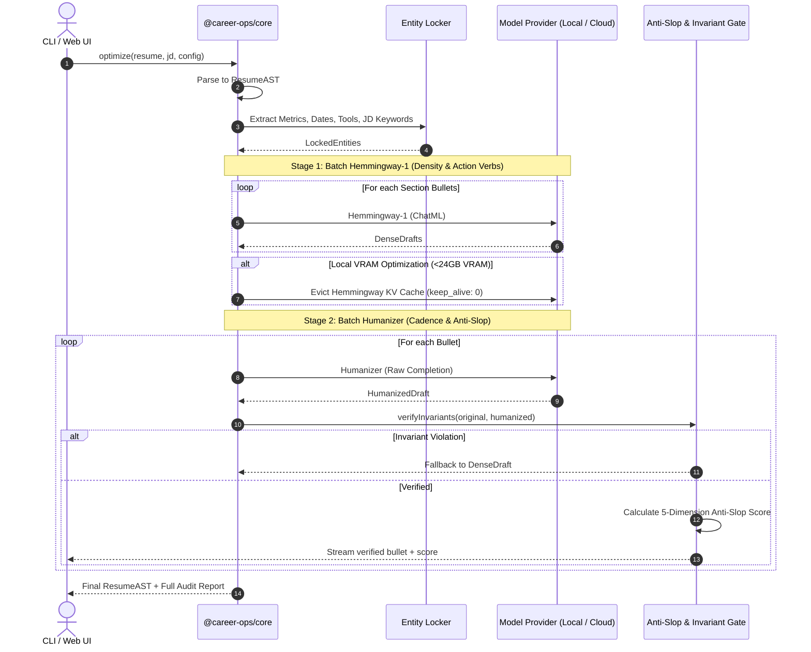
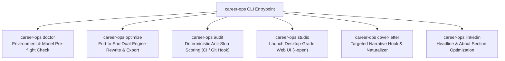

# System Design Specification: Dual-Engine Resume & Career Studio

**Repository:** `poferraz/career-ops`  
**Branch:** `feat/dual-engine-resume-product`  
**Date:** 2026-10-10  
**Status:** Approved in Stages (Section 1 Approved)  

---

## 1. Executive Summary & Vision

`career-ops` is evolving from a prompt-based agent skill into a full-fledged, multi-interface product composed of:
1. **`@career-ops/core`**: A shared TypeScript engine orchestrating a dual-model LLM pipeline (`Altworld/Hemmingway-1` + `jialinyyzz/humanizer`), document parsers, and a deterministic Anti-Slop & Invariant Validation Gate.
2. **`@career-ops/cli`**: A high-leverage terminal command center for headless optimization, pre-submission audits, and CI/CD resume verification.
3. **`@career-ops/web`**: A desktop-grade Web Application (Career Studio) featuring side-by-side diffing, live Anti-Slop radar visualization, ATS keyword coverage heatmaps, and modules for **Resumes**, **Cover Letters**, and **LinkedIn Profiles**.

---

## 2. Hiring Landscape & AI Screening Realities (2026)

### 2.1 The ATS Myth vs. Reality
* **The Myth**: Applicant Tracking Systems (Workday, Greenhouse, Ashby, Lever, Taleo) run AI detectors like GPTZero or Turnitin to auto-reject AI-written resumes.
* **The Reality**: No major ATS vendor auto-rejects based on AI detection due to legal liabilities, high false-positive rates, and discrimination risks.
* **The Real Technical ATS Killers**:
  1. **Broken Document Parsing**: Complex layouts (two-column templates, tables, text boxes, graphics) cause the parser to scramble sentences into illegible tokens.
  2. **Semantic Vector Gaps**: Resumes that fail to map onto the job description's skill taxonomy or semantic embeddings receive a low fit score.
  3. **Weak Quantifiable Impact**: Lack of measurable metrics (%, $, time saved, scope) fails the semantic extraction heuristics.

### 2.2 The Real Detection Gate: The 6-Second Human Recruiter Scan
* **67% of hiring managers** claim they spot AI-generated resumes within 20 seconds.
* **Telltale Indicators**:
  * **Machine Handwriting**: Monotonous sentence lengths (18–22 words per bullet), robotic rhythmic cadence, and overused AI buzzwords (*"spearheaded," "proven track record," "leveraging data-driven insights"*).
  * **Generic Specificity**: Bullets that look grammatically sound but contain no verifiable operational friction or organizational truth.

---

## 3. Specialized Model Profiles

### 3.1 `Altworld/Hemmingway-1` (27B Parameter Model)
* **Base Architecture**: Qwen3.8-27B fine-tuned for high-density, direct professional communication.
* **Context Window**: 262,144 tokens (capable of ingesting full career transcripts and multi-page job specs).
* **Protocol & Format**: ChatML (`<|im_start|>system...<|im_end|>`).
* **Recommended Sampling**: `temperature: 1.0`, `top_p: 0.95`, `top_k: 20`, `presence_penalty: 0.0`.
* **Role in Pipeline**: **The Condenser (Stage 1)**. Strips conversational filler, active-verb enforcement, and packs maximum quantifiable impact into minimal words.

### 3.2 `jialinyyzz/humanizer` (12B Parameter Model)
* **Base Architecture**: Gemma-based 12B model fine-tuned for text naturalization and AI-pattern eradication.
* **Protocol & Format**: **Text-Completion ONLY (NOT ChatML)**. Requires the exact byte-level prompt:
  ```text
  Rewrite the text below so it reads like a person wrote it, not a language model. Reorganize it as you see fit. Vary sentence length on purpose. Cut hedging, throat-clearing, and any sentence that only announces what comes next. Prefer the concrete word over the abstract one. It is fine to sound uneven. Every fact, number, unit, date, name and quotation must survive unchanged.

  <DRAFT_TEXT>

  ### Rewritten:
  ```
* **Recommended Sampling**: `temperature: 1.0`, `top_p: 0.95`, `top_k: 0`, `min_p: 0`, `repetition_penalty: 1.0`. No stop sequences except EOS.
* **Role in Pipeline**: **The Naturalizer & Guard (Stage 2)**. Varies sentence cadence (burstiness), purges machine predictability, and enforces strict factual invariance over all numbers, dates, tools, and quotes.

---

## 4. Section 1: Core Engine & Pipeline Architecture (`@career-ops/core`)

### 4.1 Resume Abstract Syntax Tree (AST)
All incoming documents (PDF, DOCX, Markdown) are normalized into a strongly typed AST to prevent models from destroying document hierarchy:
```typescript
export interface ResumeAST {
  header: CandidateHeader;
  summary?: string;
  experience: ExperienceRole[];
  education: EducationItem[];
  skills: SkillCategory[];
  rawMarkdown: string;
}

export interface ExperienceRole {
  id: string;
  company: string;
  title: string;
  location?: string;
  dateRange: string;
  bullets: BulletNode[];
}

export interface BulletNode {
  id: string;
  originalText: string;
  hemingwayDraft?: string;
  humanizedText?: string;
  lockedEntities: {
    metrics: string[];      // e.g., ["$1.4M", "40%", "14 microservices"]
    dates: string[];        // e.g., ["Q3 2024", "18 months"]
    techStack: string[];    // e.g., ["Kubernetes", "Next.js 15", "Snowflake"]
    jdKeywords: string[];   // Target keywords from JD
  };
  scores?: AntiSlopScore;
  status: 'pending' | 'processing' | 'verified' | 'fallback';
}
```

### 4.2 Pipeline Execution Flow


### 4.3 Factual Invariance & Anti-Slop Gate
* **Invariant Diff Assertion**: RegEx and AST scanner guarantees that 100% of numerical values, currency symbols, percentages, dates, and registered technical acronyms present in the original bullet survive intact in the output.
* **Anti-Slop Scoring Rubric**: Scores every bullet on 5 dimensions (Target >= 42/50, Minimum 35/50):
  1. **Directness (9/10)**: Removal of passive voice, hedging, filler.
  2. **Rhythm (8/10)**: Variable syllable counts and sentence lengths.
  3. **Trust (9/10)**: Zero invented claims or modified facts.
  4. **Authenticity (8/10)**: Purge of banned phrases and chatbot tone.
  5. **Density (8/10)**: High information-to-word ratio.

### 4.4 Section 1 Gap Review
* **Gap 1.1 (Memory Swap Latency)**: Swapping models per-bullet causes high reload latency.  
  * *Resolution*: Implemented **Stage-Batching** (run all Stage 1 passes, evict once, run all Stage 2 passes).
* **Gap 1.2 (Action Verb Repetition)**: Bullets optimized in isolation may repeat identical action verbs.  
  * *Resolution*: Maintain a rolling context window of the last 2 verbs used within the same job role.
* **Gap 1.3 (Non-Standard Headings)**: Resumes with unconventional section titles fail standard parsing.  
  * *Resolution*: Semantic alias map matching non-standard titles (*"Where I've Been"*) to canonical AST nodes.
* **Gap 1.4 (Ollama / Runtime Outages)**: Local runtime offline or model not pulled.  
  * *Resolution*: Pre-flight health probe with actionable terminal guidance and automatic toggle to remote OpenAI-compatible endpoints.

---

## 5. Section 2: CLI Architecture & Commands (`@career-ops/cli`)

### 5.1 Command Surface


#### 1. `career-ops doctor`
Probes local runtime health: verifies Ollama (`http://localhost:11434`), checks presence of `richardyoung/hemmingway-1` and `jialinyyzz/humanizer`, profiles system memory/VRAM, and verifies fallback API keys. Flag `--fix` triggers automatic model pulls.

#### 2. `career-ops optimize`
```bash
career-ops optimize --resume resume.pdf --jd job-spec.txt --output ./dist/ --format pdf,docx,md
```
* **Flags**: `--resume <path>`, `--jd <path>`, `--output <dir>`, `--format <pdf,docx,md,json>`, `--strategy <fast|balanced|deep>`, `--remote <url>`.
* **UX**: Streams live section-by-section terminal diffs with colored additions/deletions, followed by an interactive summary table of the 5-dimension Anti-Slop score.

#### 3. `career-ops audit`
```bash
career-ops audit --resume resume.pdf [--jd jd.txt] [--threshold 42] [--json]
```
Non-destructive quality gate designed for pre-commit hooks and CI/CD pipelines. Returns exit code `0` on pass ($\ge 42$), `1` on fail. Outputs parser health, banned phrase occurrences, missing ATS keyword vectors, and rubric breakdown.

#### 4. `career-ops studio`
Starts local Vite server, binds to `localhost:3000`, and opens default browser into the Career Studio web application.

#### 5. `career-ops cover-letter` & `career-ops linkedin`
* `cover-letter`: Generates tailored Hook $\rightarrow$ Match $\rightarrow$ Close letters, filtered through Humanizer.
* `linkedin`: Optimizes Headline, About section, and Experience snippets for recruiter search algorithms.

### 5.2 Configuration Architecture (`.career-opsrc.json`)
```json
{
  "$schema": "https://career-ops.dev/schema.json",
  "runtime": {
    "defaultProvider": "ollama",
    "ollamaHost": "http://localhost:11434",
    "hemingwayModel": "richardyoung/hemmingway-1:latest",
    "humanizerModel": "jialinyyzz/humanizer:latest",
    "remoteEndpoint": null,
    "vramSafetyMode": "sequential-swap"
  },
  "rubric": {
    "minPassingScore": 42,
    "bannedPhraseEnforcement": "strict",
    "factualLock": true
  },
  "export": {
    "defaultFormats": ["pdf", "md"],
    "pdfTemplate": "single-column-ats",
    "outputDir": "./career-materials"
  }
}
```

### 5.3 Section 2 Gap Review
* **Gap 2.1 (Unix Pipeline & Stdio Support)**: Non-interactive scripts calling the CLI must not emit terminal escape sequences or spinners.  
  * *Resolution*: Automatic `process.stdout.isTTY` detection. Suppress all formatting and output pure JSON or raw text when piped.
* **Gap 2.2 (Scanned / Image PDFs)**: Scanned PDFs without OCR return empty text strings to standard extractors.  
  * *Resolution*: Density check on parsed character count. If near zero, emit clear diagnostic error warning the user of ATS parser failure.
* **Gap 2.3 (Secret Leakage in Config Files)**: Accidental commit of remote API keys in `.career-opsrc.json`.  
  * *Resolution*: Never serialize plaintext keys in project config. Read exclusively from environment variables (`CAREER_OPS_API_KEY`) or system keychain.
* **Gap 2.4 (Orphaned Inference on Cancellation)**: User cancels mid-run with `Ctrl+C`.  
  * *Resolution*: Trap `SIGINT`, cancel active HTTP request streams, clean up temporary files, and cleanly restore terminal cursor.

