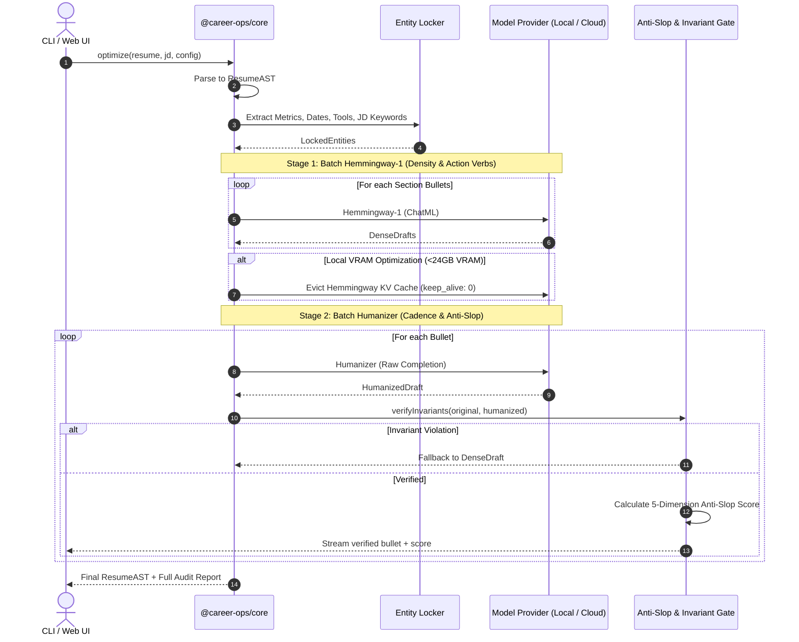
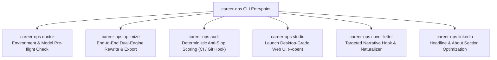
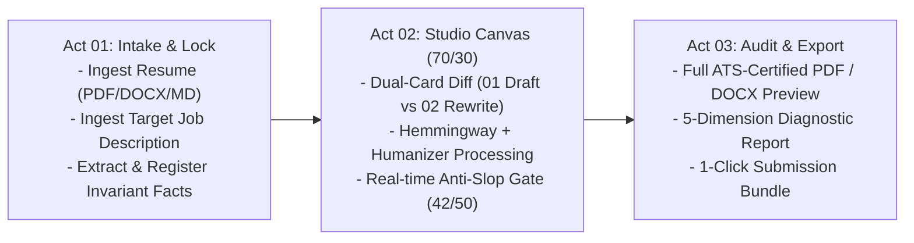
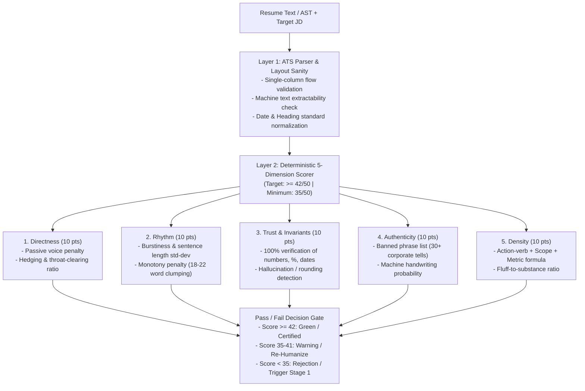

# System Design Specification: Dual-Engine Resume & Career Studio

**Repository:** `poferraz/career-ops`  
**Branch:** `feat/dual-engine-resume-product`  
**Date:** 2026-10-10  
**Status:** Approved in Stages (Section 1 Approved)  

---

## 1. Executive Summary & Vision

`career-ops` is evolving from a prompt-based agent skill into a full-fledged, multi-interface product composed of:
1. **`@career-ops/core`**: A shared TypeScript engine orchestrating a dual-model LLM pipeline (`Altworld/Hemmingway-1` + `jialinyyzz/humanizer`), document parsers, and a deterministic Anti-Slop & Invariant Validation Gate.
2. **`@career-ops/cli`**: A high-leverage terminal command center for headless optimization, pre-submission audits, and CI/CD resume verification.
3. **`@career-ops/web`**: A desktop-grade Web Application (Career Studio) featuring side-by-side diffing, live Anti-Slop radar visualization, ATS keyword coverage heatmaps, and modules for **Resumes**, **Cover Letters**, and **LinkedIn Profiles**.

---

## 2. Hiring Landscape & AI Screening Realities (2026)

### 2.1 The ATS Myth vs. Reality
* **The Myth**: Applicant Tracking Systems (Workday, Greenhouse, Ashby, Lever, Taleo) run AI detectors like GPTZero or Turnitin to auto-reject AI-written resumes.
* **The Reality**: No major ATS vendor auto-rejects based on AI detection due to legal liabilities, high false-positive rates, and discrimination risks.
* **The Real Technical ATS Killers**:
  1. **Broken Document Parsing**: Complex layouts (two-column templates, tables, text boxes, graphics) cause the parser to scramble sentences into illegible tokens.
  2. **Semantic Vector Gaps**: Resumes that fail to map onto the job description's skill taxonomy or semantic embeddings receive a low fit score.
  3. **Weak Quantifiable Impact**: Lack of measurable metrics (%, $, time saved, scope) fails the semantic extraction heuristics.

### 2.2 The Real Detection Gate: The 6-Second Human Recruiter Scan
* **67% of hiring managers** claim they spot AI-generated resumes within 20 seconds.
* **Telltale Indicators**:
  * **Machine Handwriting**: Monotonous sentence lengths (18–22 words per bullet), robotic rhythmic cadence, and overused AI buzzwords (*"spearheaded," "proven track record," "leveraging data-driven insights"*).
  * **Generic Specificity**: Bullets that look grammatically sound but contain no verifiable operational friction or organizational truth.

---

## 3. Specialized Model Profiles

### 3.1 `Altworld/Hemmingway-1` (27B Parameter Model)
* **Base Architecture**: Qwen3.8-27B fine-tuned for high-density, direct professional communication.
* **Context Window**: 262,144 tokens (capable of ingesting full career transcripts and multi-page job specs).
* **Protocol & Format**: ChatML (`<|im_start|>system...<|im_end|>`).
* **Recommended Sampling**: `temperature: 1.0`, `top_p: 0.95`, `top_k: 20`, `presence_penalty: 0.0`.
* **Role in Pipeline**: **The Condenser (Stage 1)**. Strips conversational filler, active-verb enforcement, and packs maximum quantifiable impact into minimal words.

### 3.2 `jialinyyzz/humanizer` (12B Parameter Model)
* **Base Architecture**: Gemma-based 12B model fine-tuned for text naturalization and AI-pattern eradication.
* **Protocol & Format**: **Text-Completion ONLY (NOT ChatML)**. Requires the exact byte-level prompt:
  ```text
  Rewrite the text below so it reads like a person wrote it, not a language model. Reorganize it as you see fit. Vary sentence length on purpose. Cut hedging, throat-clearing, and any sentence that only announces what comes next. Prefer the concrete word over the abstract one. It is fine to sound uneven. Every fact, number, unit, date, name and quotation must survive unchanged.

  <DRAFT_TEXT>

  ### Rewritten:
  ```
* **Recommended Sampling**: `temperature: 1.0`, `top_p: 0.95`, `top_k: 0`, `min_p: 0`, `repetition_penalty: 1.0`. No stop sequences except EOS.
* **Role in Pipeline**: **The Naturalizer & Guard (Stage 2)**. Varies sentence cadence (burstiness), purges machine predictability, and enforces strict factual invariance over all numbers, dates, tools, and quotes.

---

## 4. Section 1: Core Engine & Pipeline Architecture (`@career-ops/core`)

### 4.1 Resume Abstract Syntax Tree (AST)
All incoming documents (PDF, DOCX, Markdown) are normalized into a strongly typed AST to prevent models from destroying document hierarchy:
```typescript
export interface ResumeAST {
  header: CandidateHeader;
  summary?: string;
  experience: ExperienceRole[];
  education: EducationItem[];
  skills: SkillCategory[];
  rawMarkdown: string;
}

export interface ExperienceRole {
  id: string;
  company: string;
  title: string;
  location?: string;
  dateRange: string;
  bullets: BulletNode[];
}

export interface BulletNode {
  id: string;
  originalText: string;
  hemingwayDraft?: string;
  humanizedText?: string;
  lockedEntities: {
    metrics: string[];      // e.g., ["$1.4M", "40%", "14 microservices"]
    dates: string[];        // e.g., ["Q3 2024", "18 months"]
    techStack: string[];    // e.g., ["Kubernetes", "Next.js 15", "Snowflake"]
    jdKeywords: string[];   // Target keywords from JD
  };
  scores?: AntiSlopScore;
  status: 'pending' | 'processing' | 'verified' | 'fallback';
}
```

### 4.2 Pipeline Execution Flow


### 4.3 Factual Invariance & Anti-Slop Gate
* **Invariant Diff Assertion**: RegEx and AST scanner guarantees that 100% of numerical values, currency symbols, percentages, dates, and registered technical acronyms present in the original bullet survive intact in the output.
* **Anti-Slop Scoring Rubric**: Scores every bullet on 5 dimensions (Target >= 42/50, Minimum 35/50):
  1. **Directness (9/10)**: Removal of passive voice, hedging, filler.
  2. **Rhythm (8/10)**: Variable syllable counts and sentence lengths.
  3. **Trust (9/10)**: Zero invented claims or modified facts.
  4. **Authenticity (8/10)**: Purge of banned phrases and chatbot tone.
  5. **Density (8/10)**: High information-to-word ratio.

### 4.4 Section 1 Gap Review
* **Gap 1.1 (Memory Swap Latency)**: Swapping models per-bullet causes high reload latency.  
  * *Resolution*: Implemented **Stage-Batching** (run all Stage 1 passes, evict once, run all Stage 2 passes).
* **Gap 1.2 (Action Verb Repetition)**: Bullets optimized in isolation may repeat identical action verbs.  
  * *Resolution*: Maintain a rolling context window of the last 2 verbs used within the same job role.
* **Gap 1.3 (Non-Standard Headings)**: Resumes with unconventional section titles fail standard parsing.  
  * *Resolution*: Semantic alias map matching non-standard titles (*"Where I've Been"*) to canonical AST nodes.
* **Gap 1.4 (Ollama / Runtime Outages)**: Local runtime offline or model not pulled.  
  * *Resolution*: Pre-flight health probe with actionable terminal guidance and automatic toggle to remote OpenAI-compatible endpoints.

---

## 5. Section 2: CLI Architecture & Commands (`@career-ops/cli`)

### 5.1 Command Surface


#### 1. `career-ops doctor`
Probes local runtime health: verifies Ollama (`http://localhost:11434`), checks presence of `richardyoung/hemmingway-1` and `jialinyyzz/humanizer`, profiles system memory/VRAM, and verifies fallback API keys. Flag `--fix` triggers automatic model pulls.

#### 2. `career-ops optimize`
```bash
career-ops optimize --resume resume.pdf --jd job-spec.txt --output ./dist/ --format pdf,docx,md
```
* **Flags**: `--resume <path>`, `--jd <path>`, `--output <dir>`, `--format <pdf,docx,md,json>`, `--strategy <fast|balanced|deep>`, `--remote <url>`.
* **UX**: Streams live section-by-section terminal diffs with colored additions/deletions, followed by an interactive summary table of the 5-dimension Anti-Slop score.

#### 3. `career-ops audit`
```bash
career-ops audit --resume resume.pdf [--jd jd.txt] [--threshold 42] [--json]
```
Non-destructive quality gate designed for pre-commit hooks and CI/CD pipelines. Returns exit code `0` on pass ($\ge 42$), `1` on fail. Outputs parser health, banned phrase occurrences, missing ATS keyword vectors, and rubric breakdown.

#### 4. `career-ops studio`
Starts local Vite server, binds to `localhost:3000`, and opens default browser into the Career Studio web application.

#### 5. `career-ops cover-letter` & `career-ops linkedin`
* `cover-letter`: Generates tailored Hook $\rightarrow$ Match $\rightarrow$ Close letters, filtered through Humanizer.
* `linkedin`: Optimizes Headline, About section, and Experience snippets for recruiter search algorithms.

### 5.2 Configuration Architecture (`.career-opsrc.json`)
```json
{
  "$schema": "https://career-ops.dev/schema.json",
  "runtime": {
    "defaultProvider": "ollama",
    "ollamaHost": "http://localhost:11434",
    "hemingwayModel": "richardyoung/hemmingway-1:latest",
    "humanizerModel": "jialinyyzz/humanizer:latest",
    "remoteEndpoint": null,
    "vramSafetyMode": "sequential-swap"
  },
  "rubric": {
    "minPassingScore": 42,
    "bannedPhraseEnforcement": "strict",
    "factualLock": true
  },
  "export": {
    "defaultFormats": ["pdf", "md"],
    "pdfTemplate": "single-column-ats",
    "outputDir": "./career-materials"
  }
}
```

### 5.3 Section 2 Gap Review
* **Gap 2.1 (Unix Pipeline & Stdio Support)**: Non-interactive scripts calling the CLI must not emit terminal escape sequences or spinners.  
  * *Resolution*: Automatic `process.stdout.isTTY` detection. Suppress all formatting and output pure JSON or raw text when piped.
* **Gap 2.2 (Scanned / Image PDFs)**: Scanned PDFs without OCR return empty text strings to standard extractors.  
  * *Resolution*: Density check on parsed character count. If near zero, emit clear diagnostic error warning the user of ATS parser failure.
* **Gap 2.3 (Secret Leakage in Config Files)**: Accidental commit of remote API keys in `.career-opsrc.json`.  
  * *Resolution*: Never serialize plaintext keys in project config. Read exclusively from environment variables (`CAREER_OPS_API_KEY`) or system keychain.
* **Gap 2.4 (Orphaned Inference on Cancellation)**: User cancels mid-run with `Ctrl+C`.  
  * *Resolution*: Trap `SIGINT`, cancel active HTTP request streams, clean up temporary files, and cleanly restore terminal cursor.

---

## 6. Section 3: Desktop-Grade Web Studio UI & UX (`@career-ops/web`)

Interactive Prototype: [`docs/assets/studio-prototype.html`](file:///Users/poferraz/Documents/Development/active/career-ops/docs/assets/studio-prototype.html)

### 6.1 The Three-Act Pipeline Model
Rather than presenting an unguided screen, the Career-Ops Studio guides the candidate through a purposeful **Three-Act Pipeline**:



1. **Act 01: Intake & Entity Lock**:
   * Drag-and-drop ingestion of resume files.
   * Target Job Description semantic parser (extracts high-priority keywords).
   * Fact registration: Automatically scans and highlights every number, metric, currency, date, and proper noun to lock.
2. **Act 02: Studio Canvas (The Core Dual-Engine Diff Stage)**:
   * **Left Stage (70% Width)**: The Humanizer-inspired Dual-Card Diff container.
     * `01 Draft`: Shows raw uploaded text with red strikethroughs across corporate filler.
     * `02 Rewrite`: Shows humanized text with bright lime-green highlight pills (`#d9f99d`) on punchy action verbs and outcomes.
     * `✓ FACTS KEPT`: Capsule bar locking all invariant entities (`$1.4M 🔒`, `40% overtime 🔒`, `Kubernetes 🔒`).
   * **Right Panel (30% Width)**: The Architectural Anti-Slop Quality Gate.
     * Large bold cobalt `42/50` score badge (`PASSING`).
     * 5 Dimension breakdown (Directness, Rhythm, Trust, Authenticity, Density).
     * ATS Keyword Match Matrix.
     * AI Detection Risk gauge (`8% AI Risk · 92% Human Authentic`).
3. **Act 03: Certified Audit & Export**:
   * Full single-column ATS PDF preview.
   * Native Word `.docx` download.
   * Diagnostic audit card for candidate records.

### 6.2 Design System Tokens & Impeccable Rules (`PRODUCT.md` & `DESIGN.md`)
* **Durable Design Authority**: Standardized in [`PRODUCT.md`](file:///Users/poferraz/Documents/Development/active/career-ops/PRODUCT.md) and [`DESIGN.md`](file:///Users/poferraz/Documents/Development/active/career-ops/DESIGN.md).
* **Canvas**: Warm light zinc-50 paper canvas (`#fafafa`) with a subtle 24px blueprint graph grid (`rgba(20, 20, 184, 0.04)`).
* **Architectural Borders & Shadows**: 3px solid cobalt blue borders (`border: 3px solid #1414b8`) with 6px hard geometric drop shadows (`box-shadow: 6px 6px 0px #1414b8`).
* **Typography**:
  * Headings: `Inter` (Black 900, uppercase, tracking-tight).
  * Body: `Inter` (Regular 400 / Medium 500, `text-[15px]`, `leading-7`).
  * Mono Data: `JetBrains Mono` (Bold 700 / Medium 500, `11px–12px`).
* **The Inline Highlight Rule**:
  * Diff text highlights use pure inline styling: `background-color: #d9f99d; color: #09090b; padding: 1px 3px; border-radius: 3px; box-decoration-break: clone; -webkit-box-decoration-break: clone; display: inline;`.
  * **Strict Prohibition**: Never use `display: inline-block` on inline text highlights, as it treats multi-word clauses as rigid atomic boxes, causing jagged line breaks, trailing gaps, and orphan punctuation.
* **The Left-Justified Rhythm Rule**:
  * Both Draft and Rewrite columns share identical left-alignment (`text-left`) and vertical rhythm (`leading-7`), with bullet markers (`•`) and attached punctuation to enable instant comparative eye-tracking.

### 6.3 The Three Workspace Modules
1. **Resume Optimizer**: Bullet-by-bullet AST transformation, keyword injection, single-column ATS verification.
2. **Cover Letter Studio**: Implements the Hook $\rightarrow$ Match $\rightarrow$ Close methodology with authentic human tone calibration.
3. **LinkedIn Forge**: Generates search-optimized Headlines (220 char limit), 3-act narrative About sections, and scannable experience summaries.

### 6.4 Section 3 Gap Review
* **Gap 3.1 (Browser CORS with Local Ollama)**: Browser security blocks direct `fetch('http://localhost:11434')`.  
  * *Resolution*: Vite dev server / Node local runner proxies `/api/*` requests directly to Ollama, eliminating all browser CORS issues.
* **Gap 3.2 (Virtualization on Long Diffs)**: Heavy diff calculations cause frame stutter on 3-page resumes.  
  * *Resolution*: Virtualized DOM list rendering (`@tanstack/react-virtual`) and offloading token diffing to a dedicated Web Worker (`diff.worker.ts`).
* **Gap 3.3 (Accidental Manual Edit Metric Corruption)**: User manually edits a bullet and deletes or mistypes a metric.  
  * *Resolution*: Inline Invariant Sentinel alerts the user immediately with a warning badge if any locked metric is missing.
* **Gap 3.4 (Window Cramping on Narrow Screens)**: 3-pane layout becomes crowded under 1280px width.  
  * *Resolution*: Responsive drawer design: Intelligence & Radar inspector collapses into a floating drawer on screens $<1280\text{px}$.


---

## 7. Section 4: Anti-Slop Scoring Engine & Verification Gate (`@career-ops/audit`)

### 7.1 Deterministic Rubric Metrics & Mathematical Formulations
To ensure objective, reproducible evaluations that eliminate recruiter AI flags, the audit engine computes deterministic scores across 5 dimensions:



#### 1. Directness (10 points)
Penalizes passive voice constructions (`was promoted to lead`, `was responsible for`) and hedging tokens (`helped to`, `participated in`, `assisted with`).
$$\text{Directness} = 10 - 2 \times (\text{PassiveConstructions}) - 1.5 \times (\text{HedgingPhrases})$$

#### 2. Rhythm (10 points)
Measures sentence length variance (**burstiness**). Standard AI text clumps rigidly around $20 \pm 2$ words per sentence. Human writing has high standard deviation ($\sigma \ge 6.5$).
$$\text{Rhythm} = \min\left(10, \; \text{round}\left(4 + 0.8 \times \sigma_{\text{sentence\_length}}\right)\right)$$

#### 3. Trust & Factual Invariance (10 points)
Binary requirement: The output must contain $100\%$ of the original bullet's metrics, currency amounts, percentages, and dates.
$$\text{Trust} = \begin{cases} 10 & \text{if all original metrics match verbatim} \\ 0 & \text{if any metric was modified or dropped} \end{cases}$$

#### 4. Authenticity (10 points)
Scans for the 30+ banned phrases defined in `references/anti-slop.md` (*"spearheaded cross-functional initiatives"*, *"proven track record"*, *"leveraging insights"*, *"results-driven"*).
$$\text{Authenticity} = \max\left(0, \; 10 - 3 \times (\text{BannedPhrasesFound})\right)$$

#### 5. Density (10 points)
Verifies the presence of the three essential components in every experience bullet:
$$\text{Density} = \text{ActionVerbPresent (3 pts)} + \text{VerifiableContext (3 pts)} + \text{QuantifiedMetric (4 pts)}$$

### 7.2 ATS Parser Sanity Scanner
* **Single-Column Compliance**: Flags multi-column grids or sidebars that cause Taleo and Workday to interleave text horizontally.
* **Date Normalization**: Flags ambiguous dates (*"Spring 2023"*, *"recent"*) and enforces standard machine-readable formats (`MM/YYYY – MM/YYYY` or `YYYY – YYYY`).
* **Heading Standard**: Guarantees canonical section names (*Experience*, *Education*, *Skills*) so ATS taxonomy mappers correctly assign experience history.

### 7.3 Section 4 Gap Review
* **Gap 4.1 (False Positives on Protocol / Version Numbers)**: Technical terms like `OAuth 2.0` or `HTTP 404` misclassified as performance metrics.  
  * *Resolution*: Context-aware regex treats protocol versions and hardware names as **TechStack tokens**, excluding them from metrics calculations.
* **Gap 4.2 (Banned Phrase Evasion)**: Model rewords phrases slightly (e.g., *"demonstrated track record"* instead of *"proven track record"*).  
  * *Resolution*: Levenshtein fuzzy matching and synonym-stemming against the banned phrase dictionary.
* **Gap 4.3 (Non-Standard Action Verbs)**: Valid domain verbs (*"Orchestrated"*, *"Arbitrated"*) flagged by strict whitelists.  
  * *Resolution*: Comprehensive 250-word canonical action verb dictionary categorized by functional discipline.

---

## 8. Section 5: Repository Monorepo Structure & Implementation Roadmap

### 8.1 Monorepo Layout
```text
career-ops/
├── PRODUCT.md                                  # Durable product authority (Impeccable)
├── DESIGN.md                                   # Durable design authority (Tokens & Rules)
├── .impeccable/
│   └── design.json                             # Impeccable component sidecar
├── packages/
│   ├── core/                                   # Shared engine & model adapters
│   │   ├── src/
│   │   │   ├── ast/                            # Resume parser & AST normalizer
│   │   │   ├── models/                         # Hemmingway & Humanizer drivers
│   │   │   ├── pipeline/                       # Two-stage sequential orchestrator
│   │   │   └── audit/                          # Deterministic 5-dimension scorer
│   │   └── package.json
│   ├── cli/                                    # Terminal command center
│   │   ├── src/
│   │   │   ├── commands/                       # doctor, optimize, audit, studio
│   │   │   └── index.ts
│   │   └── package.json
│   └── web/                                    # Vite + React Desktop-grade Web Studio
│       ├── src/
│       │   ├── components/                     # Diff cards, pill bars, scorecard
│       │   ├── hooks/                          # Streaming pipeline hook
│       │   └── App.tsx
│       └── package.json
├── docs/
│   ├── assets/
│   │   └── studio-prototype.html               # Approved reference prototype
│   └── superpowers/specs/                      # Living specifications
└── references/                                 # Domain knowledge & anti-slop rules
```

### 8.2 Phased Implementation Roadmap
1. **Phase 1: Foundation & Core Engine (`@career-ops/core`)**
   * AST parsers for Markdown, DOCX, and PDF.
   * Model drivers for `Altworld/Hemmingway-1` (ChatML) and `jialinyyzz/humanizer` (Raw Completion).
   * Sequential VRAM memory swapper (`keep_alive: 0` eviction).
   * Deterministic Invariant Diff Validator.
2. **Phase 2: Audit Engine & Scoring Gate (`@career-ops/audit`)**
   * 5-dimension mathematical scoring algorithm.
   * Banned phrase fuzzy matcher.
   * ATS layout and single-column syntax parser.
3. **Phase 3: CLI Command Center (`@career-ops/cli`)**
   * Commands: `doctor`, `optimize`, `audit`, `studio`.
   * Stdio streaming, color diffs, and exit codes for CI.
4. **Phase 4: Web Studio Application (`@career-ops/web`)**
   * Vite + React + Tailwind desktop-like UI.
   * Three-Act Pipeline (Intake -> Studio Canvas -> Audit & Export).
   * Dual-card diff with pure inline wrapping and `✓ FACTS KEPT` capsule bar.
   * Real-time ATS match matrix and Anti-Slop radar.
5. **Phase 5: Certified Exporters & Release**
   * Single-column ATS PDF generator.
   * Native Word `.docx` exporter.
   * Documentation update and launch.
